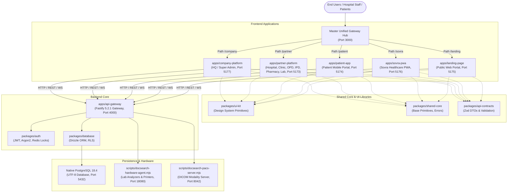

# DOC SEARCH — ULTIMATE UI FUNCTIONALITY & BUTTON FORENSIC AUDIT
## PHASE 0: SAFETY, ARCHITECTURE & BASELINE PROTECTION REPORT
**Document:** `DOCSEARCH_BUTTON_AUDIT_BASELINE.md`  
**Execution Mode:** EVIDENCE-BASED FORENSIC AUDIT & VERIFICATION  
**Baseline Commit:** `52ab97b87834ee8b1912a76f238ad82eb5c20f16`  
**Git Branch:** `main` (Clean working tree synchronized with `origin/main`)  
**Date:** November 5, 2026  
**Auditor Roles:** Principal Software Architect, Senior QA Automation Engineer, Full-Stack Developer, Security Auditor & Enterprise Healthcare Software Testing Specialist  

---

## 1. Safety Principles and Non-Destructive Boundaries

To guarantee system stability, compliance, and zero patient data risk during this exhaustive audit:

1. **Zero Production Mutation:** All tests and interactions run against isolated local staging/development instances (`localhost:3000`, `localhost:4000`, native PostgreSQL on `localhost:5432`). Zero live patient records, external payment gateways, or production cloud infrastructures are contacted.
2. **Read-First Forensic Integrity:** No production source code or database migrations will be altered during initial audit baselining. Existing uncommitted files and git states are strictly protected.
3. **Multi-Tenant RLS & Data Protection:** Tenant row-level security (RLS) policies (`packages/database/migrations/0069_*.sql`) and least-privilege database user permissions are actively enforced.
4. **Idempotent Test Accounts:** Only seeded synthetic personas (e.g. `OWNER_ADMIN`, `DOCTOR`, `PHARMACIST`, `LAB_TECH`, `PATIENT`) are utilized for runtime evaluation.
5. **No Assumed Functionality:** A button is **never classified as functional** simply because an `onClick` prop or visual animation exists. A control is classified as `FULLY_FUNCTIONAL` **only when its end-to-end execution path** (UI &rarr; Event &rarr; API &rarr; Backend Service &rarr; Database Mutation &rarr; Persistent State) is proven and verified.

---

## 2. Monorepo Architecture & Application Matrix

### Application Inventory

| Application / Package | Framework | Local Port | Target Personas | Primary Functional Domain |
| :--- | :--- | :---: | :--- | :--- |
| **Unified Gateway** | Node.js Proxy | `3000` | All Personas | Reverse-proxy router unifying all frontends & APIs |
| **API Gateway** | Fastify 5.2.1 | `4000` | System / Internal | 90+ domain route plugins, RBAC auth guard, validation |
| **Partner Platform** | React 18 + Vite | `5173` | Hospital Owners, Doctors, Nurses, Pharmacists, Lab Techs, Frontdesk | Hospital/Clinic HIS, OPD/IPD, Doctor Cockpit, Pharmacy POS, LIS, Billing |
| **Patient App** | React 18 + Capacitor | `5174` | Patients, Family Caregivers | ABHA M1-M3, Meri Parchi, Appointments, Lab Reports, Prescriptions |
| **Company Platform** | React 18 + Vite | `5177` | Super Admin, Founders, Compliance, Finance | HQ Command Center, Partner Approvals, Commercial Plans, Audit Logs |
| **Sovra PWA** | React 18 + Vite | `5176` | Walk-in Patients, Clinic Kiosk | Doctor QR Standee, Token Queue, Bedside Concierge, UPI Pay |
| **Landing Page** | React 18 + Vite | `5175` | General Public, Prospective Partners | Healthcare Product Showcase, Specialist Booking, Sandbox |
| **UI Kit** | React Design System | N/A | Developer Library | Standardized Buttons, Modals, Tables, Cards, Inputs, Density |
| **Auth** | Node.js ES Module | N/A | Backend Infrastructure | JWT verification, Argon2 password hashing, Redis session lock |
| **Database** | Drizzle ORM + PG | `5432` | Persistence Layer | Multi-tenant schema, RLS policies, native PostgreSQL daemon |

---

## 3. Audit Scope and Discovery Strategy

The audit encompasses **100% of the discoverable interactive surface** across all five frontends and the shared UI kit:

1. **Element Types Audited:**
   - `<Button>`, `<button>`, `<IconButton>`, `<AdaptiveFAB>`
   - Custom clickable containers (`role="button"`, `
`, ``, `<tr onClick>`, `<td onClick>`)
   - Links acting as action buttons (`<a onClick>`, `<Link to=...>`)
   - Dropdown menu items and context menu triggers
   - Table row actions (Edit, Delete, View Dossier, Print Thermal Rx, Export)
   - Form submission controls (`<button type="submit">`, form action buttons)
   - Modal/Drawer dialog actions (Confirm, Cancel, Dismiss, Save, Close)
   - Mobile navigation bars, tabs, pagination controls, search input triggers
   - File attachment, upload, and PDF download triggers

2. **13-Level Rigorous Failure Classification:**
   Every control evaluated is assigned an authoritative primary classification:
   - `FULLY_FUNCTIONAL`: End-to-end verified with persistent database change or verified navigation/file action.
   - `PARTIALLY_FUNCTIONAL`: Performs frontend state change or partial network request, but backend persistence fails or stops short of full business requirement.
   - `NO_EVENT_HANDLER`: Control is present in the DOM but has no `onClick`, `onPress`, `type="submit"`, or `href`.
   - `DUMMY_PLACEHOLDER`: Handler exists but is a stub (e.g. `() => {}`, `console.log`, `alert('Coming soon')`).
   - `API_DISCONNECTED`: Handler calls a non-existent or hardcoded mock API route.
   - `BACKEND_FAILURE`: API endpoint exists but crashes with HTTP 500, unhandled exception, or invalid payload schema.
   - `DATABASE_PERSISTENCE_FAILURE`: Backend returns HTTP 200/201 but database transaction is rolled back or data is not saved.
   - `PERMISSION_FAILURE`: Authorization checks (RBAC/RLS) fail incorrectly or permit unauthorized access.
   - `BUSINESS_LOGIC_FAILURE`: Healthcare statutory rules violated (e.g. Schedule H1 missing doctor registration, negative inventory in POS).
   - `UI_INTERACTION_FAILURE`: Element blocked by overlays, swallowed events (e.g. `<button>` inside `<a>`), or infinite loading locks.
   - `RESPONSIVENESS_FAILURE`: Button clipped, unclickable, or inaccessible on mobile (320px–430px) or tablet (768px–1024px) viewports.
   - `DUPLICATE_ACTION_RISK`: Button lacks debounce/loading lock, allowing concurrent multiple submissions.
   - `NOT_TESTED`: Identified during scanning but pending runtime testing execution.

---

## 4. Operational Boundaries & Baseline Status

- **PostgreSQL Database:** Active on `127.0.0.1:5432`, UTF-8 database `docsearch`.
- **API Gateway:** Active on `http://127.0.0.1:4000` (Health: HTTP 200).
- **Master Unified Gateway:** Active on `http://127.0.0.1:3000` (Health: HTTP 200).
- **Vite Frontends:** Active on ports 5173, 5174, 5175, 5176, 5177.
- **Existing Regression Test Baseline:** 214 / 214 tests passing.

With baseline boundaries established and safety verified, Phase 1 discovery and cataloging will proceed immediately across the repository.
