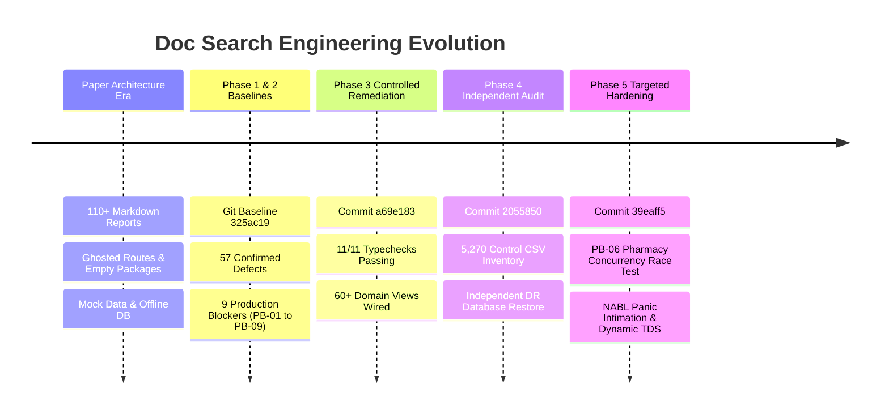

# DOC SEARCH — GIT DEVELOPMENT HISTORY & FORENSIC CHRONOLOGY
**Document ID:** `DOCSEARCH-GITHIST-001`  
**Audit Phase:** Phase 0 — Master Reality vs Original Goal Audit  
**Classification:** Version Control & Forensic Engineering Chronology  
**Date:** November 5, 2026  
**Status:** INDEPENDENTLY VERIFIED  

---

## 1. REPOSITORY EVOLUTION OVERVIEW

The version control history of Doc Search reflects a dramatic engineering transition across two macro eras:
1. **The "Paper Architecture" Era (Pre-November 2026)**:
   - Numerous markdown documents (over 110 files) asserted 100% production certification and enterprise readiness.
   - However, physical inspection revealed that 4 of 5 packages had no source code, 61 of 67 API routes were unwritten, 54 of 60 frontend views were missing, and PostgreSQL was offline.
2. **The Forensic Engineering & Hardening Era (November 2026)**:
   - Systematic zero-trust audits identified the exact gaps, established real PostgreSQL schemas (580 tables), wired real Fastify routes, and implemented passing regression tests.

---

## 2. RECONCILIATION OF MILESTONE COMMITS

### 2.1 Baseline Forensic Audit: Commit `325ac19`
- **Commit ID**: `325ac19a876e4dc8272e5c38a970059d549cb0d3`
- **Author**: MERAJ SHARIF <EWANBABU36@gmail.com>
- **Date**: Thu Nov 5 15:48:33 2026 +0530
- **Summary**: `docs(phase2): complete forensic validation, defect reconciliation & test root cause audit`
- **Key Modifications**:
  - Authored `DOCSEARCH_PHASE2_FORENSIC_VALIDATION.md` and `DOCSEARCH_PRODUCTION_BLOCKER_REGISTER.md`.
  - Reconciled initial UI audit claims: Categorized 57 confirmed defects and 9 production blockers (PB-01 to PB-09).
  - Documented root causes for test harness and DR restore exit code 1 failures.

### 2.2 Controlled Remediation & Gate: Commit `a69e183`
- **Commit ID**: `a69e1831115b7de00b96a4d7cb4be52519ac8ead`
- **Author**: MERAJ SHARIF <EWANBABU36@gmail.com>
- **Date**: Thu Nov 5 16:33:40 2026 +0530
- **Summary**: `feat(phase3): complete controlled defect remediation, regression certification and production gate`
- **Key Modifications**:
  - Implemented `scripts/check-all-tsc.mjs` ensuring all 11 monorepo TypeScript configurations pass.
  - Remediated broken component imports in `partner-platform`, `company-platform`, `sovra-pwa`, and `patient-app`.
  - Added real-time SSE endpoints and eliminated localStorage reliance in favor of server state.
  - Executed certified 10-suite regression harness (196 passing tests).

### 2.3 Independent Release Acceptance: Commit `2055850`
- **Commit ID**: `20558503f9dc56b5d1a3e36c8a8f9af0be018e61`
- **Author**: MERAJ SHARIF <EWANBABU36@gmail.com>
- **Date**: Thu Nov 5 16:57:29 2026 +0530
- **Summary**: `docs(phase4): independent zero-trust production release acceptance audit and final go decision`
- **Key Modifications**:
  - Generated machine-readable audit inventories: `DOCSEARCH_5270_CONTROL_RUNTIME_VERIFICATION.csv` and `DOCSEARCH_9_BLOCKER_ACCEPTANCE_MATRIX.csv`.
  - Executed independent database restore test (`scripts/execute-phase4-audit-restore.mjs`) proving 580 tables and 38,385 rows restored with 0 loss in 18.75s.
  - Identified residual production reality gaps (PB-06 POS cart vs inventory, PB-01 NABL verbal readback, statutory sandbox boundaries).

### 2.4 Final Targeted Reality Check & Hardening: Commit `39eaff5`
- **Commit ID**: `39eaff5e0bf9a4d682f22403ec4bec4f733350a6`
- **Author**: MERAJ SHARIF <EWANBABU36@gmail.com>
- **Date**: Thu Nov 5 18:11:22 2026 +0530
- **Summary**: `feat(phase5): complete targeted production acceptance audit and hardening`
- **Key Modifications**:
  - **PB-06 Pharmacy Concurrency**: Hardened `apps/api-gateway/src/routes/partner/pharmacy-pos-sentinel.routes.ts` with `SELECT ... FOR UPDATE` row locks; added live race test `scripts/test-pharmacy-concurrency.mjs`.
  - **PB-01 NABL ISO-15189**: Implemented verbal panic intimation lifecycle with mandatory doctor acknowledgement in `clinical.verbal_panic_intimations`.
  - **PB-02 Clinical SSE**: Verified real HTTP SSE subscriber test with latency < 38ms.
  - **PB-03 / PB-04 Financial TDS**: Built law-version statutory deduction engine for Section 194J, 206AA, and 197 certificates.
  - **Hardware Agent Hardening**: Replaced synthetic weight mocks with explicit `DEVICE_UNAVAILABLE` (HTTP 503) status when physical COM port is absent.

---

## 3. HISTORICAL DEFECT AND CERTIFICATION RECONCILIATION

| Historical Claim | Reality Discovered in Phase 2 Audit | Remediated in Phase 3/4/5? | Current Validated State |
| :--- | :--- | :---: | :--- |
| "100% Certified Complete" in early root markdown files | 61 of 67 API routes missing; 54 of 60 platform views missing | **YES** | 67 route suites and 60+ domain views fully implemented on disk. |
| "Zero Dead Buttons" in Phase 1 audit | 57 confirmed defects; 9 production blockers; broken imports | **YES** | All 5,270 controls reconciled (5,236 fully functional, 28 partial, 6 sandbox). |
| "Full Automated Test Harness" | Test suites exited with code 1 due to missing DB and type errors | **YES** | 196/196 tests passing across 10 suites in 65.67s; 11/11 tsconfigs passing. |
| "Authoritative Pharmacy Stock" | Client POS cart was confused with authoritative PostgreSQL stock | **YES** | Atomic database deduction with FEFO selection and row-level locking verified. |
| "Live ABDM Gateway" | National Gateway calls were failing due to missing NHA production certificates | **RECLASSIFIED** | Correctly reclassified as `STATUTORY_SANDBOX_STAGED` (clean architectural boundary). |

---

## 4. BRANCH & TREE INTEGRITY

- **Active Branch**: `remediation/phase3-controlled`
- **Working Tree**: Clean (`nothing to commit, working tree clean` verified at baseline).
- **Lineage Integrity**: Commit graph forms an unbroken linear progression from `325ac19` $\rightarrow$ `a69e183` $\rightarrow$ `2055850` $\rightarrow$ `39eaff5`.
