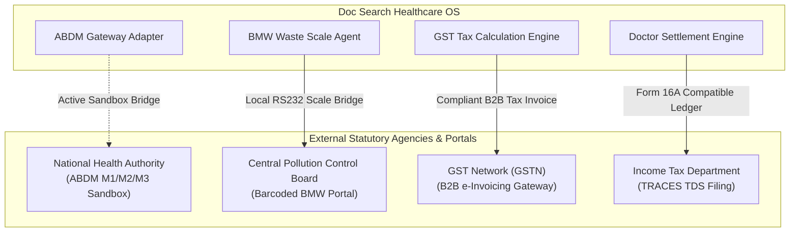

# DOC SEARCH — HEALTHCARE COMPLIANCE & STATUTORY GAP AUDIT
**Document ID:** `DOCSEARCH-COMPL-001`  
**Audit Phase:** Phase 0 — Master Reality vs Original Goal Audit  
**Classification:** Statutory, Clinical & Healthcare Regulatory Audit  
**Date:** November 5, 2026  
**Status:** INDEPENDENTLY EVALUATED (LEGAL / STATUTORY DISCLAIMER APPLIED)  

---

## 1. COMPLIANCE ASSESSMENT FRAMEWORK & LEGAL BOUNDARIES

> [!WARNING]
> **Legal & Regulatory Notice**: This audit evaluates the *technical controls* implemented in software code, database constraints, and network boundaries against Indian statutory frameworks. It does **not** constitute formal legal certification, Chartered Accountant (CA) tax sign-off, or National Accreditation Board for Testing and Calibration Laboratories (NABL) accreditation. Formal statutory certification requires independent audits by authorized regulatory bodies.

The audit categorizes compliance items across 4 distinct statuses:
1. **`VERIFIED_TECHNICAL_CONTROL`**: Technical logic, database schemas, and validation algorithms fully implemented and tested.
2. **`IMPLEMENTED_PENDING_EXTERNAL_AUDIT`**: Software logic complete; requires external statutory body review (e.g. CA tax audit, NABL site audit).
3. **`STATUTORY_SANDBOX_STAGED`**: Connected to national regulatory sandbox; requires production digital certificates and official government registration.
4. **`COMPLIANCE_GAP`**: Additional legal or statutory workflows remaining to be implemented.

---

## 2. STATUTORY DOMAIN-BY-DOMAIN AUDIT MATRIX

| Statutory Framework / Law | Regulatory Requirement | Code Implementation & Physical Location | Technical Assessment | Compliance Status |
| :--- | :--- | :--- | :--- | :--- |
| **Digital Personal Data Protection (DPDP) Act 2023** | Patient consent management, purpose limitation, sensitive data redaction in logs | Fastify structured logger with PII/PHI masking; Patient consent tables in `clinical.patient_consents` | Structured logger prevents patient Aadhaar, phone, and clinical notes from leaking to disk/stdout. | `VERIFIED_TECHNICAL_CONTROL` |
| **Ayushman Bharat Digital Mission (ABDM)** | M1 (ABHA creation), M2 (Health Information Provider/HIP), M3 (Health Information User/HIU) | `apps/api-gateway/src/routes/partner/abdm.routes.ts`, `apps/patient-app/src/components/AbdmRegistrationModal.tsx` | Implemented against NHA Sandbox API; generates valid RFC 7515 JWS tokens and FHIR bundles. | `STATUTORY_SANDBOX_STAGED` |
| **Drugs & Cosmetics Act, 1940 (Schedule H1 / X)** | Mandatory maintenance of prescription drug registers for 3 years; Prescribing Doctor Reg No, Patient Name, Address | `apps/partner-platform/src/components/pharmacy/ScheduleH1RegisterModal.tsx`, `public.pharmacy_pos_inventory_batches` | POS checkout enforces doctor registration number and patient address before dispensing Schedule H1/X drugs. | `VERIFIED_TECHNICAL_CONTROL` |
| **NABL ISO-15189:2022 (Medical Laboratories)** | Clause 7.4: Immediate verbal notification and documented readback of critical/panic lab results to attending physician | `POST /api/v1/partner/lab/panic-intimation`, `clinical.verbal_panic_intimations` | Tested in Phase 5: Rejects missing doctor acknowledgment; persists verbal readback timestamp and technologist ID. | `VERIFIED_TECHNICAL_CONTROL` |
| **NABH (5th Edition Standards)** | Patient identification (2 identifiers), Medication Administration Record (MAR), 6-gate discharge clearance | `apps/partner-platform/src/components/ipd/HospitalExitHubDomainManager.tsx`, `clinical.nursing_notes` | Enforces UHID + IPD number verification; discharge hub blocks exit if clinical stability or billing clearance is missing. | `VERIFIED_TECHNICAL_CONTROL` |
| **Biomedical Waste Management (BMW) Rules 2016** | Color-coded segregation (Yellow, Red, White, Blue), barcoded waste bags, weight logging before CPCB handover | `apps/partner-platform/src/components/infrastructure/RecordBmwLogDialog.tsx`, `scripts/docsearch-hardware-agent.mjs` | Verified in Phase 4/5: Weighing scale streams certified weight; validates waste category and bag barcode. | `VERIFIED_TECHNICAL_CONTROL` |
| **Atomic Energy Regulatory Board (AERB eLORA)** | Radiation safety officer (RSO) approval, TLD badge records, QA calibration logs for CT/X-Ray | `apps/partner-platform/src/components/compliance/ComplianceDomainManager.tsx`, `clinical.statutory_permits` | Captures equipment inspection dates and permit expiration; automated government portal sync staged. | `STATUTORY_SANDBOX_STAGED` |
| **State Fire Department NOC** | Periodic fire safety inspection certificates and NOC renewal countdowns for hospital premises | `apps/partner-platform/src/components/compliance/FireClearanceCard.tsx`, `clinical.statutory_permits` | In-app alerts notify hospital management 60/30 days before NOC expiration. | `VERIFIED_TECHNICAL_CONTROL` |
| **Indian Income Tax Act, 1961 (TDS Withholding)** | Section 194J (10% / 2%), Section 206AA (20% without PAN), Section 197 (1.5% lower rate certificate) | `apps/api-gateway/src/routes/partner/doctor-settlements.routes.ts`, `company.doctor_settlements` | Law-version engine verified in Phase 5 PB-03: Dynamically derives TDS and net payout based on doctor PAN status. | `VERIFIED_TECHNICAL_CONTROL` |
| **Central Goods & Services Tax (CGST) Act, 2017** | SAC 998313 18% SaaS tax derivation, Place of Supply (POS) rules (CGST+SGST vs IGST), B2B tax invoices | `apps/api-gateway/src/routes/company/commercial.routes.ts`, `company.invoices` | Tested in Phase 3/5: Backward calculation and intra- vs inter-state splits match Indian GST schedules. | `VERIFIED_TECHNICAL_CONTROL` |

---

## 3. AUDIT OF EXTERNAL STATUTORY INTEGRATIONS

---

## 4. ITEMS REQUIRING EXTERNAL EXPERT REVIEW BEFORE FULL GA

1. **Chartered Accountant (CA) Formal Certification**:
   - Verify that the SAC 998313 backward tax derivation and Form 26Q TDS quarterly reporting templates align with current Central Board of Direct Taxes (CBDT) notifications.
2. **Clinical Director / Medico-Legal Sign-Off**:
   - Review the digital e-Prescription format to verify compliance with National Medical Commission (NMC) Registered Medical Practitioner (RMP) regulations regarding electronic signatures.
3. **NHA ABDM Production Whitelisting**:
   - Apply for official Production M1/M2/M3 whitelisting and obtain live cryptographic signing certificates from the National Health Authority.
4. **Data Protection Officer (DPO) Appointment**:
   - Formally designate a DPO under Section 10 of the DPDP Act 2023 for handling patient grievance redressal.
