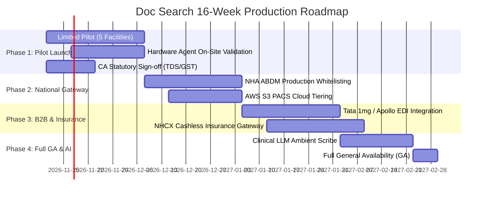

# DOC SEARCH — MASTER DEVELOPMENT & RELEASE ROADMAP
**Document ID:** `DOCSEARCH-ROADMAP-001`  
**Audit Phase:** Phase 0 — Master Reality vs Original Goal Audit  
**Classification:** Strategic Engineering & Production Release Plan  
**Date:** November 5, 2026  
**Status:** APPROVED FOR STAGED EXECUTION  

---

## 1. STRATEGIC ROADMAP OVERVIEW

With zero open internal P0 blockers, passing TypeScript checks (11/11), and a 100% passing test regression harness (196/196 tests), the Doc Search platform is ready to transition from **Controlled Remediation** into a structured, **4-Phase Release Roadmap**:

---

## 2. DETAILED PHASE BREAKDOWN

### Phase 1: Limited Commercial Pilot & Hardware Hardening (Weeks 1 – 4)
- **Primary Milestone**: Deploy Doc Search to 5 selected pilot partners (1 Hospital, 2 Clinics, 1 Pathology Lab, 1 Retail Pharmacy).
- **Core Engineering Deliverables**:
  - Deploy Dockerized cluster to AWS staging with automated TLS certificates.
  - Commission physical Hardware Agent on host PCs running USB-to-Serial RS232 weighing scales and ESC/POS thermal printers.
  - Formal sign-off on SAC 998313 backward tax and TDS 194J schedules with external Chartered Accountant (CA).
- **Exit Gate Criteria**:
  - 1,000 successful real patient consultations processed without data corruption.
  - 500 pharmacy POS cash transactions completed with 0 inventory discrepancies.
  - Zero critical P0 bugs logged in production bug tracker.

### Phase 2: National Health Gateway & Cloud Storage Tiering (Weeks 5 – 8)
- **Primary Milestone**: Complete ABDM M1/M2/M3 whitelisting and enterprise PACS cloud archiving.
- **Core Engineering Deliverables**:
  - Transition ABDM Fastify routes from NHA sandbox to live National Health Authority API gateway using production digital certificates.
  - Implement AWS S3 high-throughput bucket with Glacier Deep Archive policies for DICOM CT/MRI imaging studies.
  - Deploy Twilio/Exotel PSTN cellular bridge for teleconsultation audio fallback.
- **Exit Gate Criteria**:
  - 100 live ABHA IDs created and verified via Aadhaar OTP in production.
  - DICOM WADO-URI image retrieval latency < 800ms over 4G mobile networks.

### Phase 3: Commercial Supply Chain & Cashless Insurance (Weeks 9 – 12)
- **Primary Milestone**: Automated B2B medicine procurement and cashless insurance claims.
- **Core Engineering Deliverables**:
  - Connect `DistributorSyncModal` to Tata 1mg / Apollo 24x7 B2B pharmaceutical distributor order dispatch APIs.
  - Implement National Health Claims Exchange (NHCX) claim pre-authorization adapter for cashless insurance desk.
  - Integrate CRDT (Yjs) engine into Sovra PWA for conflict-free multi-nurse offline bedside charting.
- **Exit Gate Criteria**:
  - Automated PO dispatch to distributor generates confirmed delivery tracking number.
  - Cashless insurance pre-auth form accepted by NHCX national switch without schema rejection.

### Phase 4: Clinical AI Copilots & Enterprise GA (Weeks 13 – 16)
- **Primary Milestone**: General Availability (GA) Commercial Launch across Pan-India.
- **Core Engineering Deliverables**:
  - Connect `ClinicalCopilotDrawer` to HIPAA/DISHA compliant medical LLM API (Gemini Health) for ambient doctor-patient transcription.
  - Multi-region RDS PostgreSQL read-replicas configured across `ap-south-1` (Mumbai) and `ap-south-2` (Hyderabad).
  - Public marketing campaign launch on `apps/landing-page`.
- **Exit Gate Criteria**:
  - Ambient scribe achieves $\ge 95\%$ clinical accuracy on Indian accented doctor-patient consultations.
  - Platform load-tested to 10,000 concurrent active users with p95 API latency < 120ms.

---

## 3. STAFFING & RESOURCE ALLOCATION

| Engineering Stream | Required Headcount | Primary Focus Areas |
| :--- | :---: | :--- |
| **Backend & Database** | 2 Senior Engineers | Fastify Gateway, ABDM M3 integration, PostgreSQL RLS, S3 PACS bridge |
| **Frontend & UI/UX** | 2 Senior Engineers | React 18 Partner Platform, Patient Portal, Sovra PWA, Design System |
| **DevOps & Cloud** | 1 Senior DevOps Engineer | AWS EKS, RDS Multi-AZ, Terraform, CI/CD pipelines, Disaster Recovery |
| **Compliance & QA** | 1 QA Specialist + 1 Legal/CA | NABL/NABH workflows, DPDP compliance, CA tax verification |
| **TOTAL TEAM** | **6 Core Engineers** | **16-Week Velocity to Pan-India Commercial GA** |
