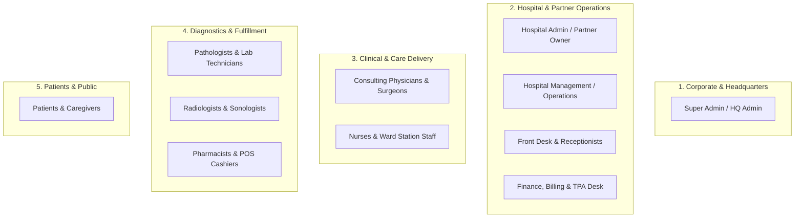
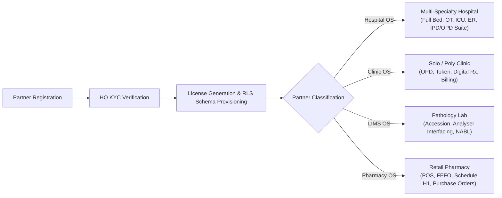

# DOC SEARCH — MASTER PRODUCT VISION & ECOSYSTEM SPECIFICATION
**Document ID:** `DOCSEARCH-VISION-001`  
**Audit Phase:** Phase 0 — Master Reality vs Original Goal Audit  
**Classification:** Authoritative Product & Business Vision Baseline  
**Date:** November 5, 2026  
**Status:** FORENSICALLY RECOVERED & FROZEN  

---

## 1. EXECUTIVE STATEMENT & CORE PURPOSE

**Doc Search** was conceived as an end-to-end, multi-tenant **Healthcare Operating System (Healthcare OS)** and National Digital Health Network designed specifically for the Indian healthcare ecosystem. 

Unlike traditional siloed hospital management software (HMS) or standalone point-of-sale (POS) systems, Doc Search was envisioned to unify the entire healthcare delivery supply chain—from solo general practitioners and diagnostic laboratories to 500-bed multi-specialty hospital networks, retail pharmacies, and retail healthcare consumers (patients).

### The Core Problem Solved
1. **Fragmented Patient Records**: In India, patient medical histories are fragmented across physical paper prescriptions, disparate laboratory reports, and isolated clinic record books. Doc Search unifies this via Ayushman Bharat Digital Mission (ABDM) M1/M2/M3 compliance and a single Longitudinal Electronic Health Record (EHR).
2. **Operational Silos in Hospitals**: IPD admissions, OT scheduling, nursing stations, pharmacy dispensing, and discharge billing typically operate on separate unlinked databases, resulting in leakage, billing disputes, and medication errors.
3. **Statutory Non-Compliance**: Clinics and pharmacies struggle with complex Indian regulations, including GST SAC 998313 backward derivations, TDS Section 194J/206AA doctor settlements, Drugs & Cosmetics Rules (Schedule H1 and Schedule X registers), AERB radiation badges, and NABL ISO-15189 verbal panic intimation.
4. **Predatory SaaS Pricing**: Tier-1 hospital ERP solutions (e.g., Epic, Cerner) are unaffordable for 95% of Indian clinics and nursing homes. Doc Search democratizes enterprise-grade infrastructure at accessible INR price points.

---

## 2. SAAS BUSINESS MODEL & COMMERCIAL ARCHITECTURE

Doc Search operates on a **B2B Subscription SaaS + Transactional Platform Model**, anchored in Indian statutory compliance (GST SAC 998313 at 18%):

### 2.1 Standard Commercial Tiers (Annual Subscriptions)

| Partner Segment | Plan Identifier | Product Tier | Standard Base Price (Annual, GST-Inclusive) | Statutory SAC Code | Core Entitlements & Workflows |
| :--- | :--- | :--- | :--- | :--- | :--- |
| **Solo Doctor / OPD Clinic** | `PLAN_CLINIC_ANNUAL` | Clinical Standard | **₹6,000 / year** | 998313 | Digital Rx, Appointment Scheduler, Patient EMR, OPD Billing, WhatsApp Notifications, 1 Doctor Seat |
| **Pathology Laboratory** | `PLAN_PATHOLOGY_ANNUAL` | LIMS Standard | **₹6,000 / year** | 998313 | LIMS Analyzer Interfacing (RS232/TCP), Barcode Specimen Tracking, NABL Formats, Patient Portal, Up to 3 Analyzers |
| **Retail Pharmacy** | `PLAN_PHARMACY_ANNUAL` | POS Standard | **₹6,000 / year** | 998313 | FEFO/Batch Inventory, Schedule H1/X Registers, Point of Sale, Barcode Billing, Supplier POs |
| **Multi-Specialty Hospital** | `PLAN_HOSPITAL_ANNUAL` | Enterprise Hospital | **₹20,000 / year** | 998313 | Full Hospital OS: IPD, OPD, OT, ICU, Nursing Stations, ER Triage, Emergency, Pharmacy, Lab, Radiology, Exit Hub, Cross-Department Billing |

### 2.2 Commercial Rules & Invariants
- **GST Backward Derivation**: All consumer- and partner-facing prices are GST-inclusive. The platform backward-calculates the taxable base and bifurcates CGST (9%) + SGST (9%) for intra-state supply, or IGST (18%) for inter-state supply.
- **Tenure Commitments**: Pre-approved discounting of 0% (1-yr), 2% (2-yr), 10% (3-yr), and 20% (5-yr).
- **Extension Invariant**: Renewals never forfeit active remaining days. A 1-year renewal on an account with 45 remaining days yields exactly 410 active days.
- **Locked ≠ Deleted Invariant**: Subscription expiration halts write access to clinical and commercial workflows but never purges historical clinical or audit data.

---

## 3. USER ECOSYSTEM (12 PRIMARY PERSONAS)

The architecture is designed to support 12 distinct personas across administrative, clinical, diagnostic, and commercial domains:

### Detailed Persona Breakdown & Responsibilities:

1. **Super Admin / HQ Admin (`apps/company-platform`)**:
   - Platform-wide tenant management, commercial subscription approvals, plan overrides, KYC verification, platform financial ledgers, and global system health telemetry.
2. **Hospital Owner / Partner Admin (`apps/partner-platform`)**:
   - Facility profile, branch/ward/bed layout, staff credentials, RBAC assignment, departmental revenue analytics, and facility-level audit logging.
3. **Hospital Management / Medical Superintendent**:
   - Bed occupancy tracking, average length of stay (ALOS), OT utilization, clinical audit compliance, and statutory health authority reporting.
4. **Consulting Physicians & Specialists**:
   - OPD consultation queue, digital prescriptions with drug-drug interaction warnings, IPD daily progress notes, OT surgical summaries, and discharge summaries.
5. **Nurses & Ward Station Staff**:
   - Bedside vitals monitoring, medication administration records (MAR), nurse handovers, shift logs, doctor order verification, and sample collection dispatch.
6. **Front Desk & Receptionists**:
   - Patient registration, ABHA ID creation, token generation, appointment scheduling, visitor pass issuance, and initial deposit receipt.
7. **Pathologists & Lab Technicians**:
   - Sample accessioning, analyzer telemetry ingestion, critical panic value detection, ISO-15189 compliance, and digital signature sign-off.
8. **Pharmacists & POS Cashiers**:
   - FEFO batch selection, barcode dispensing, prescription verification, Schedule H1/X narcotics recordkeeping, purchase invoice processing, and POS counter receipt.
9. **Radiologists & PACS Technicians**:
   - Modality worklist management, DICOM image viewing, measurements, diagnostic reporting, and critical finding verbal communication.
10. **Finance, Billing & TPA Executives**:
    - Centralized IPD/OPD folio consolidation, advance deposits, cashless insurance claim estimation, CGHS/ECHS tariff application, TDS 194J calculation, and final discharge billing.
11. **Patients & Caregivers (`apps/patient-app`, `apps/sovra-pwa`)**:
    - Appointment booking, live queue token tracking, teleconsultation access, digital prescription retrieval, lab report viewing, and payment processing.
12. **Ambulance & Emergency Response Staff**:
    - ER triage grading (Manchester / ESI), trauma bay alert dispatch, ambulance GPS telemetry, and rapid emergency admission.

---

## 4. PARTNER ECOSYSTEM & FACILITY CLASSIFICATIONS

The platform categorizes healthcare partners into four operational typologies:

1. **Multi-Specialty Hospitals (20 to 500+ Beds)**:
   - Requires full integrated ERP: ADT, Bed Management, ICU, OT, ER, Pharmacy, LIMS, Blood Bank, Insurance TPA, CSSD, Biomedical Engineering, Mortuary.
2. **Clinics & Day-Care Polyclinics (OPD Centric)**:
   - Streamlined OPD workflow: Token kiosk, doctor consultation pad, e-Prescription, basic point-of-sale billing, WhatsApp appointment reminders.
3. **Standalone Pathology Laboratories (LIMS Centric)**:
   - Specimen lifecycle: Phlebotomy collection, accessioning barcodes, unidirectional/bidirectional analyzer interfacing, critical panic alerts, digital reports.
4. **Standalone Retail & Institutional Pharmacies (POS Centric)**:
   - Inventory & billing: AIOCD-AWACS 50,000+ medicine master, FEFO batch selection, schedule H1/X registers, GST compliance, distributor stock orders.

---

## 5. MARKET DIFFERENTIATION & VALUE PROPOSITION

| Dimension | Legacy Indian Hospital Software | Generic Global SaaS (Epic/Cerner) | Doc Search Healthcare OS |
| :--- | :--- | :--- | :--- |
| **Architecture** | On-premise desktop client (VB6, FoxPro, .NET) | Heavy enterprise cloud / Private VPC | Modern Monorepo Cloud-Native (Fastify + React + PostgreSQL RLS) |
| **Pricing** | ₹2L - ₹10L upfront license + maintenance | \$500k - \$10M enterprise implementation | Flat ₹6,000 - ₹20,000 / year transparent subscription |
| **Statutory Fit** | Manual external spreadsheets for GST & TDS | Custom enterprise localization needed | Native Indian GST backward calculation, TDS 194J/206AA, Schedule H1/X built-in |
| **ABDM Integration** | Non-existent or legacy third-party bridge | Complex FHIR adapter required | Native M1 (ABHA creation), M2 (Health Repository), M3 (Data Exchange) integration hooks |
| **Interoperability** | Siloed database per branch | Heavy HL7 interface engine | Zero-friction REST/SSE event streaming, DICOM Web PACS, Hardware Agent |

---

## 6. VISION DOCUMENT SUMMARY MATRIX

- **Target Market**: Indian Healthcare Delivery Ecosystem (Tier-1 to Tier-4 cities).
- **Core Platform Architecture**: Multi-tenant Fastify REST Gateway + React 18 Dashboards + Native PostgreSQL RLS + Hardware Agent.
- **Key Business Invariant**: Zero data deletion upon subscription expiry, 100% auditable healthcare compliance.
