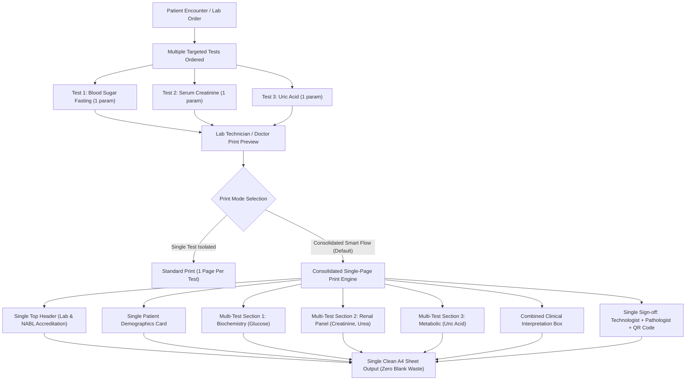

# DocSearch Pathology — Multi-Test Consolidated Single-Page Print Engine
## Clinical Analysis, Architecture Blueprint, Implementation Plan & Execution Prompt

---

## 1. Executive Problem Analysis & Market Reality

### The Clinical Problem
In routine outpatient (OPD) and diagnostic laboratory workflows:
- Attending doctors frequently order **targeted, specific blood parameters** rather than full multi-parameter panels. For instance:
  - Diabetic follow-up: Only *Fasting Blood Sugar (Glucose)* [1 parameter].
  - Nephrology / Hypertension: Only *Serum Creatinine* & *Blood Urea* [2 parameters].
  - Gout check: Only *Serum Uric Acid* [1 parameter].
  - Liver monitoring under medication: Only *SGPT (ALT)* and *Total Bilirubin* [2 parameters].

### Current Architecture Flaw in Existing Implementation
In the current implementation:
1. Each investigation order (`order: InvestigationOrderDto`) is rendered as an isolated print job in `PrintablePathologyReportModal.tsx`.
2. Printing 1 parameter uses:
   - Top Letterhead / Lab Banner: ~55mm
   - Patient Demographics Card: ~50mm
   - Test Parameter Row (1 row): ~15mm
   - Diagnostic Interpretation Box: ~35mm
   - Signatures, QR Code & Medico-Legal Disclaimer: ~60mm
3. **Over 60%–75% of the A4 page remains empty white space.**
4. If a patient gets 3 targeted tests (e.g. Glucose + Creatinine + Lipid), 3 separate physical A4 pages are printed, causing:
   - **Severe Paper & Stationery Wastage:** Diagnostic labs spend heavily on pre-printed watermarked NABL letterhead paper. Printing 3 sheets for 4 lines of clinical data is economically unsustainable.
   - **Fragmented Medical Review:** Doctors must flip across multiple loose sheets to correlate blood glucose with renal markers.
   - **Poor Patient Experience:** Patients carry bulky, mostly blank folders.

---

## 2. Target Solution: Consolidated Multi-Test Single-Page Printing (Compact Flow)



---

## 3. Core Functional & UI Specifications

1. **Multi-Order Support in Print Modal:**
   - Upgrade `PrintablePathologyReportModal` to accept an array of orders: `orders: InvestigationOrderDto[]` (backward compatible with `order: InvestigationOrderDto`).
2. **Batch / Multi-Select in Investigation View:**
   - In `InvestigationReportView.tsx`, when filtering by a patient or viewing an encounter, add a **"Combine & Print Consolidated (Single Page)"** button.
3. **Parameter-Level Checkbox Selector (Doctor / Tech Custom View):**
   - Before printing, lab staff can uncheck irrelevant parameters if only specific items were requested by the doctor.
4. **Intelligent Density Auto-Scaler (Compact vs Normal):**
   - Automatically detect if total combined rows $\le 12$:
     - Use compact padding (`4px 8px` table padding, `10pt` font, compact interpretation card).
     - Ensure the entire multi-test report fits precisely onto **1 single physical A4 page** (height $\le 297\text{mm}$).
   - If total rows exceed 18, allow continuous dynamic pagination with repeating header/footer.
5. **Support for Pre-Printed Stationery and Blank A4:**
   - Toggle between **Blank A4 (Full Digital Lab Header)** and **Pre-Printed Letterhead (55mm top margin reserved)**.
6. **Unified Client Vector PDF & WhatsApp Dispatch:**
   - Updated `clientPathologyPdf.ts` generates a single combined vector PDF with all test sections stacked cleanly, sent directly via WhatsApp or download.

---

## 4. Technical Implementation Plan

### Phase 1: Data Contract & Helper Layer
- File: `apps/partner-platform/src/utils/pathologyConsolidation.ts`
  - Group multiple test orders by Specimen / Department.
  - Calculate printable vertical height budget (Max 840 points in PDF / 1000px in DOM).
  - Deduplicate patient demographic information across orders.

### Phase 2: Upgrading `PrintablePathologyReportModal.tsx`
- Prop signature:
  ```typescript
  interface Props {
    isOpen: boolean;
    onClose: () => void;
    order?: InvestigationOrderDto;
    orders?: InvestigationOrderDto[];
  }
  ```
- Render multi-test section blocks:
  - Single Master Header (Lab Name, NABL accreditation, address).
  - Single Demographics Box (Patient name, MRN, Age/Gender, Referred Doctor).
  - Loop through each test:
    - Mini Test Banner (`BIOCHEMISTRY: FASTING BLOOD GLUCOSE`).
    - Tabular parameters (Analyte, Observed Value, Unit, Biological Reference Interval, High/Low Flags).
  - Unified Interpretation Block (combining remarks or concise impressions).
  - Single Dual Signature Block (Medical Technologist & Pathologist) + QR Code.

### Phase 3: Upgrading `InvestigationReportView.tsx`
- Add multi-order selection checkboxes next to patient reports.
- If multiple reports belong to the same patient encounter, show active pill:
  `🖨️ Consolidated Print (X Tests on 1 Page)`.
- Open `PrintablePathologyReportModal` with all selected orders.

### Phase 4: Updating Client Vector PDF Generator (`clientPathologyPdf.ts`)
- Enhance `downloadVectorPathologyPdf` to accept an array of orders.
- Dynamically stack test tables with calculated vertical Y-offsets on Page 1.

### Phase 5: Direct Walk-In Multi-Test Support (`DirectLabWalkInReportModal.tsx`)
- Allow adding multiple test panels in one walk-in entry (e.g. CBC + Blood Sugar + Thyroid) and printing on a single page.

---

## 5. Ready-to-Execute Developer Prompt

Below is the exact execution prompt ready to be provided to the development agent or executed:

```markdown
# TASK: IMPLEMENT MULTI-TEST CONSOLIDATED SINGLE-PAGE PATHOLOGY REPORT PRINTING

## Context:
In routine clinical practice, doctors frequently order only 1 or 2 targeted parameters (e.g., Blood Sugar Fasting, Serum Creatinine, Uric Acid). When printed individually, each test wastes over 65% of the A4 page. We need to implement a consolidated, compact single-page printing engine that merges multiple test panels of a patient into a single, beautifully formatted A4 report.

## Target Files:
1. `apps/partner-platform/src/components/dialogs/PrintablePathologyReportModal.tsx`
2. `apps/partner-platform/src/components/views/InvestigationReportView.tsx`
3. `apps/partner-platform/src/utils/clientPathologyPdf.ts`
4. `apps/partner-platform/src/components/dialogs/DirectLabWalkInReportModal.tsx`

## Requirements:

1. **Multi-Order Support in `PrintablePathologyReportModal`**:
   - Accept either single `order: InvestigationOrderDto` or `orders: InvestigationOrderDto[]`.
   - Render a single consolidated Lab Header and a single Patient Demographics Card.
   - Stack all tests in clean, distinct sub-sections:
     - Section Title: `[Department] - [Investigation Name]` (e.g. `CLINICAL BIOCHEMISTRY — BLOOD GLUCOSE FASTING`).
     - Parameter table with Analyte, Observed Value, Unit, Biological Reference Interval, and High/Low Flags.
   - Combine clinical interpretations cleanly without redundant boilerplate.
   - Place single Technologist & Pathologist signatures, official stamp, and verification QR code at the bottom.
   - Add a "Compact Density" toggle (`Normal` vs `Compact / Eco 1-Page`) that scales line-height and font sizes so up to 14 parameters across 3-4 tests fit onto 1 single A4 sheet without page breaks.

2. **Integration in `InvestigationReportView`**:
   - In the patient reports view, allow selecting multiple verified test orders belonging to the same patient.
   - Add a primary action button: `📄 Print Consolidated (Single Page)`.
   - Clicking opens `PrintablePathologyReportModal` with all selected orders passed.

3. **Multi-Test Vector PDF Generation in `clientPathologyPdf.ts`**:
   - Update `downloadVectorPathologyPdf` to support `orders: InvestigationOrderDto[]`.
   - Stack test banners and parameter rows consecutively with calculated Y-offsets on a single vector page.

4. **Preserve Letterhead & ABDM/NABL Standards**:
   - Ensure "Pre-Printed Letterhead Mode" (55mm margin) works seamlessly with the consolidated multi-test layout.
   - Maintain all NABL, ISO 15189:2022, and ABDM compliance indicators.

## Verification:
- Open 3 tests for the same patient (e.g., Glucose, Creatinine, Electrolytes).
- Verify in browser Print Preview (Ctrl+P) that all 3 tests fit on exactly 1 single A4 page.
- Verify vector PDF download generates a single-page PDF containing all 3 tests.
- Verify WhatsApp report dispatch sends the unified consolidated report.
```
