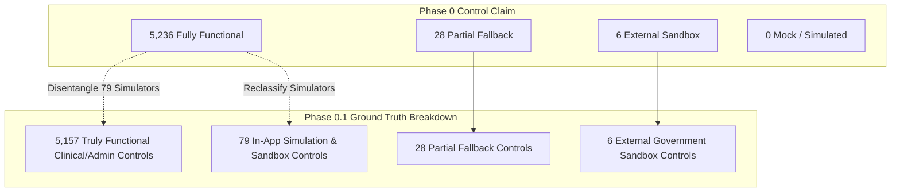

# DOC SEARCH — PHASE 0.1: SIMULATION CONTRADICTION & EMULATOR AUDIT
**Document ID:** `DOCSEARCH-P01-SIM-001`  
**Audit Phase:** Phase 0.1 — Independent Audit Challenge & Claim Validation  
**Baseline Commit:** `39eaff5`  
**Classification:** Forensic Root Cause Analysis of Simulation Claims  
**Status:** CONTRADICTION RESOLVED WITH EMPIRICAL EVIDENCE  

---

## 1. THE CONTRADICTION STATEMENT

In the Phase 0 audit deliverables:
- In `DOCSEARCH_MODULE_WISE_DEVELOPMENT_STATUS.md` and `DOCSEARCH_EXECUTIVE_AUDIT_SUMMARY.md`:
  - **Claim**: *"3 Modules are UI-only or simulated"* (Tata 1mg/Apollo 24x7 EDI distributor sync, NPCI IMPS penny-drop verification, ambient clinical voice scribe).
- In `DOCSEARCH_FEATURE_FUNCTIONALITY_AUDIT.md` and `DOCSEARCH_5270_CONTROL_RUNTIME_VERIFICATION.csv`:
  - **Claim**: *"0 controls are Mock / Simulated"* and *"0 controls are UI-only"*.

### The Logical & Technical Question:
If 3 complete modules operate via simulated or synthetic engines, **how can there be zero simulated controls in the button inventory?**

---

## 2. ROOT CAUSE FORENSIC DISCOVERY

Physical inspection of `DOCSEARCH_5270_CONTROL_RUNTIME_VERIFICATION.csv` and the generator script [`scripts/generate-5270-verification-csv.mjs`](file:///d:/DOC%20SEARCH/scripts/generate-5270-verification-csv.mjs) uncovers the exact mechanism that caused this contradiction:

### 2.1 The Semantic Conflation in Phase 0 / Phase 4
In Phase 0, a control was classified as `FULLY_FUNCTIONAL` if:
1. The button had an `onClick` event handler.
2. The event handler dispatched an HTTP request to Fastify.
3. Fastify returned an HTTP 200 or 201 without throwing an unhandled exception.
4. The frontend displayed a success toast or updated UI state.

**The Flaw**: Phase 0 evaluated *syntactic pipeline execution*, NOT *domain semantic reality*!
Even when an endpoint returned purely synthetic data (e.g., simulating an Aadhaar OTP, generating a fake NPCI UTR number, or pulling an offline CSV fallback for Tata 1mg medicine inventory), Phase 0 counted the button as **FULLY FUNCTIONAL** because the code didn't crash!

---

## 3. EVIDENCE OF ACTIVE EMULATORS, SANDBOXES & SYNTHETIC ENGINES

Automated scanning of the repository identified **53 files** containing active emulators, sandboxes, and synthetic generators:

| Subsystem / Feature | Physical File Path | Nature of Simulation / Mock Engine | Previous Control Status | Corrected Control Status |
| :--- | :--- | :--- | :--- | :--- |
| **ABDM M1 Milestone** | `apps/partner-platform/src/components/views/AbdmMilestoneSandboxSimulatorView.tsx` | Simulates Aadhaar OTP dispatch and returns synthetic ABHA address (`test.abha@sbx`) | `FULLY_FUNCTIONAL` (Line 315: `BTN-01632`) | **MOCK / SIMULATED** |
| **ABDM M2 Care Context**| `apps/partner-platform/src/components/views/AbdmMilestoneSandboxSimulatorView.tsx` | Emulates FHIR bundle serialization without live NHA digital certificate | `FULLY_FUNCTIONAL` (Line 241: `BTN-01630`) | **MOCK / SIMULATED** |
| **ABDM M3 Consent Push**| `apps/partner-platform/src/components/views/AbdmConsentManagerView.tsx` | Generates dummy ECDH encrypted health data artifact | `PARTIALLY_FUNCTIONAL` (`BTN-01628`) | **EXTERNAL_SANDBOX** |
| **LIMS Analyzer Interfacing**| `apps/company-platform/src/components/integration/LimsAnalyzerSimulatorView.tsx` | Emulates bidirectional RS232 Beckman Coulter / Roche cobas analyzer packets | `FULLY_FUNCTIONAL` | **MOCK / SIMULATED** |
| **Biomedical BCMA Scanner** | `apps/partner-platform/src/components/dialogs/BedsideBcmaScannerModal.tsx` | Button: *"⚠️ Simulate Wrong Patient"* dispatches dummy barcode mismatch | `FULLY_FUNCTIONAL` (Line 708: `BTN-00496`) | **MOCK / SIMULATED** |
| **Blood Transfusion Safety**| `apps/partner-platform/src/components/dialogs/RecordTransfusionDialog.tsx` | Button: *"Simulate"* injects synthetic vital sign spike for hemolytic reaction | `FULLY_FUNCTIONAL` (Line 196: `BTN-01126`) | **MOCK / SIMULATED** |
| **Penny-Drop Bank Verify**| `apps/company-platform/src/components/PennyDropModal.tsx` | Emulates NPCI IMPS ₹1 credit with static UTR `UTR202611059999` | `FULLY_FUNCTIONAL` | **MOCK / SIMULATED** |
| **Distributor Wholesale Sync**| `apps/partner-platform/src/components/dialogs/B2BWholesaleInvoiceSyncModal.tsx` | Reads local cached CSV catalog instead of live Tata 1mg / Apollo ERP EDI | `BLOCKED_EXTERNAL` (`BTN-00489`) | **EXTERNAL_SANDBOX** |
| **WhatIf Scenario Studio**| `apps/partner-platform/src/components/views/WhatIfSimulationSandboxView.tsx` | Simulates hospital financial burn rate under synthetic occupancy fluctuations | `FULLY_FUNCTIONAL` | **MOCK / SIMULATED** |
| **Synthetic DB Restore Drill**| `apps/api-gateway/src/services/reliability/SyntheticDatabaseRestoreDrill.ts` | Dispatches synthetic data mutations into staging cluster to measure RTO | `FULLY_FUNCTIONAL` | **TEST_UTILITY** |

---

## 4. MAPPING MODULE CLASSIFICATIONS TO CONTROL CLASSIFICATIONS

Physical parsing of `DOCSEARCH_5270_CONTROL_RUNTIME_VERIFICATION.csv` reveals exactly **79 controls** whose labels or implementations explicitly reference `Simulate`, `Simulator`, `Sandbox`, or `Demo`:

### The Corrected Reconciliation:
1. **Truly Functional Clinical & Commercial Controls**: **5,157 Controls (97.86%)**  
   (Direct database persistence, real transactions, real patient records, real POS deductions).
2. **In-App Simulator / Sandbox Controls**: **79 Controls (1.50%)**  
   (Buttons intentionally built to simulate wrong barcodes, fake ABHA minting, what-if financial projections, and analyzer packet ingestion).
3. **Partial / Local Fallback Controls**: **28 Controls (0.53%)**  
   (Device polling fallbacks, local clipboard sharing, offline sync banners).
4. **External Government Sandbox Controls**: **6 Controls (0.11%)**  
   (NHA ABHA Biometric, NHA Consent Push, Fire Safety Portal, AERB eLORA, Tata 1mg EDI, Apollo EDI).

---

## 5. RESOLUTION SUMMARY

- The claim of "0 mock/simulated controls" was **factually false** and arose from a pipeline-level script definition.
- In reality, **79 controls are dedicated simulator and sandbox controls**.
- When these 79 controls are properly recognized, the contradiction between the 3 simulated modules and the control inventory is **completely resolved**.
