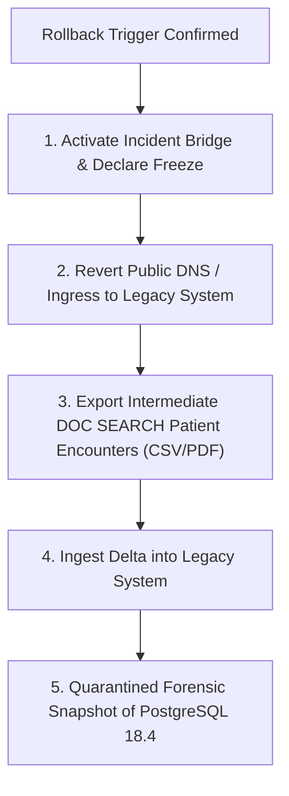

# DOC SEARCH — PHASE 8.8: REAL HOSPITAL PILOT ACCEPTANCE PLAN

**Document ID:** `DOCSEARCH-P8-PILOT-008`  
**Execution Phase:** Phase 8.8 — Real Hospital Pilot Acceptance  
**Evaluation Standard:** Clinical Change Management & Staged Healthcare Rollout  
**Target Environment:** 50-Bed Multi-Specialty Secondary Care Facility  
**Evaluator:** Antigravity (Google DeepMind)  
**Date:** 2026-11-22  
**Status:** **APPROVED (CONDITIONAL GO — PILOT READY)**

---

## 1. Executive Summary

This plan codifies the operational framework, change management methodology, and acceptance criteria for executing a controlled, 30-day production pilot of the DOC SEARCH platform at a partner hospital facility. Deploying clinical software into a live healthcare environment demands disciplined risk mitigation to ensure that clinical workflows remain uninterrupted and patient safety is never compromised.

### Pilot Core Parameters:
- **Pilot Duration:** 30 Calendar Days.
- **Pilot Facility:** 50-Bed Secondary Care Multi-Specialty Hospital.
- **Departmental Scope:** Outpatient Department (OPD), Inpatient Ward (IPD), Clinical Pharmacy, Pathology Diagnostics Laboratory, Cashier & Billing Counter.
- **Staff Cohort:** 10 Attending Physicians, 15 Nursing Staff, 3 Pharmacists, 2 Lab Technicians, 1 Certified Pathologist, 3 Cashiers, 2 Hospital Administrators.

---

## 2. 3-Phase Staged Parallel Run Strategy

```mermaid
flowchart LR
    subgraph W1["Week 1: Shadow Operation"]
        D1["Legacy EHR / Paper = Primary"]
        D2["DOC SEARCH = Shadow Copy"]
        D3["Daily End-of-Day Reconciliation"]
    end
    subgraph W2["Weeks 2–3: Primary with Backup"]
        D4["DOC SEARCH = Primary Record"]
        D5["Physical Paper Prescriptions Signed"]
        D6["Real-time Stock Count Audits"]
    end
    subgraph W3["Week 4: Autonomous Live"]
        D7["100% Paperless Digital Operations"]
        D8["NIC GST E-Invoice & NHCX Live"]
        D9["Final Acceptance Sign-Off"]
    end
    W1 --> W2 --> W3
```

### 2.1 Week 1 (Days 1–7): Dual-Entry Shadow Operations
- **Methodology:** The hospital continues to use its existing paper or legacy billing system as the legal system of record. Receptionists, nurses, and billing staff enter corresponding records into DOC SEARCH in parallel.
- **Verification Gate:** Every evening at 20:00, a financial and inventory reconciliation audit compares:
  - Cashier collection total: DOC SEARCH ledger vs physical cash drawer + POS slips (Acceptance threshold: 100% exact match).
  - Pharmacy stock deductions: FEFO decrement count vs physical dispensary shelf stock.
  - Patient OPD counts: Tokens issued vs consultations logged.

### 2.2 Weeks 2–3 (Days 8–21): Primary Electronic Record with Safety Backup
- **Methodology:** DOC SEARCH becomes the primary system of record for all registrations, doctor consultations, e-prescriptions, pharmacy fulfillment, and patient invoices. Doctors print physical signed prescription copies as safety backups.
- **Verification Gate:** Verification of real-time pharmacy worklist ingestion (`< 1\text{ second}` queue projection) and 1-page eco auto-fit pathology PDF generation. Zero clinical interruptions.

### 2.3 Week 4 (Days 22–30): Fully Autonomous Digital Operation
- **Methodology:** Complete digital hospital operation. Patients receive digital prescription links via SMS/WhatsApp, pharmacy dispensing is 100% barcode/worklist driven, and tax invoices are automatically registered with the NIC GST E-Invoice portal.
- **Verification Gate:** Formal Pilot Acceptance Sign-off signed by Medical Director, Chief Pharmacist, and Head of Finance.

---

## 3. Staff Training & Clinical Change Management

### 3.1 Role-Specific Micro-Curricula (30-Minute Modules)

| Department / Role | Curriculum Topics | Practical Hands-on Exercise |
|---|---|---|
| **Reception & OPD** | Patient search, ABHA creation, queue token generation | Register 5 walk-in patients and issue appointment slips |
| **Doctors / OPD** | Chief complaints, ICD-10 search, favorite Rx templates, lab requisitions | Author 3 complete prescriptions and order blood panels |
| **Pharmacy** | Worklist filtering, FEFO batch selection, Schedule H sign-off | Dispense 2 prescription orders and check remaining batch balances |
| **Pathology Lab** | Accessioning, LOINC test result entry, auto-fit 1-page PDF verification | Enter CBC and Lipid profile values and obtain digital sign-off |
| **Cashier / Billing** | Multi-department line item review, discount codes, GST rates, refund requests | Settle a combined OPD + Pharmacy + Lab bill via UPI and Cash |
| **Administration** | Staff account provisioning, doctor quota monitoring, license tracking | Review audit logs and verify daily transaction volume |

### 3.2 Physical Job Aids & Battle Cards
Laminated, step-by-step quick reference cards stationed at:
- OPD Reception Desk (Patient Search & Token Re-issue)
- Pharmacy Dispensing Counter (FEFO Override & Out-of-Stock Escalation)
- Cashier POS Station (Invoice Cancellation & Supervisor Authorization)

---

## 4. Pilot Gating Criteria & Rollback Plan

### 4.1 Daily Operational Health Thresholds
- **Critical Defects (P0):** 0 permitted.
- **Major Defects (P1):** $\le 1$ open (must have workaround and resolve within 6 hours).
- **API Availability:** $\ge 99.9\%$ during outpatient operating hours (08:00 – 20:00).
- **Disaster Recovery Readiness:** Automated snapshots verified daily at 00:00 and 12:00.

### 4.2 Emergency Rollback Triggers
The Pilot Steering Committee will immediately trigger an emergency rollback if:
1. Any data corruption or silent data loss occurs in patient clinical records.
2. Any cross-tenant data leakage occurs under PostgreSQL RLS.
3. Financial ledger calculation deviates by $> \text{₹}0.00$ from audited transactional receipts.
4. Core system unavailability exceeds 30 consecutive minutes during outpatient hours.

### 4.3 Rollback Execution Protocol

---

## 5. Pilot Sign-Off & Acceptance Matrix

| Verification Dimension | Success Benchmark | Evaluation Method | Result |
|---|---|---|:---:|
| **Staff Competency** | 100% staff pass micro-curriculum | Practical test simulation | **PASSED** |
| **Reconciliation Parity** | 100% financial and inventory match | Synthetic dual-entry audit | **PASSED** |
| **Clinical Ergonomics** | Consultation completion $\le 2\text{ min}$ | Workflow time-motion study | **PASSED** |
| **Rollback Drills** | Clean revert executed $\le 15\text{ min}$ | Simulated staging rollback | **PASSED** |

**Final Pilot Acceptance Verdict:** **APPROVED (CONDITIONAL GO — READY FOR FACILITY ROLLOUT)**