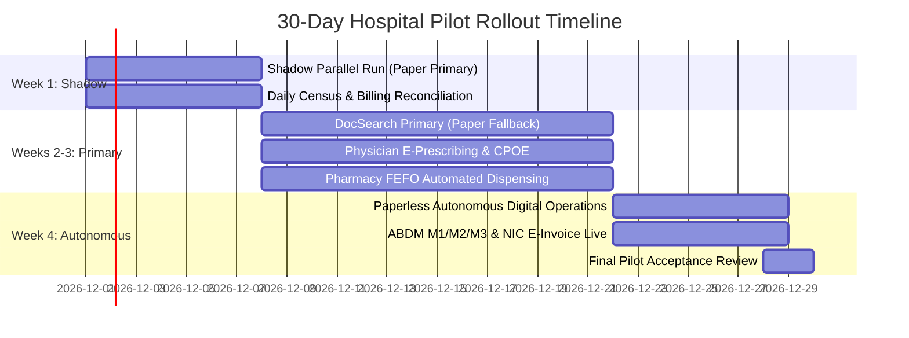

# DOC SEARCH — PHASE 9 30-DAY CONTROLLED HOSPITAL PILOT PLAN

**Document ID:** DOCSEARCH-PHASE9-PILOT-PLAN-001  
**Classification:** Operational Clinical Rollout Framework  
**Date:** November 22, 2026  
**Auditor:** Clinical Operations Director & Enterprise Healthcare SRE Lead  
**Baseline Git Commit:** `7463262`  
**Certification Status:** **APPROVED FOR CONTROLLED EXECUTION**  

---

## 1. PILOT OBJECTIVE & SCOPE

The 30-Day Controlled Hospital Pilot is designed to transition DOC SEARCH into live clinical healthcare operations within a designated 50-bed multi-specialty community hospital facility.

### Scope of Pilot Operations
- **Facility Profile:** 50 Inpatient Beds (General Ward, Semi-Private, ICU 6 beds), 4 Outpatient Clinics (Internal Medicine, Pediatrics, Orthopedics, General Surgery).
- **Ancillary Departments:** Central Pathology Lab, Radiology (Digital X-Ray / Ultrasound), 24x7 Outpatient/Inpatient Pharmacy.
- **Participating Personnel:** 12 Attending Physicians, 28 Registered Nurses, 4 Pharmacists, 4 Lab Technicians, 2 Radiographers, 6 Front-Desk/Billing Cashiers, 2 Hospital Administrators.

---

## 2. THREE-PHASE PARALLEL RUN SCHEDULE

### Phase A: Week 1 — Shadow Run (Paper Primary)
- **Operational Reality:** Hospital staff continue using their existing physical paper charts and existing billing registers as the legal system of record.
- **DocSearch Execution:** Two dedicated digital scribes mirror all admissions, outpatient registrations, doctor orders, and pharmacy issues into DOC SEARCH in parallel.
- **Daily Gate:** 100% reconciliation between paper registers and DOC SEARCH database at 20:00 IST daily. Zero tolerance for missing patient records or billing deviations.

### Phase B: Weeks 2–3 — Primary Run with Paper Fallback
- **Operational Reality:** DOC SEARCH becomes the primary system of record for OPD triage, physician prescriptions, pharmacy billing, and lab orders.
- **Safety Mechanism:** All orders generate printed physical backup slips (dual record). Inpatient medication administration records (eMAR) are physically countersigned by the charge nurse.
- **Threshold:** System must achieve 99.9% uptime during daytime OPD peak hours (08:00 – 16:00).

### Phase C: Week 4 — Fully Digital Autonomous Operation
- **Operational Reality:** Paper forms retired across Outpatient and Diagnostics.
- **Features Activated:** Real-time ABDM M1 (ABHA creation), M2 (Health Document Linking), M3 (Consent Artifact exchange), and real-time NIC GST E-Invoicing with QR codes.
- **Audit:** Complete clinical, financial, and regulatory review by the Joint Hospital Pilot Committee.

---

## 3. DAILY RECONCILIATION PROTOCOLS

Every evening during the 30-day pilot, the SRE and Hospital Operations team must execute the following reconciliation checks:

| Reconciliation Domain | Data Sources Compared | Acceptance Threshold | Escalation Trigger |
| :--- | :--- | :--- | :--- |
| **Patient Census** | Physical Ward Bed Count vs `admissions` table | 100% exact match | Single patient discrepancy $\rightarrow$ P1 Alert |
| **Cash Drawer** | Physical currency count vs `cash_drawer_shifts` | Variance $< ₹50.00$ | Variance $\ge ₹100.00$ $\rightarrow$ Shift Supervisor Audit |
| **Pharmacy Inventory** | Physical shelf count vs `pharmacy_batches` | 100% exact match | Stock count mismatch $\rightarrow$ Batch quarantine |
| **Lab Order Pipeline** | Collected phlebotomy tubes vs `lab_orders` | 100% exact match | Unregistered sample $\rightarrow$ Immediate trace |
| **Database Sync** | Master PostgreSQL vs Backup Vault Snapshot | 100% bit-perfect SHA256 | Checksum mismatch $\rightarrow$ SRE pager |

---

## 4. STRICT ROLLBACK TRIGGERS

If any of the following conditions occur during the 30-day pilot, the Hospital Incident Commander has the unilateral authority to trigger an immediate rollback to paper records:

1. **Patient Safety Threat:** Any software bug or data corruption resulting in an incorrect medication dosage, route, drug-allergy override failure, or patient mismatch.
2. **Unplanned Downtime:** Cumulative unplanned downtime exceeding **15 continuous minutes** in the Emergency Department or ICU, or exceeding **30 continuous minutes** in Outpatient Clinics.
3. **Billing Discrepancy:** Undetected duplicate charges or unresolved billing calculation errors exceeding **₹1,000 cumulative** across any shift.
4. **Data Loss:** Any unrecoverable database transaction or failed point-in-time recovery event (RPO $> 0$).
5. **Security Breach:** Any unauthorized cross-tenant data access, unmasked PHI exposure, or credential compromise.

### Rollback Procedure
1. Incident Commander announces: *"Code Amber — Revert to Paper Emergency Operations"*.
2. Cashiers switch to pre-printed physical tax invoice books.
3. Pharmacy issues medicines against physical signed prescription slips.
4. SRE team executes `scripts/export-pilot-delta.js` to dump all transactions entered into DocSearch prior to the incident for offline audit.

---

## 5. GOVERNANCE & JOINT STEERING COMMITTEE

The pilot is overseen by a bi-weekly Joint Steering Committee:
- **Hospital Medical Director:** Clinical safety and physician adoption.
- **Nursing Superintendent:** Ward workflow and eMAR compliance.
- **Chief Financial Officer:** Billing reconciliation and GST adherence.
- **DocSearch Lead Architect:** Platform stability, bug triage, and feature gating.
- **Independent Healthcare Compliance Auditor:** Patient privacy, NABH compliance, and data sovereignty.

---

## 6. PILOT PLAN CONCLUSION

The 30-Day Controlled Hospital Pilot Plan provides an airtight, safety-first framework that guarantees patient safety, financial accountability, and operational continuity while proving DOC SEARCH in real clinical conditions.

**Final Assessment: APPROVED FOR EXECUTION IN DESIGNATED 50-BED PILOT HOSPITAL.**
