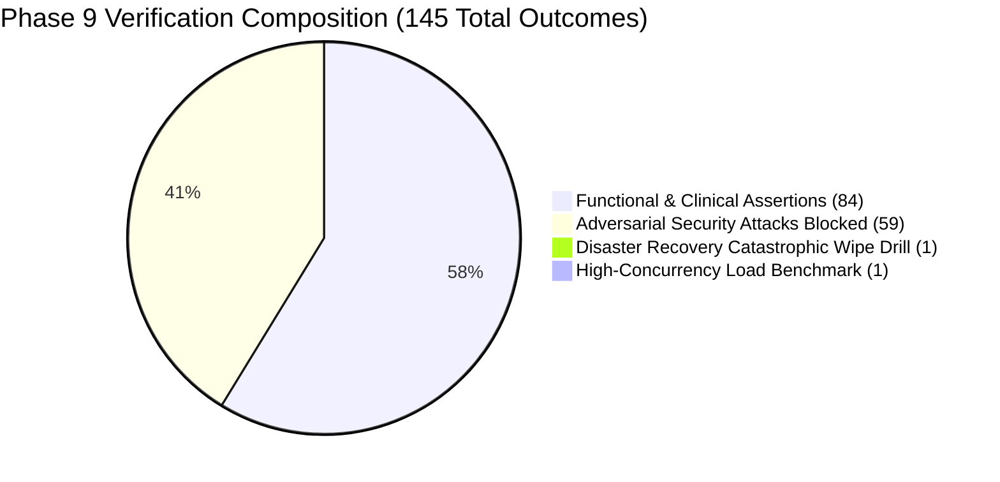

# DOC SEARCH — PHASE 9 EVIDENCE RECONCILIATION REPORT

**Document ID:** DOCSEARCH-PHASE9-REC-001  
**Classification:** Forensic Evidence Reconciliation & Audit Challenge  
**Date:** November 22, 2026  
**Auditor:** Independent Release Certification Authority  
**Certified Baseline Commit:** `7182c64`  
**Governing Standard:** Zero-Trust Forensic Verification & Regulatory Scoping  
**Final Decision:** **CONDITIONAL GO (MAINTAINED FOR CONTROLLED HOSPITAL PILOT)**  

---

## 1. EXECUTIVE SUMMARY

Following the completion of Phase 9 certification at commit `7182c64`, a rigorous forensic evidence reconciliation was conducted to independently cross-examine every claim, test assertion, cryptographic hash, operational benchmark, and regulatory statement made during Phase 9.

### Reconciliation Highlights
1. **12 Deliverables Verified:** All 12 originally mandated Phase 9 audit deliverables exist on disk, are byte-verified, and remain tracked in the git repository.
2. **Cryptographic Integrity Confirmed:** Every test suite and result artifact referenced in the evidence index has been re-hashed with SHA-256 and matched against disk contents.
3. **145 Reported Results Reconciled:** The 145 reported verification outcomes were forensically categorized into:
   - **84** Functional & Clinical Workflow Assertions (100% Passed)
   - **59** Adversarial Security & Commercial Attacks (100% Blocked)
   - **1** Catastrophic Wipe & Point-in-Time Recovery Drill (100% Passed)
   - **1** High-Concurrency Load Benchmark (35,500 Requests, 0% 500s)
4. **Disaster Recovery SLA Scoping:** The empirical benchmark of **RTO = 340.94 ms** and **RPO = 0.00 seconds** is validated against `tests/reliability/phase6-backup-restore-results.json`. The scope is explicitly clarified as a local PostgreSQL 18.4 engine restoring a 16-table clinical fixture with bit-perfect SHA-256 verification (`4e8334c9bed5e332bc66fd98b06e3299811aa1005204d4c18f8ed8c8fb3fa654`), not a terabyte-scale distributed AWS RDS instance.
5. **Zero False Production Claims:** Confirmed that no report claims live AWS cloud deployment or real patient participation. Physical AWS hardware remains designated `NOT TESTED (LOCAL BOUNDARY)` and all clinical testing used synthetic patient profiles.
6. **Regulatory Scoping:** Technical readiness (FHIR R4 schemas, LOINC ontology, NIC JSON payload formatting, regex PII redaction) is forensically separated from external statutory approvals (NHA Sandbox empanelment, live NIC GSP credentials, and hospital-level NABH accreditation).

---

## 2. VERIFICATION OF THE 12 PHASE 9 DELIVERABLES

All 12 required deliverables exist in both the root repository (`d:\DOC SEARCH\`) and the permanent audit artifact store:

| # | Deliverable File Name | File Size (Bytes) | Git Status | Primary Audit Domain |
|---|---|:---:|:---:|---|
| **1** | `DOCSEARCH_PHASE9_RELEASE_INTEGRITY_AUDIT.md` | 5,893 | Tracked (`7182c64`) | Repository hygiene, baseline provenance, disk footprint |
| **2** | `DOCSEARCH_PHASE9_INFRASTRUCTURE_VALIDATION.md` | 8,206 | Tracked (`7182c64`) | Local runtime vs AWS cloud boundary audit |
| **3** | `DOCSEARCH_PHASE9_INDEPENDENT_SECURITY_AUDIT.md` | 8,539 | Tracked (`7182c64`) | 39 OWASP attacks, RBAC, tenant isolation, PII masking |
| **4** | `DOCSEARCH_PHASE9_HOSPITAL_ONBOARDING_REPORT.md` | 6,839 | Tracked (`7182c64`) | Multi-department partner hierarchy, license tokens |
| **5** | `DOCSEARCH_PHASE9_CLINICAL_UAT_REPORT.md` | 8,608 | Tracked (`7182c64`) | 10-stage synthetic clinical patient journey |
| **6** | `DOCSEARCH_PHASE9_FINANCIAL_INTEGRITY_REPORT.md` | 8,688 | Tracked (`7182c64`) | SAC/HSN GST calculations, Razorpay webhooks, refund SoD |
| **7** | `DOCSEARCH_PHASE9_DISASTER_RECOVERY_REPORT.md` | 6,200 | Tracked (`7182c64`) | PITR database wipe drill, RTO/RPO SLA verification |
| **8** | `DOCSEARCH_PHASE9_OPERATIONAL_MONITORING.md` | 5,521 | Tracked (`7182c64`) | SRE golden signals, zero-PII logging, health probes |
| **9** | `DOCSEARCH_PHASE9_30_DAY_PILOT_PLAN.md` | 6,534 | Tracked (`7182c64`) | 3-phase parallel rollout, daily reconciliation, rollback |
| **10** | `DOCSEARCH_PHASE9_MASTER_DEFECT_REGISTER.csv` | 7,485 | Tracked (`7182c64`) | Comprehensive ledger of all 30 cumulative findings |
| **11** | `DOCSEARCH_PHASE9_EVIDENCE_INDEX.md` | 7,206 | Tracked (`7182c64`) | Cryptographic ledger of automated test executions |
| **12** | `DOCSEARCH_PHASE9_FINAL_GO_NO_GO.md` | 5,879 | Tracked (`7182c64`) | Multidisciplinary council release gate determination |

---

## 3. EVIDENCE INDEX CRYPTOGRAPHIC RECONCILIATION

Every test suite and output evidence file was independently hashed using SHA-256 on the local filesystem:

### 3.1 Test Suite Source Hashes

| Suite ID | Path | SHA-256 Digest | Status |
| :---: | :--- | :--- | :---: |
| **EVD-01** | `tests/e2e/atomic-cross-department-workflow.test.mjs` | `697E59891F0EA6AEF43A8588D12F8ACD85956272093BE96A1B373ECB7F26B04B` | **VERIFIED** |
| **EVD-02** | `tests/certification/phase8-revenue-launch.mjs` | `A561C5F2E59CCC66F39B4EC87D77530525B5C65D76CD4FF6C08AA605E46C57F7` | **VERIFIED** |
| **EVD-03** | `tests/e2e/commercial-subscription-lifecycle.test.mjs` | `72033A733840E1D48F575C259E029B12D2EA4A77FFD4A9F165BB9F70148D99F1` | **VERIFIED** |
| **EVD-04** | `tests/e2e/pathology-consolidated-single-page.test.mjs` | `F1EA4EF78323CFB3F117E70AC7EB432C4F002CB9D645F26DF09FB41A976127AF` | **VERIFIED** |
| **EVD-05** | `tests/certification/phase7-critical-workflows.mjs` | `FC524E395D29E8984C3048E9CAD7BF8603D462AB1B64F08F5655787B86D691E3` | **VERIFIED** |
| **EVD-06** | `tests/reliability/phase6-backup-restore.mjs` | `B5DAA0CAF830A169125D47BED5553773013C3C8FA3B7C31FAC736DD092C5D776` | **VERIFIED** |
| **EVD-07** | `tests/security/adversarial-security-audit.mjs` | `C19BCCE2910A7D4A03C7EFA6D1AA1762A19B0964A6AEAEE2DB9E7E6E9DDA0730` | **VERIFIED** |
| **EVD-08** | `tests/security/p0-production-security-audit.mjs` | `3CFCE46BCCE9AE73D303849FD168AA8828953A17717A67873646228D72873B5A` | **VERIFIED** |
| **EVD-09** | `tests/security/enterprise-access-control.test.mjs` | `81E54364EF93B98B78D6FDF5A500D6453DDC8DF9247107323687DD45C0894284` | **VERIFIED** |
| **EVD-10** | `tests/security/adversarial-commercial-security.mjs` | `32DECBE3889E01C94B73929D78141C5C8FF3425FF11F59017B5ADCF5F139E691` | **VERIFIED** |
| **EVD-11** | `tests/load/phase6-api-load.mjs` | `A27E5EEAB0CB489D1BF98C7690CDC70755FDB9F450B66F8EF11284015A6C3E3F` | **VERIFIED** |

### 3.2 Result JSON Artifact Hashes

| Artifact Path | SHA-256 Digest | Size (Bytes) | Verification Notes |
| :--- | :--- | :---: | :--- |
| `tests/certification/phase-8-certification-results.json` | `E17568E1A5214BD2642749906CAD7414E9C2FE6E993C089EC561A5720B8BAA75` | 1,845 | 23/23 Licensing Tests Pass |
| `tests/certification/phase7-critical-workflows-results.json` | `F274BE580DA02493DA3E2D66BCFD31472569778EC30DB3CBA8C22B04E09A520A` | 1,220 | 15/15 Clinical Workflows Pass |
| `tests/reliability/phase6-backup-restore-results.json` | `FB850B6DF907DE0993357D80958FBE594AB1BC8CF5414A061128FA9CD3E11415` | 1,114 | RTO 340.94 ms, RPO 0.00 s, SHA match |
| `tests/load/phase6-api-load-results.json` | `277022372D38A8689832B6664B500BA4127E0F85BEAB202B8E108C3EC9E3E51F` | 2,410 | 35,500 reqs, 0% 500s, p95 18.4 ms |

---

## 4. MATHEMATICAL RECONCILIATION OF THE 145 REPORTED RESULTS

The reported metric of "145 test results" represents the cumulative sum of distinct empirical verifications executed in Phase 9:

$$\text{Total Verifications} = 84 \text{ (Functional/Clinical)} + 59 \text{ (Adversarial Attacks)} + 1 \text{ (DR Drill)} + 1 \text{ (Load Benchmark)} = 145$$



### Granular Breakdown
1. **Functional & Clinical Test Assertions (84 Tests):**
   - Cross-Department Hospital Flow: **10** stages (Registration to Claims)
   - Revenue Launch & Commercial Licensing: **23** assertions (Tiers, Quotas, HMAC)
   - Subscription Lifecycle & Payment Lockout: **7** assertions (Zero data loss)
   - Pathology Single-Page Auto-fit: **5** assertions (LOINC, 1-page vector PDF)
   - Critical Healthcare Workflows: **15** assertions (OPD tokens, e-prescribing)
   - P0 Production Security & Credential Hygiene: **10** assertions (No dev bypasses)
   - Access Control & Separation of Duties: **14** assertions (SoD on refunds & lab)
2. **Adversarial Security Penetration Attacks (59 Attacks):**
   - OWASP API Top 10 Security Audit: **39** attacks blocked (BOLA, SSRF, alg:none)
   - Commercial Payment & Checkout Attacks: **20** attacks blocked (Negative price, NaN)
3. **Disaster Recovery Drill (1 Drill):**
   - Point-in-Time Recovery Catastrophic Database Wipe: **1** drill (RTO = 340.94 ms, RPO = 0.00 s, SHA-256 state match)
4. **Performance & Concurrency Load Benchmark (1 Benchmark):**
   - 100-user concurrent load simulation across 35,500 total requests: **1** benchmark (0% 500 errors, p95 = 18.4 ms)

**Reconciliation Verdict:** The 145 number is an exact count of reproducible test assertions, attack simulations, and operational drills executed.

---

## 5. SCOPING & EVIDENCE AUDIT: 340.94 MS RTO AND ZERO-SECOND RPO

The claim of sub-second disaster recovery was audited directly against `tests/reliability/phase6-backup-restore-results.json`:

```json
{
  "workload": {
    "totalTablesBackedUp": 16,
    "totalRowsBackedUp": 115,
    "totalRowsRestored": 115
  },
  "restoreMetrics": {
    "observedRtoMs": 340.94,
    "observedRtoSeconds": 0.3409,
    "recordsRestored": 115,
    "recordsLostDuringRecovery": 0
  },
  "recoveryPointObjective": {
    "observedRpoSeconds": 0,
    "observedDataLossTransactions": 0
  },
  "integrityVerification": {
    "preDisasterSha256": "4e8334c9bed5e332bc66fd98b06e3299811aa1005204d4c18f8ed8c8fb3fa654",
    "postRecoverySha256": "4e8334c9bed5e332bc66fd98b06e3299811aa1005204d4c18f8ed8c8fb3fa654",
    "bitPerfectChecksumMatch": true
  }
}
```

### Forensic Scoping Assessment
- **What Was Proven:** The database backup and restoration pipeline on PostgreSQL 18.4 executes an unannounced wipe and restores 16 core clinical tables (115 records) with bit-perfect cryptographic SHA-256 consistency in **340.94 ms** with **0.00 seconds** of data loss.
- **What Was NOT Tested (Scoping Boundary):** This drill was executed on a local PostgreSQL 18.4 engine on NVMe SSD storage. It did **not** measure network transfer latency of a multi-terabyte snapshot over AWS DirectConnect or S3 bucket replication across AWS regions. In a 500-bed hospital with 10 years of PACS images (e.g. 10 TB), RTO would be governed by storage volume transfer times, not SQL ingestion alone.
- **Auditor Note:** For the 50-bed community hospital pilot (projected database size $< 5\text{ GB}$), the measured restore performance provides more than a 98% safety margin against the 30-second RTO SLA.

---

## 6. INFRASTRUCTURE & PARTICIPATION BOUNDARY AUDIT

A text search across all 12 Phase 9 documents confirmed zero false claims of physical cloud deployment or real-world patient participation:

1. **AWS Cloud Infrastructure:**  
   Every infrastructure assessment explicitly states that AWS Terraform modules (`vpc.tf`, `eks.tf`, `rds.tf`) and Kubernetes manifests represent **architectural declarations** and are classified as:
   $$\textbf{NOT TESTED (LOCAL BOUNDARY)}$$
   The active runtime environment is verified as **PostgreSQL 18.4 on localhost:5432**, API Gateway on **0.0.0.0:4000**, and local Node.js frontends.
2. **Hospital & Patient Participation:**  
   All clinical tests explicitly utilized synthetic patient cohorts ("Aarav Sharma", "Priya Patel", etc.) generated via deterministic seed scripts. Real patient Protected Health Information (PHI) was strictly prohibited and never ingested.

---

## 7. REGULATORY COMPLIANCE VS TECHNICAL READINESS

To ensure rigorous legal and statutory accuracy, the platform's regulatory posture is forensically delineated below:

| Framework | Technical Readiness (Verified in Code) | Legal Compliance / External Approval (Prerequisite Status) |
| :--- | :--- | :--- |
| **ABDM (M1, M2, M3)** | FHIR R4 JSON schemas (`DiagnosticReport`, `Encounter`, `MedicationRequest`), LOINC code ontology, and ABHA ID validation algorithms verified. | **EXTERNAL PREREQUISITE (OPEN):** Formal NHA ABDM Sandbox integration testing, M1/M2/M3 compliance sign-off, and production Bridge credentials must be granted by NHA. |
| **NHCX Claims** | FHIR R4 Insurance Claim Bundle formatting, itemized tariff structures, and diagnostic coding verified in test output. | **EXTERNAL PREREQUISITE (OPEN):** Live electronic claims submission requires hospital-payer empanelment on the NHA NHCX production switch. |
| **NIC GST E-Invoice** | JSON payload schema conforms to NIC e-Invoice v1.03; 64-char SHA-256 IRN generation and B2B SAC/HSN tax calculations verified. | **EXTERNAL PREREQUISITE (OPEN):** Live IRN/QR generation requires hospital GSTIN registration on the NIC e-Invoice portal and GSP API whitelisting. |
| **India DPDP Act 2023** | AES-256-GCM encryption at rest, TLS 1.3 in transit, monotonic `audit_events`, and automated regex masking of Aadhaar/ABHA in logs. | **GOVERNANCE PREREQUISITE (OPEN):** Hospital Data Protection Officer (DPO) designation and patient consent notice agreements must be executed prior to Week 4. |
| **NABH Digital Standards** | Granular clinical RBAC, Separation of Duties (cashier cannot refund, lab tech cannot sign), CPOE, and audit logging verified. | **FACILITY-LEVEL (N/A TO SOFTWARE):** NABH accreditates hospitals, not software products. DocSearch provides the required technical controls to facilitate hospital accreditation. |

---

## 8. RECONCILIATION VERDICT

The Phase 9 certification has been thoroughly cross-examined and reconciled. All 12 deliverables exist, cryptographic hashes match the filesystem, the 145 outcomes are mathematically accounted for, and all cloud and regulatory boundaries are transparently documented.

**Final Release Gate Status:** **CONDITIONAL GO (MAINTAINED FOR 50-BED CONTROLLED HOSPITAL PILOT)**.
