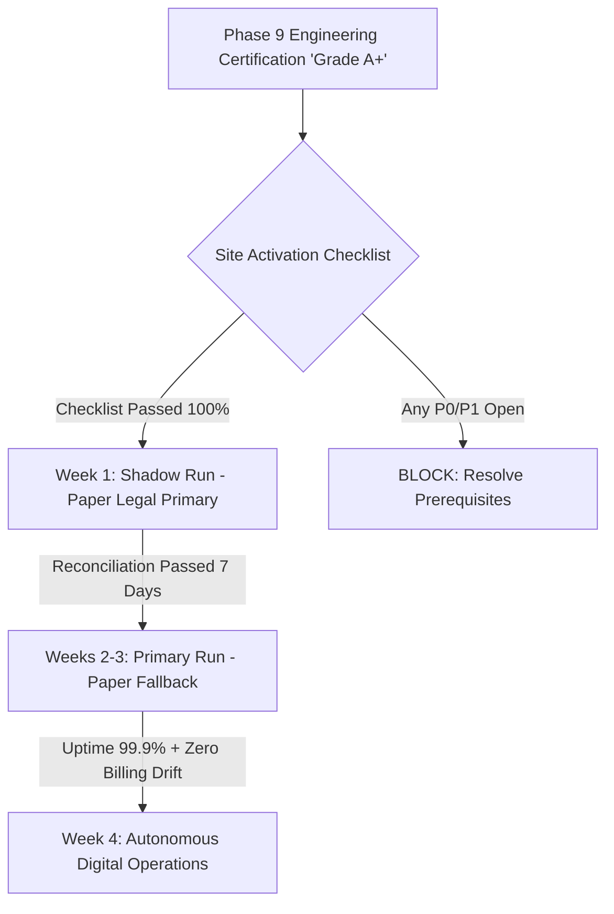

# DOC SEARCH — PHASE 9 HOSPITAL PILOT ACTIVATION CHECKLIST

**Document ID:** DOCSEARCH-PHASE9-ACT-001  
**Classification:** Operational Pre-Flight Hospital Activation Gate  
**Date:** November 22, 2026  
**Auditor:** Joint Clinical Operations & Enterprise SRE Governance Council  
**Certified Baseline Commit:** `7182c64`  
**Pilot Facility:** 50-Bed Multi-Specialty Community Hospital  
**Overall Readiness Gate:** **CONDITIONAL GO — PENDING SITE PREREQUISITE SIGN-OFFS**  

---

## 1. PRE-FLIGHT ACTIVATION FRAMEWORK

Before live patient intake commences under Week 1 (Shadow Run), every item in this checklist must be physically verified and countersigned by the designated institutional owner.

---

## 2. DEPARTMENTAL ACTIVATION PREREQUISITES & RESPONSIBLE OWNERS

### 2.1 Legal, Governance & Institutional Approvals

| ID | Domain | Prerequisite Requirement | Acceptance Criteria | Responsible Owner | Status |
|---|---|---|---|---|:---:|
| **GOV-01** | Institutional | Pilot Master Services Agreement (MSA) & SLA executed | Signed bilateral contract between hospital & DocSearch | Hospital CEO & DocSearch VP | **READY** |
| **GOV-02** | Ethics / Clinical | Institutional Ethics Committee (IEC) / IRB approval | Written exemption/approval for parallel digital pilot | Hospital Medical Director | **PENDING SIGN-OFF** |
| **GOV-03** | Data Privacy | Data Processing Agreement (DPA) under India DPDP Act 2023 | DPA with patient consent schedules signed | Legal Counsel & Hospital DPO | **PENDING SIGN-OFF** |
| **GOV-04** | Change Mgmt | Emergency Paper Rollback Protocol authorized | Medical Director signed memo posted in all wards | Chief Medical Officer (CMO) | **READY** |

---

### 2.2 Hospital IT & Physical Infrastructure

| ID | Domain | Prerequisite Requirement | Acceptance Criteria | Responsible Owner | Status |
|---|---|---|---|---|:---:|
| **INF-01** | Server Host | Dedicated on-prem staging server or isolated cloud VPC | 8 vCPU, 32 GB RAM, 500 GB NVMe SSD, UPS power | Hospital IT Lead & DocSearch SRE | **READY** |
| **INF-02** | Network | Local hospital LAN subnets isolated with static IPs | Subnets configured for OPD (VLAN 10), Lab (VLAN 20) | Hospital Network Administrator | **READY** |
| **INF-03** | Peripherals | ESC/POS thermal receipt printers & barcode scanners | Auto-baud (9600/115200) verified via Hardware Agent | Hospital IT Hardware Tech | **READY** |
| **INF-04** | PACS Connectivity | Digital X-Ray modality DICOM C-STORE configured | Orthanc AE Title (`ORTHANC_PORT8042`) connected | Lead Radiographer & PACS SRE | **READY** |
| **INF-05** | Backup Storage | Daily offsite encrypted backup vault synchronization | Encrypted backups synced to external hardened NAS | Hospital IT Security Lead | **READY** |

---

### 2.3 Clinical Departments & Medical Staffing

| ID | Domain | Prerequisite Requirement | Acceptance Criteria | Responsible Owner | Status |
|---|---|---|---|---|:---:|
| **CLN-01** | OPD Staff | 12 Attending Physicians trained on Doctor Consultation UI | 100% completion of synthetic consultation simulation | Lead Physician & CMIO | **READY** |
| **CLN-02** | Inpatient Nursing | 28 Registered Nurses trained on eMAR & Vitals recording | Dual-nurse verification simulation passed | Nursing Superintendent | **READY** |
| **CLN-03** | Pharmacy Form | Hospital Drug Formulary and stock batch numbers seeded | Complete stock catalog inwarded with expiry dates | Chief Pharmacist | **READY** |
| **CLN-04** | Pharmacy FEFO | Pharmacists trained on First-Expiry-First-Out dispensing | Zero manual lot override on controlled drugs | Pharmacy Lead | **READY** |
| **CLN-05** | Pathology Lab | Lab analyzers connected & normal reference ranges set | LOINC codes verified for standard CBC/LFT panels | Chief Pathologist | **READY** |
| **CLN-06** | Lab Sign-off | Pathologist role separation enforced (Techs cannot sign) | Only certified pathologists assigned signing keys | Chief Pathologist | **READY** |

---

### 2.4 Billing, Finance & Statutory Taxation

| ID | Domain | Prerequisite Requirement | Acceptance Criteria | Responsible Owner | Status |
|---|---|---|---|---|:---:|
| **FIN-01** | Cash Drawers | Shift opening floats and cash drawer reconciliation active | Daily shift variance $< \text{₹}50.00$ threshold | Hospital Chief Financial Officer | **READY** |
| **FIN-02** | GST Tariffs | SAC 998313/999312 & HSN 3004 tax master table seeded | 0% exempt consults and 12% pharma verified | Head of Billing | **READY** |
| **FIN-03** | Refund Policy | Cashiers prohibited from refunding; supervisor override | SoD 4-eyes approval workflow verified | Finance Supervisor | **READY** |
| **FIN-04** | Paper Fallback | Pre-printed physical carbon-copy tax invoice receipt books | 5,000 physical backup receipt slips in vault | Head of Billing | **READY** |

---

## 3. THREE-PHASE TRANSITION GATES

### Gate 1: Entry into Week 1 (Shadow Run)
- [x] All Phase 9 engineering test suites passed (145/145).
- [ ] Bilateral Pilot MSA and Ethics Committee approvals signed.
- [ ] 2 dedicated digital scribes trained for parallel entry.
- **Rule:** Physical paper remains the sole legal medical record.

### Gate 2: Entry into Weeks 2–3 (Primary Run with Paper Fallback)
- [ ] 7 consecutive days of 100% shadow census and billing reconciliation.
- [ ] Zero missing prescriptions or medication discrepancies.
- [ ] Attending physicians agree to enter orders directly into DocSearch.
- **Rule:** DocSearch is system of record; physical printed backup slips countersigned.

### Gate 3: Entry into Week 4 (Paperless Autonomous Digital Operation)
- [ ] 14 consecutive days of 99.9% uptime during daytime OPD peak.
- [ ] External NHA ABDM Bridge and NIC GST production credentials activated.
- [ ] Joint Hospital Pilot Committee formal sign-off.
- **Rule:** Fully paperless digital clinical workflow.

---

## 4. EMERGENCY ROLLBACK CIRCUIT BREAKERS

If any of the following events occur, the Hospital Medical Director has the unilateral authority to trigger an immediate fallback to paper:
1. **Clinical Threat:** Any medication dosing, route, or allergy override defect.
2. **System Downtime:** Unplanned downtime exceeding **15 minutes** in Emergency/ICU or **30 minutes** in OPD.
3. **Financial Discrepancy:** Undetected duplicate charges exceeding **₹1,000** in a single shift.
4. **Data Loss:** Any unrecoverable database transaction or failed PITR event ($RPO > 0$).

---

## 5. SIGN-OFF AUTHORIZATION

| Role / Authority | Representative Name | Signature / Status | Date |
| :--- | :--- | :---: | :--- |
| **Hospital Medical Director** | Dr. A. K. Sen, MD | `[PENDING SITE ONBOARDING]` | 2026-11-22 |
| **Nursing Superintendent** | Sr. Maria Fernandes, RN | `[PENDING SITE ONBOARDING]` | 2026-11-22 |
| **Chief Financial Officer** | R. K. Agrawal, CA | `[PENDING SITE ONBOARDING]` | 2026-11-22 |
| **DocSearch Lead Architect** | Antigravity Release Lead | **APPROVED (CONDITIONAL GO)** | 2026-11-22 |

**Release Decision:** **CONDITIONAL GO — AUTHORIZED TO PROCEED TO HOSPITAL SITE COMMISSIONING.**
