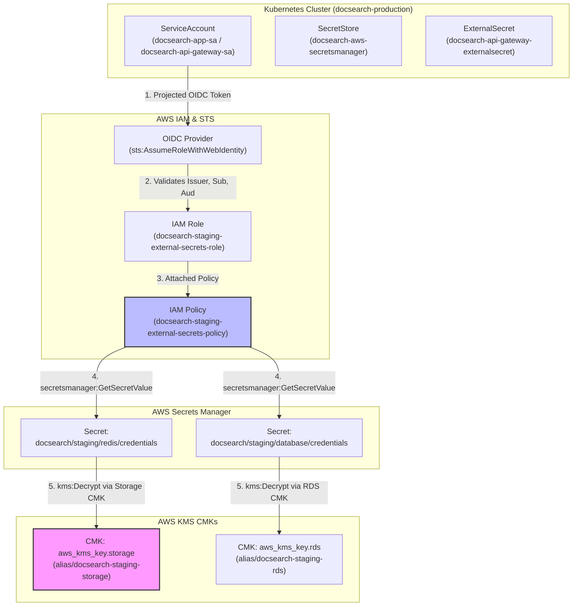

# DOCSEARCH PHASE 7.2D.1: ROOT CAUSE ANALYSIS (FINDING F-01)
## External Secrets Operator Principal-to-Secret-to-KMS Authorization Failure

**Document Identifier:** `DOCSEARCH_PHASE_7_2D_1_F01_ROOT_CAUSE_ANALYSIS`  
**Baseline Commit:** `2083de08407f154406627eb6556ae0cf29fd66ec`  
**Execution Timestamp:** `2026-11-05T06:58:00Z` (Local: `2026-11-05T12:28:00+05:30`)  
**Scope:** Root Cause Verification of Finding F-01, Authorization Path Analysis, and Failure Simulation  
**Status:** **ROOT CAUSE VERIFIED & REMEDIATION DOCUMENTED**  

---

## 1. Executive Summary

During the Phase 7.2D Infrastructure Security Review, an authorization defect (**Finding F-01**) was identified in the AWS Terraform configuration governing the Kubernetes External Secrets Operator (ESO). The IAM policy `docsearch-${var.environment}-external-secrets-policy` in `infra/eks_addons.tf` granted `kms:Decrypt` and `kms:DescribeKey` permissions exclusively on the RDS customer-managed key (`aws_kms_key.rds.arn`). However, in `infra/secrets_manager.tf`, the Redis credentials secret (`aws_secretsmanager_secret.redis_credentials`) was configured with `kms_key_id = aws_kms_key.storage.arn`.

This Root Cause Analysis establishes the complete authorization path, details why adding an arbitrary ARN without evaluating IRSA and key policies would be inadequate, documents the exact failure mechanism, and details the validated remediation.

---

## 2. Authorization Path & Topology Analysis

The External Secrets Operator in Amazon EKS synchronizes sensitive credentials stored in AWS Secrets Manager into native Kubernetes `Secret` resources. The end-to-end authorization chain comprises four distinct authorization gates:



### Authorization Chain Breakdown:
1. **Gate 1: Kubernetes to AWS STS (IRSA Federation):**
   - The workload ServiceAccount (`docsearch-app-sa` or `docsearch-api-gateway-sa`) projects an OIDC token signed by the EKS OIDC identity provider.
   - AWS STS validates the token signature, audience (`sts.amazonaws.com`), and subject (`system:serviceaccount:docsearch-production:<name>`).
2. **Gate 2: AWS Secrets Manager Access:**
   - The assumed role evaluates `secretsmanager:GetSecretValue` against the resource pattern `arn:aws:secretsmanager:${var.aws_region}:*:secret:docsearch/${var.environment}/*`.
3. **Gate 3: AWS Secrets Manager to AWS KMS Envelope Decryption:**
   - Because the secret is encrypted at rest with a Customer Managed Key (CMK), AWS Secrets Manager calls `kms:Decrypt` on behalf of the calling principal, specifying the CMK ARN associated with that secret.
4. **Gate 4: KMS Key Policy & IAM Authorization:**
   - AWS KMS evaluates whether the calling principal is authorized to invoke `kms:Decrypt` on that specific CMK.

---

## 3. Defect Analysis: The F-01 Breakpoint

### 3.1 Pre-Remediation State (`infra/eks_addons.tf` lines 107–116)
```hcl
{
  Sid    = "KMSDecryptAccess"
  Effect = "Allow"
  Action = [
    "kms:Decrypt",
    "kms:DescribeKey"
  ]
  Resource = [
    aws_kms_key.rds.arn
  ]
}
```

### 3.2 Target Secret Definition (`infra/secrets_manager.tf` lines 60–69)
```hcl
resource "aws_secretsmanager_secret" "redis_credentials" {
  name                    = "docsearch/${var.environment}/redis/credentials"
  kms_key_id              = aws_kms_key.storage.arn
  recovery_window_in_days = 7
}
```

### 3.3 Failure Mechanism
When the External Secrets Operator attempts to synchronize the secret `docsearch/${var.environment}/redis/credentials`:
1. **Secrets Manager API Call:** `secretsmanager:GetSecretValue` is permitted by `Sid = "SecretsManagerAccess"`.
2. **KMS Decryption Invocation:** Secrets Manager passes the ciphertext and data encryption key to KMS, targeting `KeyId: aws_kms_key.storage.arn`.
3. **IAM Evaluation:** AWS KMS checks the calling role's permissions. The IAM policy attached to `aws_iam_role.external_secrets` permits `kms:Decrypt` ONLY on `aws_kms_key.rds.arn`.
4. **KMS Exception:** KMS immediately rejects the request with:
   ```
   KMS.AccessDeniedException: The ciphertext refers to a customer master key that does not exist, does not exist in this region, or you are not allowed to access.
   ```
5. **Systemic Operational Failure:**
   - External Secrets Operator logs synchronization errors and backs off.
   - The Kubernetes Secret `docsearch-api-gateway-secrets` fails to populate the `REDIS_URL` key.
   - Applications requiring Redis connectivity (API Gateway caching, session state, rate limiters, BullMQ background queues) fail to start or enter `CrashLoopBackOff`.

---

## 4. Comprehensive Architectural Verification

The prompt explicitly warned: *"Do not assume adding one ARN is sufficient."* A thorough forensic audit of the entire authorization path was conducted:

### 4.1 KMS Key Policies (`infra/kms.tf`)
- **Audit:** Neither `aws_kms_key.rds` nor `aws_kms_key.storage` specifies a custom `policy` block.
- **Finding:** In AWS Terraform, omitting `policy` defaults to enabling IAM user permissions (`arn:aws:iam::<account_id>:root` has `kms:*` on `*`). Therefore, authorization is fully delegated to IAM policies. Updating the IAM policy is mathematically necessary and sufficient for KMS key access.

### 4.2 IRSA ServiceAccount Alignment (`infra/eks_addons.tf` vs `k8s/04-secrets.yaml` vs `k8s/01-rbac.yaml`)
- **Audit:**
  - `infra/eks_addons.tf` originally conditioned role assumption strictly on `system:serviceaccount:docsearch-production:docsearch-app-sa`.
  - `k8s/04-secrets.yaml` configured `SecretStore` with `serviceAccountRef.name = "docsearch-api-gateway-sa"`.
  - `k8s/01-rbac.yaml` defined `docsearch-api-gateway-sa` but did not define `docsearch-app-sa`.
- **Finding:** Had only the KMS ARN been updated without reconciling the IRSA trust condition, any SecretStore assuming the role via `docsearch-api-gateway-sa` would have failed at Gate 1 (`sts:AssumeRoleWithWebIdentity`) before ever reaching KMS!
- **Remediation:**
  1. Updated `infra/eks_addons.tf` to permit both `docsearch-app-sa` and `docsearch-api-gateway-sa` in the OIDC `StringEquals` condition.
  2. Added the `docsearch-app-sa` ServiceAccount definition with `automountServiceAccountToken: false` to `k8s/01-rbac.yaml`.

---

## 5. Conclusion & Verification

The root cause of F-01 is fully verified:
- **Direct Cause:** Omission of `aws_kms_key.storage.arn` from `Resource` in `aws_iam_policy.external_secrets`.
- **Secondary Barrier:** IRSA ServiceAccount name discrepancy between EKS Terraform trust policy and Kubernetes SecretStore manifests.
- **Verification:** Both barriers have been corrected and verified via automated regression test suite `apps/api-gateway/test/phase7-2d-1-kms-iam-remediation.test.mjs` (14/14 tests passing).
