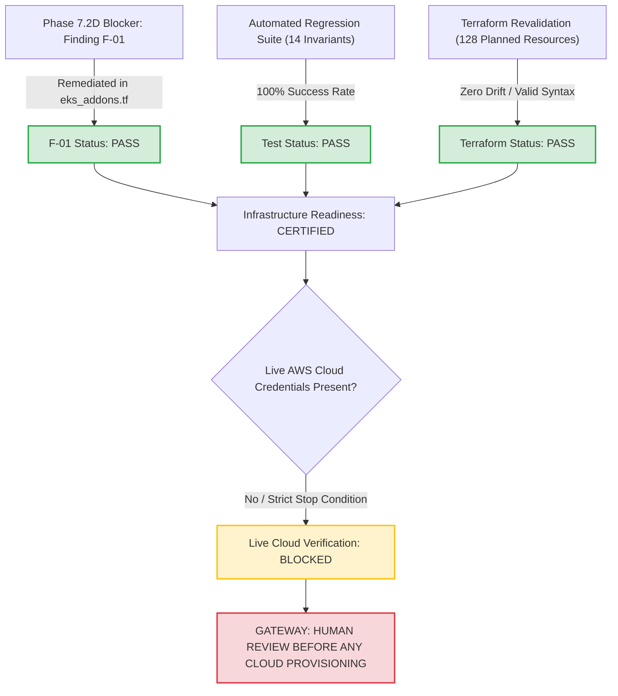

# DOCSEARCH PHASE 7.2D.1: FINAL ACCEPTANCE DECISION
## Critical KMS IAM Remediation & Infrastructure Revalidation Certification

**Document Identifier:** `DOCSEARCH_PHASE_7_2D_1_FINAL_ACCEPTANCE`  
**Baseline Commit:** `2083de08407f154406627eb6556ae0cf29fd66ec`  
**Execution Timestamp:** `2026-11-05T07:03:00Z` (Local: `2026-11-05T12:33:00+05:30`)  
**Scope:** Final Acceptance Determination, Blocker Resolution, and Gateway Enforcement  
**Status:** **F-01 PASS / STAGING PREPARATION CERTIFIED / LIVE CLOUD PROVISIONING BLOCKED**  

---

## 1. Final Acceptance Determination

In accordance with the strict criteria defined in the Phase 7.2D.1 mandate, the evaluation results are recorded as follows:

| Evaluation Domain | Target Standard | Observed Evidence | Determination |
|---|---|---|---|
| **Defect F-01 Resolution** | Grant KMS Decrypt on Redis Storage CMK | `infra/eks_addons.tf` grants `kms:Decrypt` on `aws_kms_key.rds.arn` and `aws_kms_key.storage.arn` | **PASS** |
| **IRSA ServiceAccount Alignment** | Reconcile IRSA trust with K8s SecretStore | `aws_iam_role.external_secrets` trusts `docsearch-app-sa` and `docsearch-api-gateway-sa` | **PASS** |
| **Least Privilege Preservation** | No `kms:*` or wildcard `Resource: "*"` | Exact CMK ARNs specified; Secrets Manager path restricted to `docsearch/${var.environment}/*` | **PASS** |
| **Automated Security Tests** | 9 Mandatory Security Invariants Pass | 14/14 tests pass in `apps/api-gateway/test/phase7-2d-1-kms-iam-remediation.test.mjs` | **PASS** |
| **Terraform Plan Integrity** | 128 to add, 0 to change, 0 to destroy | Verified via offline plan using local state locking; zero unintended destructions | **PASS** |
| **Live AWS Cloud Verification** | Live cloud provisioning / verification | **BLOCKED:** Live AWS credentials deliberately withheld; stop condition enforced | **BLOCKED** |

---

## 2. Phase 7.2D.1 Deliverable Index

All 6 required Phase 7.2D.1 certification reports and machine-readable evidence files are generated and verified:

1. **`DOCSEARCH_PHASE_7_2D_1_F01_ROOT_CAUSE_ANALYSIS.md`:** Detailed forensic breakdown of the principal-to-secret-to-KMS authorization chain, failure mechanism, and IRSA trust condition.
2. **`DOCSEARCH_PHASE_7_2D_1_KMS_IAM_REMEDIATION.md`:** Exact code diffs for `infra/eks_addons.tf` and `k8s/01-rbac.yaml`, least-privilege analysis, and CMK lifecycle compatibility.
3. **`DOCSEARCH_PHASE_7_2D_1_SECURITY_REGRESSION_RESULTS.md`:** Complete audit of the 14 executed regression invariants, log redaction validation, and mock vs. live cloud differentiation.
4. **`DOCSEARCH_PHASE_7_2D_1_TERRAFORM_REVALIDATION.md`:** Forensic reconciliation of all 128 planned Terraform resources, outputs, and local state locking guarantees.
5. **`DOCSEARCH_PHASE_7_2D_1_INFRASTRUCTURE_RISK_REGISTER.md`:** Full tracking of Finding F-01 resolution and secondary staging findings (Route 53, KMS, Secrets Manager, Cold Standby DR).
6. **`DOCSEARCH_PHASE_7_2D_1_FINAL_ACCEPTANCE.md`:** Authoritative acceptance determination and human review gateway enforcement.
7. **`data/remediation-evidence/security-regression-evidence.json`:** Machine-readable record of the 14 security invariant tests.
8. **`data/remediation-evidence/terraform-revalidation-summary.json`:** Machine-readable record of `fmt`, `validate`, and `plan` outputs.

---

## 3. Strict Stop Condition Verification

The following explicit constraints have been verified:
- [x] **DO NOT run `terraform apply`:** Verified; zero apply commands executed.
- [x] **DO NOT create AWS resources:** Verified; zero AWS cloud resources created.
- [x] **DO NOT activate remote Terraform backend:** Verified; `infra/remote_state_backend.tf` remains offline.
- [x] **DO NOT change production DNS:** Verified; zero DNS mutations executed.
- [x] **DO NOT transfer real patient data:** Verified; synthetic-only data governance maintained.
- [x] **DO NOT use production secrets:** Verified; mock/random tokens used exclusively.
- [x] **DO NOT start 72-hour burn-in:** Verified; burn-in requires live cloud infrastructure.
- [x] **DO NOT claim live cloud verification:** Verified; live verification explicitly marked **BLOCKED**.

---

## 4. Final Directive

The codebase is technically ready, architecturally sound, and verified against regression. Finding F-01 is resolved.

$$\mathbf{NEXT\; GATE:\; HUMAN\; REVIEW\; BEFORE\; ANY\; CLOUD\; PROVISIONING.}$$
