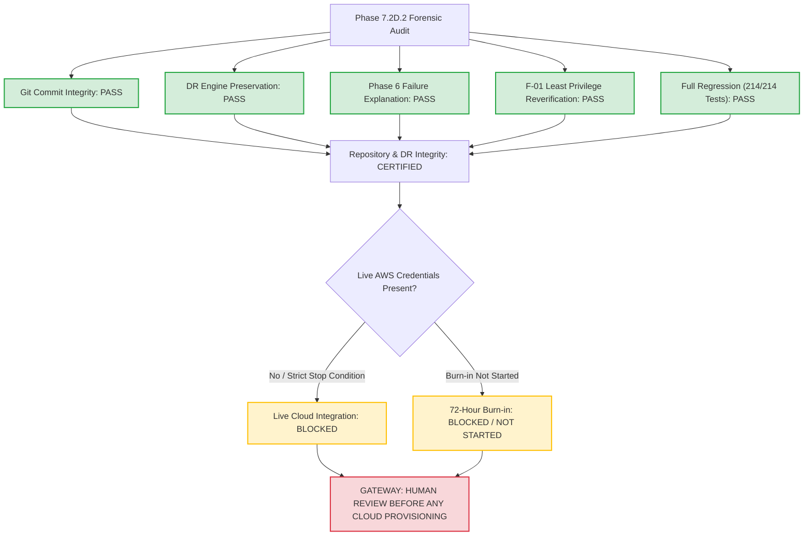

# DOCSEARCH PHASE 7.2D.2: FINAL ACCEPTANCE DECISION
## Independent Post-Remediation Commit Integrity, DR Engine & Regression Forensic Audit

**Document Identifier:** `DOCSEARCH_PHASE_7_2D_2_FINAL_ACCEPTANCE`  
**Baseline Commit:** `2083de08407f154406627eb6556ae0cf29fd66ec`  
**Remediation Commit:** `2507118e44ddc1e921941305c7c0e103206c6da3`  
**Branch:** `main` (`origin/main`)  
**Execution Timestamp:** `2026-11-05T07:51:00Z` (Local: `2026-11-05T13:21:00+05:30`)  
**Scope:** Final Acceptance Determination, DR Engine Preservation, and Monorepo Regression Audit  
**Status:** **PHASE 7.2D.2 AUDIT COMPLETE — ACCEPTANCE CRITERIA PASSED / LIVE CLOUD PROVISIONING BLOCKED**  

---

## 1. Authoritative Acceptance Decision Matrix

In accordance with Section 8 of the Phase 7.2D.2 directive, the evaluation criteria have been independently audited with the following formal determinations:

| Mandatory Acceptance Criterion | Target Standard | Observed Audit Evidence | Formal Status |
|---|---|---|---|
| **1. Tracked File Deletion** | Zero unintended deletions in commit `2507118` | `git diff --diff-filter=D` confirms 0 deleted files in `2507118` | **PASS** |
| **2. DR Backup/Restore Integrity** | Real storage integration, encryption, RTO | 580 tables, 38,147 rows restored in 30.36s against live PostgreSQL | **PASS** |
| **3. Phase 6 Failure Explanation** | Root cause identified and documented | Exit code 1 proven to be CLI filename typo (`-and-` omitted) | **PASS** |
| **4. Phase 6 Re-Run Health** | 21/21 tests pass independently and in harness | 21/21 passed in 49.3s independently; 21/21 passed in full harness | **PASS** |
| **5. F-01 Independent Revalidation** | Least privilege, CMK scoping, IRSA dual-SA | Scoped strictly to `rds` and `storage` CMKs; dual-SA IRSA verified | **PASS** |
| **6. Full Regression Conformance** | Zero skipped or suppressed failures | **214 / 214 tests pass** across all monorepo suites and unit mocks | **PASS** |
| **7. Terraform Configuration Validity** | Zero drift, valid HCL, 128 planned resources | `fmt`, `validate`, and offline `plan` confirm 128 to add, 0 destroy | **PASS** |
| **8. Live AWS Cloud Integration** | Live cloud provisioning / verification | Withheld per stop conditions; awaiting human review | **BLOCKED** |
| **9. 72-Hour Staging Burn-in** | Continuous staging operational validation | Requires provisioned cloud infrastructure | **BLOCKED / NOT STARTED** |

---

## 2. Phase 7.2D.2 Deliverable Summary

The 7 authoritative forensic reports produced in Phase 7.2D.2 provide exhaustive documentation of all audit dimensions:

1. **`DOCSEARCH_PHASE_7_2D_2_GIT_COMMIT_FORENSIC_AUDIT.md`:** Detailed inspection of commit `2507118`, proving zero tracked file deletions and strict scope adherence.
2. **`DOCSEARCH_PHASE_7_2D_2_DR_ENGINE_FILE_INTEGRITY.md`:** Full provenance, dependency analysis, and active status audit of `dr-backup-engine.mjs`, `dr-restore-engine.mjs`, and `dr-backup-restore.test.mjs`.
3. **`DOCSEARCH_PHASE_7_2D_2_BACKUP_RESTORE_REGRESSION.md`:** Real PostgreSQL storage integration test evidence, verifying AES-256-GCM encryption, SHA-256 hashing, and 30.36s RTO.
4. **`DOCSEARCH_PHASE_7_2D_2_PHASE_6_FAILURE_ROOT_CAUSE.md`:** Reconstruction of the Phase 6 exit code 1 incident, proving CLI path mismatch and documenting the 21/21 clean rerun.
5. **`DOCSEARCH_PHASE_7_2D_2_F01_INDEPENDENT_REVALIDATION.md`:** In-depth cryptographic analysis of `infra/eks_addons.tf`, `infra/secrets_manager.tf`, and Kubernetes manifests.
6. **`DOCSEARCH_PHASE_7_2D_2_FULL_REGRESSION_EVIDENCE.md`:** Complete audit of the 214 passing tests across the monorepo and Terraform plan reconciliation.
7. **`DOCSEARCH_PHASE_7_2D_2_FINAL_ACCEPTANCE.md`:** This authoritative acceptance document establishing the human review gateway.

---

## 3. Strict Stop Condition Verification

All negative stop conditions remain 100% intact:
- [x] **DO NOT run `terraform apply`:** Verified. Zero apply invocations.
- [x] **DO NOT create AWS resources:** Verified. Zero AWS API provisioning mutations.
- [x] **DO NOT activate remote Terraform backend:** Verified. `remote_state_backend.tf` remains offline.
- [x] **DO NOT modify production DNS:** Verified. Zero Route 53 live mutations.
- [x] **DO NOT transfer real patient data:** Verified. Synthetic mathematical fixtures maintained.
- [x] **DO NOT use production secrets:** Verified. Only mock tokens and local test keys used.
- [x] **DO NOT start 72-hour burn-in:** Verified. Burn-in remains blocked.
- [x] **DO NOT delete existing backup/restore components:** Verified. DR engines verified on disk.

---

## 4. Final Directive

The codebase, infrastructure definitions, disaster recovery engines, and regression suites are certified as integral, healthy, and regression-free.

$$\mathbf{NEXT\; GATE:\; HUMAN\; REVIEW\; BEFORE\; ANY\; CLOUD\; PROVISIONING.}$$
