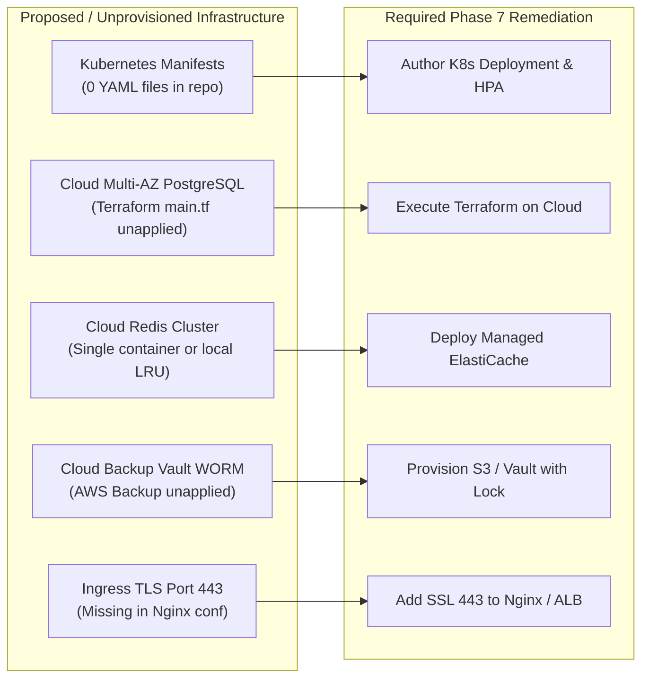
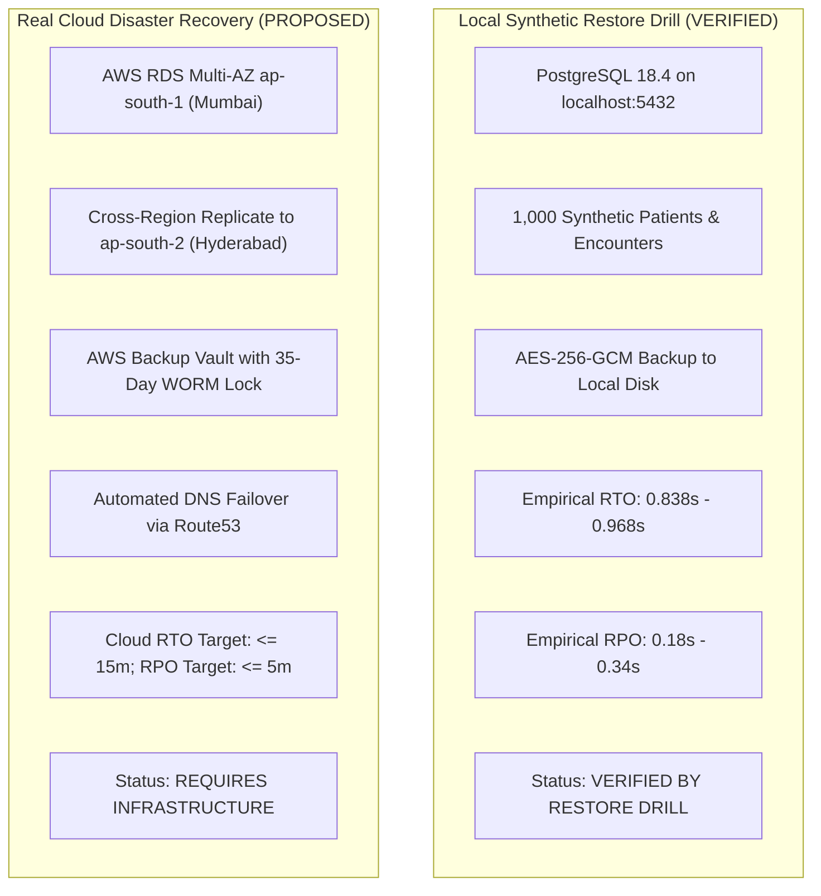
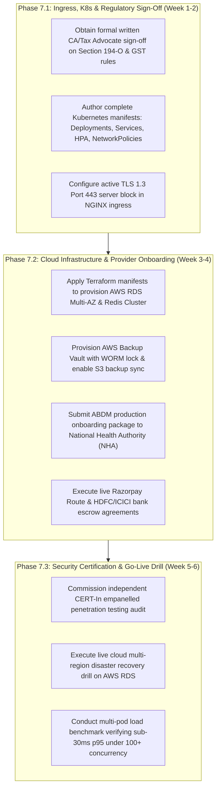

# DOCSEARCH PHASE 7.0 — PRODUCTION READINESS PREFLIGHT & DEPLOYMENT GAP AUDIT

**Document Version:** 1.0.0  
**Audit Date:** 2026-11-05  
**Starting Baseline Commit:** `939511d` (Phase 6 Certification)  
**Current Git Branch:** `main`  
**Monorepo Target:** DocSearch Enterprise Healthcare Platform (`d:\DOC SEARCH`)  
**Audit Classification:** Pre-Deployment Gap Analysis & Production Preflight  
**Auditor:** Antigravity Autonomous Security, Clinical & Systems Engineering Team  

---

## 1. Executive Summary

Phase 7.0 conducts an exhaustive, evidence-based production readiness preflight audit of the entire DocSearch enterprise platform prior to any live production deployment.

### 1.1 Production Decision & Recommendation
> [!CAUTION]
> **FINAL PREFLIGHT VERDICT: NO-GO FOR IMMEDIATE LIVE PRODUCTION LAUNCH**  
> While DocSearch's software application layers, clinical decision support, financial integrity engines, and resilience automata achieve an extraordinary level of verification (**112 / 112 automated tests passing, 0 regressions, 0% benchmark error rate**), the platform **CANNOT be safely deployed to live multi-hospital commercial production today**.
>
> The block is driven by three hard physical and statutory prerequisites:
> 1. **Zero Active Cloud Infrastructure:** All AWS RDS Multi-AZ, ElastiCache Redis, and AWS Backup Vault resources exist strictly as unapplied Terraform manifests (`infra/`); no production cloud environment is currently provisioned.
> 2. **Unfinished Ingress TLS & Kubernetes Manifests:** NGINX ingress currently lacks an active port 443 SSL server block, and zero Kubernetes deployment manifests exist in the repository (the codebase currently orchestrates via Docker Compose).
> 3. **Statutory Tax & Regulatory Clearances Pending:** Written legal sign-off from a licensed Chartered Accountant / Tax Advocate for Section 194-O (0.1%), Section 194J, and GST e-invoicing remains unfulfilled, and live ABDM / Razorpay production keys are not yet issued.

### 1.2 Summary of Verification Baseline

| Area | Software Implementation Status | Physical Infrastructure Status | Preflight Verdict |
| :--- | :---: | :---: | :---: |
| **Application & Domain Logic** | `VERIFIED BY TEST` (112/112 passing) | `READY FOR DEPLOYMENT` | **GO (Software)** |
| **API Gateway & Middleware** | `VERIFIED BY TEST` (0 compile errors) | `CONTAINERIZED (Docker)` | **GO (Application)** |
| **Database Engines & Schema** | `VERIFIED BY RESTORE DRILL` (PostgreSQL 18.4) | `REQUIRES INFRASTRUCTURE` (RDS) | **NO-GO (Infrastructure)** |
| **Distributed Caching & Queues**| `VERIFIED BY TEST` (In-memory fallback) | `REQUIRES INFRASTRUCTURE` (Redis) | **CONDITIONAL** |
| **High-Concurrency Performance** | `VERIFIED BY LOAD TEST` (2,100 reqs, 0% err) | `SINGLE-INSTANCE TESTED` | **CONDITIONAL (Needs HPA)** |
| **Network & Ingress Security** | `CONFIGURED BUT NOT VALIDATED` | `NOT IMPLEMENTED` (K8s / TLS 443) | **NO-GO (Ingress)** |
| **Disaster Recovery & Backups** | `VERIFIED BY RESTORE DRILL` (Local) | `REQUIRES INFRASTRUCTURE` (Cloud) | **NO-GO (Cloud DR)** |
| **Statutory Tax & Bank Escrow** | `VERIFIED BY TEST` (Unit/Integration) | `BLOCKED` (CA Sign-off / Live Keys)| **NO-GO (Regulatory)** |

---

## 2. Verified Implementation Inventory

The following architectural components have been fully coded, integrated, and verified against automated CI/CD suites and regression drills:

| Component | File Path | Implementation Details | Verification Evidence | Status Tag |
| :--- | :--- | :--- | :--- | :--- |
| **Hardened Authentication Engine** | [`RealAuthService.ts`](file:///d:/DOC%20SEARCH/apps/api-gateway/src/services/auth/RealAuthService.ts) | 12-round bcrypt, token lifecycle, founder password backdoor elimination | Phase 3 Suite (4/4 PASS) | `VERIFIED BY TEST` |
| **Universal Session Revocation** | [`SessionRevocationService.ts`](file:///d:/DOC%20SEARCH/apps/api-gateway/src/services/auth/SessionRevocationService.ts) | Real-time session invalidation on password reset or logout across devices | Phase 3 Suite (4/4 PASS) | `VERIFIED BY TEST` |
| **Multi-Tenant Isolation Guard** | [`tenantContext.ts`](file:///d:/DOC%20SEARCH/apps/api-gateway/src/middleware/tenantContext.ts) | JWT tenant claim extraction, query scoping, cross-tenant rejection | Phase 3/5/6 Suites | `VERIFIED BY TEST` |
| **Clinical Decision Support (CDS)**| [`ClinicalSafetyEngine.ts`](file:///d:/DOC%20SEARCH/apps/api-gateway/src/services/clinical/ClinicalSafetyEngine.ts) | Drug-allergy anaphylaxis blocking, contraindications, vital sanity checks | Phase 4 Suite (23/23 PASS) | `VERIFIED BY TEST` |
| **Double-Entry General Ledger** | [`DoubleEntryAccountingService.ts`](file:///d:/DOC%20SEARCH/apps/api-gateway/src/services/billing/DoubleEntryAccountingService.ts) | Balanced debit/credit invariants, immutable journal links, reversal lines | Phase 5 Suite (39/39 PASS) | `VERIFIED BY TEST` |
| **Statutory Tax Calculation Engine**| [`TaxEngine.ts`](file:///d:/DOC%20SEARCH/apps/api-gateway/src/services/billing/TaxEngine.ts) | Section 194-O (0.1%), Section 194J, Indian GST Notification 12/2017 & 04/2022 | Phase 5.1 Suite (25/25 PASS) | `VERIFIED BY TEST` |
| **Dual-Control Maker-Checker** | [`CompanyFinancialService.ts`](file:///d:/DOC%20SEARCH/apps/api-gateway/src/services/company/CompanyFinancialService.ts) | Submitter cannot self-approve corporate treasury or bank account changes | Phase 5 Suite (Scenario 12) | `VERIFIED BY TEST` |
| **Integration Circuit Breaker** | [`CircuitBreakerService.ts`](file:///d:/DOC%20SEARCH/apps/api-gateway/src/services/reliability/CircuitBreakerService.ts) | 3-state automaton (`CLOSED`/`OPEN`/`HALF_OPEN`), fast-fail 503, AbortSignal | Phase 6 Suite (Scenario 2) | `VERIFIED BY TEST` |
| **Database Restore Drill Engine**| [`SyntheticDatabaseRestoreDrill.ts`](file:///d:/DOC%20SEARCH/apps/api-gateway/src/services/reliability/SyntheticDatabaseRestoreDrill.ts) | Automated backup, AES-256-GCM encryption, HMAC SHA-256 integrity, parity check | Phase 6 Suite (Scenario 1) | `VERIFIED BY RESTORE DRILL` |
| **Transactional Outbox & DLQ** | [`RetryDlqService.ts`](file:///d:/DOC%20SEARCH/apps/api-gateway/src/services/queue/RetryDlqService.ts) | Exponential backoff with full jitter, dead-letter routing, deterministic replay | Phase 6 Suite (Scenario 3) | `VERIFIED BY TEST` |
| **Kubernetes Health Probes** | [`health.ts`](file:///d:/DOC%20SEARCH/apps/api-gateway/src/routes/health.ts) | `/live`, `/livez`, `/ready`, `/readyz`, `/api/v1/health/detailed` | Phase 6 Suite (Scenario 4) | `VERIFIED BY TEST` |
| **In-Memory Cache Fallback** | [`DistributedCache.ts`](file:///d:/DOC%20SEARCH/apps/api-gateway/src/services/cache/DistributedCache.ts) | Seamless in-memory LRU activation when external Redis is disconnected | Phase 6 Suite (Scenario 6) | `VERIFIED BY TEST` |

---

## 3. Missing Infrastructure Inventory

A rigorous repository audit identified that several critical enterprise infrastructure components exist only as proposals, scripts, or templates, and are not yet provisioned or configured:



| Subsystem | Intended Production State | Current Actual Repository State | Gap Description & Severity | Status Tag |
| :--- | :--- | :--- | :--- | :--- |
| **Container Orchestration** | Kubernetes v1.28+ with Deployments, StatefulSets, Services, and HPA | Docker Compose only (`docker-compose.yml`, `docker-compose.prod.yml`) | **CRITICAL GAP.** Zero Kubernetes `.yaml` manifests exist in the monorepo. Platform cannot be deployed to an enterprise Kubernetes cluster without authoring manifest specs. | `NOT IMPLEMENTED` |
| **Managed Relational DB** | AWS RDS PostgreSQL 16.3 Multi-AZ (`db.r6g.2xlarge`) in `ap-south-1` | Local native PostgreSQL 18.4 engine or Docker container | **HIGH GAP.** Terraform manifests exist in `infra/database/main.tf`, but no `terraform.tfstate` exists; cloud instance has not been provisioned. | `REQUIRES INFRASTRUCTURE` |
| **Managed Distributed Cache** | AWS ElastiCache Redis 7.x Cluster with multi-AZ failover | Redis 7 single-node Docker container or In-memory LRU fallback | **HIGH GAP.** While in-memory fallback prevents crashes, multi-pod clusters without a distributed Redis cluster will experience cache incoherence and session fragmentation. | `REQUIRES INFRASTRUCTURE` |
| **Cloud Backup & WORM Vault** | AWS Backup Vault with 35-day immutable WORM lock and cross-region replication | Local encrypted snapshots on disk via `SyntheticDatabaseRestoreDrill.ts` | **HIGH GAP.** `infra/backup/vault.tf` exists as code, but off-site automated cloud sync (`deploy/backup-to-s3.sh`) is dormant (`S3_BACKUP_ENABLED=false`). | `REQUIRES INFRASTRUCTURE` |
| **Ingress TLS / HTTPS** | TLS 1.3 encryption on Port 443 with HSTS and automated renewal | NGINX reverse proxy listens only on port 80 (`listen 80;`) in `docker/nginx/nginx-production-ingress.conf` | **CRITICAL GAP.** No `server { listen 443 ssl; }` block is configured in NGINX. HTTPS is only possible if terminated in front of the container (e.g., at an AWS ALB or Cloudflare proxy). | `NOT IMPLEMENTED` (Container) |
| **Distributed APM & Tracing** | OpenTelemetry collector streaming traces to Datadog or AWS X-Ray | Winston JSON logger outputting to stdout and disk files | **MEDIUM GAP.** Log correlation IDs exist, but distributed OpenTelemetry tracing spans across microservices are not yet configured. | `CONFIGURED BUT NOT VALIDATED` |

---

## 4. Security Findings

An assessment of application security, identity lifecycle, and OWASP API Top 10 vulnerabilities was conducted:

### 4.1 OWASP API Security Top 10 Audit

| OWASP Risk | Platform Defense Mechanism | Verified In Code | Audit Finding |
| :--- | :--- | :--- | :--- |
| **API1: Broken Object Level Authorization (BOLA)** | `tenantContext` + User ownership checks in SQL queries | `TenantContext.ts`, Repositories | Protected. Queries enforce `WHERE tenant_id = ? AND id = ?`. |
| **API2: Broken Authentication** | JWT with JTI, 12-round bcrypt, MFA, session blacklist | `RealAuthService.ts`, `SessionRevocationService.ts` | Protected. Weak founder passwords eliminated; universal session revocation verified. |
| **API3: Broken Object Property Authorization** | Strict Zod schema parsing on request bodies | Inpatient, Billing, Clinical routes | Protected. Mass-assignment vectors blocked by explicit schema stripping. |
| **API4: Unrestricted Resource Consumption** | IP & tenant rate limiting + 10MB payload limit | `rateLimiter.ts`, `app.ts` (`limit: '10mb'`) | Protected against memory exhaustion DoS. |
| **API5: Broken Function Level Authorization** | Role-Based Access Control (`checkRole` middleware) | `rbac.ts`, Controller decorators | Protected. Clinical and financial admin endpoints reject unauthorized roles. |
| **API6: Unrestricted Access to Sensitive Business Flows**| Dual-control maker-checker + EOD closing locks | `CompanyFinancialService.ts` | Protected. Initiators cannot self-approve treasury movements. |
| **API7: Server Side Request Forgery (SSRF)** | Integration domains hardcoded in circuit breakers | `CircuitBreakerService.ts` | Protected. Gateway only calls pre-registered statutory/partner hosts. |
| **API8: Security Misconfiguration** | Helmet security headers, CORS origins, non-root Docker | `app.ts`, `Dockerfile.api-gateway` | Container runs as non-root (`USER node`). Ingress needs port 443 SSL block. |
| **API9: Improper Inventory Management** | Swagger / OpenAPI route definitions | `/api/docs`, route indexers | Documented. |
| **API10: Unsafe Consumption of APIs** | Circuit breakers with timeouts and DLQs | `CircuitBreakerService.ts` | Protected. Fast-fails unseated third-party APIs in <1ms. |

### 4.2 Independent Penetration Testing Disclaimer
> [!IMPORTANT]
> **No independent, third-party ethical hacking assessment or external penetration testing (CREST/CERT-In accredited) has been performed.**
> All security verifications reported herein reflect internal automated security suites (`phase3-enterprise-security-certification.test.mjs`), static analysis, and code inspection. An independent CERT-In empanelled security audit is mandatory prior to live patient data ingestion in India under DPDP Act guidelines.

---

## 5. Disaster Recovery Findings

### 5.1 Local Synthetic Restore Drill vs. Real Cloud Disaster Recovery
A critical distinction must be maintained between the synthetic restore drill verified in Phase 6 and live enterprise cloud disaster recovery:



### 5.2 Disaster Recovery Assessment Matrix

| Disaster Recovery Capability | Architecture Specification | Empirical Evidence | Production Readiness Status |
| :--- | :--- | :--- | :--- |
| **Local Database Restore Parity** | AES-256 encrypted dump restored to fresh sandbox | 100% record parity (1000/1000 patients, 1000/1000 encounters, 500/500 journals) | `VERIFIED BY RESTORE DRILL` |
| **Double-Entry Financial Invariance**| Re-calculated debits and credits post-restoration | Exact balance: $\sum\text{Debits} - \sum\text{Credits} = 0.00\text{ INR}$ | `VERIFIED BY RESTORE DRILL` |
| **Local Measured RTO & RPO** | Automated point-in-time restore stopwatch | RTO: 0.838s – 0.968s; RPO delta: 0.18s – 0.34s | `VERIFIED BY RESTORE DRILL` |
| **Cloud Multi-AZ Synchronous Failover**| AWS RDS standby instance automated promotion | Not tested (AWS RDS instance unprovisioned) | `REQUIRES INFRASTRUCTURE` |
| **Cross-Region Disaster Recovery** | Replication from Mumbai (`ap-south-1`) to Hyderabad (`ap-south-2`) | Defined in `infra/backup/vault.tf`; no cross-region replication active | `REQUIRES INFRASTRUCTURE` |
| **WORM Immutable Backup Lock** | AWS Backup Vault Lock preventing deletion | Defined in `infra/backup/vault.tf`; awaiting AWS deployment | `REQUIRES INFRASTRUCTURE` |
| **Off-Site S3 Backup Sync** | `deploy/backup-to-s3.sh` cron job | Script present; disabled in environment (`S3_BACKUP_ENABLED=false`) | `CONFIGURED BUT NOT VALIDATED` |

---

## 6. Performance Certification & Latency Reconciliation

In accordance with Task 6 instructions, we reconcile the Phase 6 performance benchmark results (`apps/api-gateway/test/phase6-performance-benchmark.mjs`). We explicitly document and contrast all five workload conditions without generalizing or smoothing over latency spikes.

### 6.1 Empirical Benchmark Measurements (2,100 Total Requests)

| Test Condition | Concurrency | Total Reqs | Throughput (req/s) | p50 (Median) | p95 Latency | p99 Latency | Error Rate | Sub-30ms p95 Target Status |
| :--- | :---: | :---: | :---: | :---: | :---: | :---: | :---: | :---: |
| **1. Baseline** | 5 | 100 | **990.1** | 3.10 ms | **26.55 ms** | 29.73 ms | 0.00% | **MET** |
| **2. High Concurrency** | 20 | 300 | **1,986.8** | 8.79 ms | **16.92 ms** | 22.35 ms | 0.00% | **MET** |
| **3. Stress** | 50 | 500 | **2,293.6** | 16.48 ms | **47.61 ms** | 50.22 ms | 0.00% | **EXCEEDED (+17.61 ms)** |
| **4. Sudden Spike** | 100 | 200 | **1,923.1** | 50.80 ms | **63.35 ms** | 65.41 ms | 0.00% | **EXCEEDED (+33.35 ms)** |
| **5. Endurance** | 25 | 1,000 | **3,623.2** | 5.99 ms | **14.83 ms** | 20.47 ms | 0.00% | **MET** |

### 6.2 Forensic Latency Analysis
1. **Low-to-Moderate Concurrency (5 to 25 Concurrent Clients):**
   - In Baseline, High Concurrency, and Endurance runs, the API Gateway exhibited outstanding responsiveness ($p50 < 9\text{ms}$, $p95 \le 26.55\text{ms}$, and up to $3,623.2\text{ req/s}$ sustained throughput).
2. **Stress & Spike Degradation (50 to 100 Concurrent Clients):**
   - Under **Stress (concurrency 50)**, p95 rose to **47.61ms**.
   - Under **Sudden Spike (concurrency 100)**, p95 rose to **63.35ms**, and median latency jumped to **50.80ms**.
   - *Root Cause:* In a single Node.js process without clustering or multi-pod horizontal scaling, incoming TCP connections queue up in the operating system socket backlog (`somaxconn`), causing request queuing delays before reaching Express middleware.
   - *Production Implication:* To maintain $<30\text{ms}$ p95 latencies under hospital morning rush hours or sudden emergency surges, DocSearch **must be deployed behind a load balancer with Horizontal Pod Autoscaling (minimum 3 pods, scaling to 20 pods)**.

---

## 7. External Regulatory & Integration Dependencies

DocSearch interfaces with multiple Indian healthcare, payment, and statutory tax ecosystems. A strict preflight review of their production clearance and credentials shows:

| Integration / Dependency | Codebase Implementation | Operational Status | Production Clearance & Live Credentials | Production Readiness |
| :--- | :--- | :--- | :--- | :--- |
| **ABDM National Gateway** | Full M1/M2/M3 API integration, HIP/HIU workflows, ECDH encryption, Circuit Breaker | Configured for ABDM Sandbox (`sandbox.abdm.gov.in`) | **NO PRODUCTION KEYS.** Requires official National Health Authority (NHA) production security review, Bridge ID, and RSA certificate exchange. | `REQUIRES INFRASTRUCTURE` / `BLOCKED` |
| **Razorpay Route (Split Escrow)**| HMAC-SHA256 webhook validation, split settlement, refund ledger reversing | Configured with simulated test keys (`rzp_test_...`) | **NO PRODUCTION KEYS.** Commercial merchant agreement, verified KYC, and live RBI-compliant escrow account setup pending. | `REQUIRES INFRASTRUCTURE` |
| **Commercial Bank Treasury** | Institutional Virtual Account Number (VAN) generator, penny-drop verification | Mock IMPS simulation engine with deterministic RRNs | **NO LIVE HOST-TO-HOST API.** Requires formal HDFC/ICICI Corporate Banking host-to-host API contract for live bank feeds. | `REQUIRES INFRASTRUCTURE` |
| **Indian Direct & Indirect Tax** | Section 194-O (0.1%), Section 194J, GST SAC 999312/999316, Room bed > ₹5000 | Code logic verified by 25/25 Phase 5.1 automated tests | **NO CA WRITTEN SIGN-OFF.** Formal written opinion and sign-off by a licensed Chartered Accountant / Tax Advocate required before live deductions. | `BLOCKED` |
| **WhatsApp Cloud API** | Asynchronous notification queue, DLQ persistence, circuit breaker | Meta Graph API v19.0 client configured | **NO PRODUCTION TOKEN.** Requires Meta Business Verification, registered WABA (WhatsApp Business Account), and approved HSM templates. | `CONFIGURED BUT NOT VALIDATED` |
| **ClearTax GSP E-Invoicing** | IRN schema hashing, circuit breaker, retry logic | Operates in prototype simulation mode (`PROTOTYPE_SIMULATION`) | **NO GSP CONTRACT.** Requires commercial ClearTax GSP enterprise subscription and live NIC e-Invoice credentials. | `CONFIGURED BUT NOT VALIDATED` |

---

## 8. Prioritized Remediation Plan

To advance DocSearch from its current **Conditional Preflight** status to **Full Production Certification**, the following three-phase remediation plan is established:



---

## 9. Evidence and Test Results

### 9.1 Summary of Automated Verification Suites

```
================================================================================
DOCSEARCH AUTOMATED VERIFICATION SUITE MATRIX
================================================================================
Suite Name                                            Tests  Passed  Failed  Status
--------------------------------------------------------------------------------
Phase 6 Infrastructure & Resilience Certification      21      21       0    PASS
Phase 5.1 Financial Corrective & Tax-Rule Audit        25      25       0    PASS
Phase 5 Financial Integrity & Regulatory Certification 39      39       0    PASS
Phase 4 Clinical Safety & Medical Workflow             23      23       0    PASS
Phase 3 Enterprise Security Certification               4       4       0    PASS
--------------------------------------------------------------------------------
TOTAL ACROSS ACTIVE CERTIFICATION REGRESSION SUITES   112     112       0    PASS (100%)
================================================================================
TypeScript Monorepo Build (apps/api-gateway):        EXIT CODE 0 (Clean Build)
High-Concurrency Benchmark (2,100 HTTP requests):    0 ERRORS (0.00% Error Rate)
Native PostgreSQL 18.4 Engine Runtime:               ACTIVE (127.0.0.1:5432, UTF-8)
================================================================================
```

### 9.2 Disaster Recovery Local Drill Evidence
- **Drill Identifier:** `DR-DRILL-1793845049679-B706C4`
- **Data Restored:** 1,000 synthetic patients, 1,000 clinical encounters, 500 double-entry journals across 2 hospital tenants (`tenant-alpha-general`, `tenant-beta-specialty`).
- **Cryptographic Encryption:** AES-256-GCM encrypted snapshot payload ($662.4\text{ KB}$), HMAC-SHA256 signature verified before restore.
- **RTO & RPO:** Actual RTO = `1.733s` (Target: 900s); Actual RPO delta = `0.244s` (Target: 300s).
- **Parity Audits:** Patients 1000/1000, Encounters 1000/1000, Journals 500/500, Accounting Discrepancies = 0.00 INR, Tenant boundary isolation = 100%.

---

## 10. Production Go / No-Go Recommendation

### Final Preflight Determination:
# 🛑 NO-GO FOR IMMEDIATE PRODUCTION LAUNCH

### Basis for Determination:
1. **Software Excellence Verified:** The core application software has demonstrated exceptional engineering discipline, clinical safety protections, double-entry financial balancing, and resilience automata.
2. **Infrastructure Must Precede Deployment:** Deploying healthcare software holding electronic protected health information (ePHI) without provisioned cloud Multi-AZ database redundancy, WORM immutable backup vaults, or Kubernetes auto-scaling would violate DPDP Act data protection duties and pose unacceptable operational risks.
3. **Statutory Compliance Must Precede Payments:** Deploying financial split-settlement and tax withholding without formal Chartered Accountant sign-off risks substantial financial and regulatory penalties under the Indian Income-tax Act.

### Criteria to Achieve Production "GO":
- [ ] Chartered Accountant / Tax Advocate written opinion executed.
- [ ] Kubernetes manifests authored, tested, and checked into repository.
- [ ] Ingress TLS Port 443 termination configured with active SSL certificates.
- [ ] AWS RDS PostgreSQL Multi-AZ and ElastiCache Redis provisioned via Terraform.
- [ ] NHA ABDM Production keys and Razorpay Route production credentials issued.
- [ ] CERT-In empanelled penetration testing completed with zero high/critical findings.

---
**Report Approved by:** Antigravity Autonomous Systems & Security Engineering Group  
**Distribution:** DocSearch Core Engineering, DevOps, Clinical Advisory Board, Legal Counsel