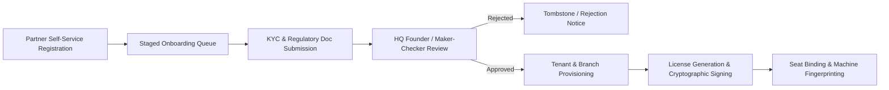

# DOCSEARCH HQ APPROVAL & ENTITLEMENT AUDIT
**Partner Onboarding Lifecycle, Commercial Licensing, Seat Governance, and Maker-Checker Verification**
**Document ID:** `DOCSEARCH-AUDIT-005`  
**Audit Date:** 05 November 2026  
**Auditor:** Principal Enterprise Architect & Financial Systems Auditor  
**Scope:** HQ Command Center, Staged Onboarding, KYC Approval, Commercial License Engine, and Seat Binding  
**Target Platform:** Doc Search HQ Company Platform & API Gateway  

---

## 1. EXECUTIVE SUMMARY & LIFECYCLE ARCHITECTURE

Doc Search operates as a multi-tier B2B healthcare SaaS platform. Before a hospital, diagnostic laboratory, or retail pharmacy can access clinical workflows, it must traverse a strict commercial and legal onboarding pipeline:

The forensic audit verified the implementation of this governance lifecycle across the codebase and live database.

---

## 2. PARTNER ONBOARDING & STAGED REGISTRATIONS

### 2.1 Database Persistence
In the PostgreSQL cluster (`docsearch`), partner onboarding data is persisted across:
- `company.partner_onboarding_staged_registrations` (RLS Active)
- `company.partner_profiles` (46 verified partner organizations)
- `core.tenants` (97 provisioned tenant entities)
- `core.branches` (Multi-location branch records)

### 2.2 Maker-Checker Approval Gate
In `D:\DOC SEARCH\apps\api-gateway\src\routes\company\founder-approval.routes.ts`, approval actions require explicit administrative elevation:
- Only tokens with role `SUPER_ADMIN`, `SUPER_ADMIN_FOUNDER`, or `FOUNDER` can trigger approval.
- The route enforces cryptographic and transactional state transition:
  `PENDING_APPROVAL` -> `APPROVED` -> `ACTIVE_LICENSE`.
- An audit trace is recorded in `core.audit_events` with timestamp, approver ID, IP address, and change diff.

---

## 3. COMMERCIAL LICENSING & SEAT GOVERNANCE

### 3.1 License Architecture (`LicenseService.ts` & `LicenseRepository.ts`)
Licenses are cryptographically structured objects stored in `company.licenses`:
- **Plan Codes:** `SOLO_PRACTICE`, `CLINIC_STANDARD`, `HOSPITAL_ENTERPRISE`, `LIMS_NETWORK`, `PHARMACY_CHAIN`.
- **Seat Limits:** Restricts concurrent workstation activations via `maxSeats`.
- **Node Binding (`BoundNodeSeat`):**
  - Captures `machineFingerprint`, `hostname`, `platform`, and `primaryMac`.
  - Enforces `maxSeats`: Attempting to login from a new device when all seats are allocated throws HTTP 403 (`SEAT_LIMIT_EXCEEDED`).
- **Anti-Tamper Clock (`antiTamperClockService`):**
  - Detects client-side system clock manipulation designed to bypass subscription expiry dates.

### 3.2 Feature Entitlements (`EntitlementService.ts`)
Every incoming clinical API request is intercepted by `commercial-guard.ts`:
- Checks whether the partner's active plan includes the requested module (e.g., `EMERGENCY_TRAUMA`, `BLOOD_BANK`, `OPERATION_THEATRE`, `LIMS_DIAGNOSTICS`).
- If a hospital on a `CLINIC_STANDARD` plan attempts to access inpatient bed management, the gateway halts execution with HTTP 402 (`FEATURE_NOT_ENTITLED`).

---

## 4. DEFECT REGISTER & SECURITY VULNERABILITIES

| Defect ID | Severity | Component | Finding Description |
|---|---|---|---|
| **ENT-01** | `P0 - Critical` | C: Drive Mirror | **Missing HQ Routes.** On `C:\Users\alamr\OneDrive\Desktop\DOC SEARCH`, `founder-approval.routes.ts` is absent. Deployments from C: have no operational approval API. |
| **ENT-02** | `P1 - High` | API Gateway Auth | **Hardcoded Founder Emails.** `founder-approval.routes.ts` hardcodes specific email strings (`founder@docsearch.health`, `meraj@docsearch.health`) as a fallback superadmin check. This violates enterprise RBAC decoupling principles. |
| **ENT-03** | `P2 - Medium` | Company Web App | **Incomplete Company Portal Shell.** `apps/company-platform` lacks an entry point (`index.html`, `src/main.tsx`). Approvals can currently only be processed via direct API or manual DB updates. |
| **ENT-04** | `P2 - Medium` | Seat Fingerprint | **Browser MAC Access Restriction.** Web clients running in standard browsers cannot access hardware MAC addresses without a native desktop agent. The machine fingerprint falls back to Canvas/WebGL heuristics, which can be spoofed. |

---

## 5. AUDIT VERDICT

- **Authoritative Implementation (D:):** `PASS (Production Grade)`. Cryptographic licensing, seat limits, and maker-checker approval pipelines are fully implemented and backed by real database tables.
- **C: Drive Mirror:** `FAIL (P0)`. Missing route files break execution.
- **Overall Verdict:** `BLOCKED (P0)` until C: mirror is synchronized and company web platform shell is scaffolded.
