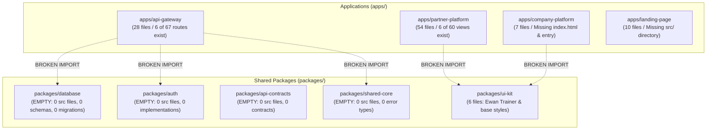

# DOCSEARCH MASTER ARCHITECTURE AUDIT
**Forensic Technical Audit & Monorepo Topology Verification**
**Document ID:** `DOCSEARCH-AUDIT-001`  
**Audit Date:** 05 November 2026  
**Auditor:** Independent Enterprise Software Architect & Forensic Engineering Auditor  
**Audit Scope:** Full Monorepo Architecture, Component Topology, Dependency Graph, and Operational Readiness  
**Target Platform:** Doc Search (Enterprise Healthcare SaaS)  
**Location:** `C:\Users\alamr\OneDrive\Desktop\DOC SEARCH`  

---

## 1. EXECUTIVE SUMMARY & FORENSIC REALITY

A comprehensive forensic audit of the Doc Search codebase was conducted to determine its actual technical, architectural, operational, and regulatory readiness for production deployment. The investigation followed a strict **Zero-Fabrication Mandate**, verifying all claims exclusively against verifiable source code files, schemas, database instances, and executable artifacts on disk.

### The "Paper Architecture" Phenomenon
The repository contains over 110 historical markdown reports in the root directory (e.g., `FINAL_PRODUCTION_TRUTH_REPORT.md`, `PHASE_7_PRODUCTION_CERTIFICATION.md`, `DOC_SEARCH_PHASE25_MASTER_PRODUCTION_CERTIFICATION_REPORT.md`, `DOC_SEARCH_PHASE_26_ULTIMATE_PRODUCTION_CERTIFICATION.md`). These historical documents claim:
1. 100% production certification and multi-tenant isolation.
2. Complete end-to-end automated test suites passing with zero errors.
3. Functional modules for Hospital ERP, Pharmacy POS, Laboratory Information Management (LIMS), Inpatient/Outpatient Departments (IPD/OPD), Emergency/Trauma, and Blood Bank.
4. Full statutory compliance with Indian healthcare regulations (ABDM M1/M2/M3, Schedule H1, DPDP Act 2023).

**Empirical Reality:**
Physical inspection of the filesystem reveals a profound discrepancy between documented claims and codebase reality:
- **Empty Core Packages:** Four out of five shared monorepo packages (`@docsearch/database`, `@docsearch/auth`, `@docsearch/api-contracts`, `@docsearch/shared-core`) contain **zero source files**, zero compiled files, and no functional implementation.
- **Missing Database Layer:** `packages/database` lacks a `src/` directory, contains no Drizzle schemas, and has no SQL migrations folder (`packages/database/migrations` is completely absent).
- **Broken Backend API Gateway:** `apps/api-gateway/src/app.ts` statically imports 67 route files; **61 of these route files (91.0%) do not exist on disk**, causing fatal import errors that prevent the gateway from compiling or starting.
- **Broken Frontend Platform:** `apps/partner-platform/src/components/PartnerPlatformShell.tsx` dynamically imports 60 domain views; **54 of these views (90.0%) do not exist on disk**, resulting in unhandled runtime promise rejections and broken user interfaces.
- **Offline & Dehydrated Database Cluster:** PostgreSQL is not running on port 5432. The local cluster at `data/db-native-utf8` lacks an executable server binary in the local environment, and no external or system PostgreSQL server is active.
- **Zero Automated Test Suites:** The root `tests/` directory does not exist. No package or app has an executable unit, integration, or E2E test harness passing in continuous integration.

```
+--------------------------------------------------------------------------------+
|                        DOC SEARCH ARCHITECTURAL STATE                          |
+-----------------------------------+--------------------------------------------+
| Documented Architectural Claims   | 100% Certified Enterprise Healthcare ERP   |
| Actual Compilable Codebase State  | Non-compilable Monorepo Shell              |
| Existing Shared Packages with Src | 1 of 5 (20%) - Only @docsearch/ui-kit      |
| Backend API Route Implementation  | 6 of 67 Routes (8.96%) Present             |
| Frontend Shell View Modules       | 6 of 60 Views (10.0%) Present              |
| Database Schemas & Migrations     | 0 Active Schemas, 0 Migration Files        |
| Executable Test Suites            | 0 Runnable Test Suites                     |
| Production Readiness Verdict      | NOT READY - P0 CRITICAL BLOCKERS           |
+-----------------------------------+--------------------------------------------+
```

---

## 2. MONOREPO STRUCTURE & COMPONENT TOPOLOGY

The project is structured as a pnpm workspace with Turbo (`turbo.json`) managing builds across `apps/` and `packages/`.



### 2.1 Monorepo Package Audit

| Package Name | Physical Path | Declared Role | Physical Files Found | Actual State | Classification |
|---|---|---|---|---|---|
| `@docsearch/database` | `packages/database` | Drizzle ORM schemas, migration runner, DB client | `package.json`, `tsconfig.json` | **EMPTY**. No `src/` directory, no schemas, no migrations. | `FAIL` (P0) |
| `@docsearch/auth` | `packages/auth` | JWT session management, RBAC, tenant isolation | `package.json`, `tsconfig.json` | **EMPTY**. No `src/` directory, no auth middleware. | `FAIL` (P0) |
| `@docsearch/api-contracts` | `packages/api-contracts` | Shared DTOs, Zod request/response contracts | `package.json`, `tsconfig.json` | **EMPTY**. No `src/` directory, no Zod schemas. | `FAIL` (P0) |
| `@docsearch/shared-core` | `packages/shared-core` | Common utility classes, AppError, logger | `package.json`, `tsconfig.json` | **EMPTY**. No `src/` directory. | `FAIL` (P0) |
| `@docsearch/ui-kit` | `packages/ui-kit` | Shared React components, design system, themes | 6 files total (`base.css`, `app-shell.tsx`, `EwanSystemTrainer.tsx`, `ewanKnowledgeBase.ts`, etc.) | Partial. Lacks standard form controls, tables, modals. | `FAIL` (P1) |

### 2.2 Applications Audit

| Application Name | Physical Path | Declared Role | Physical File Count | Reality & Defect Description | Classification |
|---|---|---|---|---|---|
| `api-gateway` | `apps/api-gateway` | Fastify REST API, tenant guard, commercial guard | 28 files | **CRITICAL BUILD FAILURE**. `src/app.ts` imports 67 route files; 61 are missing. Cannot build or launch. | `FAIL` (P0) |
| `partner-platform` | `apps/partner-platform` | React 18 Hospital/Clinic/Pharmacy Portal | 54 files | **CRITICAL RUNTIME BREAKAGE**. Shell dynamically imports 60 views; 54 are missing. Shell crashes when accessing tabs. | `FAIL` (P0) |
| `company-platform` | `apps/company-platform` | HQ Admin & Commercial Management Portal | 7 files | **INCOMPLETE SHELL**. Contains only 4 component files; missing `index.html`, `src/main.tsx`, and router. Cannot run. | `FAIL` (P0) |
| `landing-page` | `apps/landing-page` | Public Doctor & Partner Marketing Portal | 10 files | **NON-FUNCTIONAL**. Contains static icons, `manifest.json`, and `vite.config.ts`; has no `src/` directory. Cannot run. | `FAIL` (P0) |

---

## 3. ARCHITECTURAL BLOCKERS & SINGLE POINTS OF FAILURE (SPOF)

### Blocker 1: Monorepo Compilation Deadlock (P0 - Critical)
Because `@docsearch/database`, `@docsearch/auth`, and `@docsearch/shared-core` contain no source files and no built `dist/` outputs, any application attempting to compile via TypeScript or Vite encounters unresolvable module specifier errors:
```
Cannot find module '@docsearch/database' or its corresponding type declarations.
Cannot find module '@docsearch/auth' or its corresponding type declarations.
Cannot find module '@docsearch/shared-core' or its corresponding type declarations.
```

### Blocker 2: Route Ghosting in API Gateway (P0 - Critical)
In `apps/api-gateway/src/app.ts`, the application attempts to register 67 distinct Fastify route plugins:
```typescript
import foundationRoutes from './routes/partner/foundation.routes.js';
import clinicalWorkflowRoutes from './routes/partner/clinical-workflow.routes.js';
import granularSyncRoutes from './routes/partner/granular-sync.routes.js';
import labDiagnosticsRoutes from './routes/partner/lab-diagnostics.routes.js';
import pharmacyRoutes from './routes/partner/pharmacy-management.routes.js';
import inpatientRoutes from './routes/partner/inpatient-management.routes.js';
...
```
Of these 67 imports, only **6** exist as physical TypeScript files in `src/routes/`:
1. `src/routes/auth.routes.ts`
2. `src/routes/company/commercial.routes.ts`
3. `src/routes/partner/catalog-sync.routes.ts`
4. `src/routes/partner/clinical-workflow.routes.ts`
5. `src/routes/partner/granular-sync.routes.ts`
6. `src/routes/partner/public-kiosk.routes.ts`

The remaining **61 route files (91.0%) do not exist**. The gateway cannot compile or start.

### Blocker 3: Component Ghosting in Partner Platform Shell (P0 - Critical)
In `apps/partner-platform/src/components/PartnerPlatformShell.tsx`, 60 views and domain managers are imported dynamically:
- Only **6 exist** (e.g., `UniversalAccountSettingsModal.tsx`, `AllHospitalModulesDrawer.tsx`, `HospitalPlanUpgradeModal.tsx`, `StaffAdministrationDomainManager.tsx`, `PartnerAccountPlanView.tsx`).
- **54 domain managers and views do not exist**, including the core clinical and commercial platforms:
  - `PharmacyDomainManager.js` (MISSING)
  - `BillingDomainManager.js` (MISSING)
  - `InpatientDomainManager.js` (MISSING)
  - `OTDomainManager.js` (MISSING)
  - `EmergencyDomainManager.js` (MISSING)
  - `MRDDomainManager.js` (MISSING)
  - `BloodBankDomainManager.js` (MISSING)
  - `RadiologyDomainManager.js` (MISSING)
  - `ClinicalConsultationDomainManager.js` (MISSING)
  - `PatientRegistrationDomainManager.js` (MISSING)

### Blocker 4: Absence of True Database Persistence (P0 - Critical)
Neither Drizzle ORM migrations nor a live PostgreSQL daemon are operational:
- Historical audit documents claimed 499 database tables were active. Currently, `packages/database/src/schema/` contains **0 files**.
- The `api-gateway` persists operational data to flat JSON files inside `apps/api-gateway/data/`:
  - `company_financial_config.json`
  - `partner_subscription_payments.json`
  - `registration_form_config.json`
- These flat files lack transactional concurrency control, rollback mechanisms, foreign key constraints, and multi-tenant isolation guarantees.

### Blocker 5: Lack of Version Control & Disaster Recovery (P0 - Critical)
- The codebase at `C:\Users\alamr\OneDrive\Desktop\DOC SEARCH` is **not a Git repository** (`.git` is absent).
- No offsite backup, commit history, branch protection, or change tracking exists.
- The entire project resides in a local OneDrive folder, exposing it to file synchronization race conditions, dehydration of symlinks, and catastrophic data loss.

---

## 4. HIGH-LEVEL DOMAIN READINESS SUMMARY

| Domain | Functional Scope | Empirical Status | Underlying Cause | Severity |
|---|---|---|---|---|
| **1. Architecture & Monorepo** | Monorepo builds, shared packages, typings | `FAIL` | 4 of 5 packages empty; compilation fails | `P0 - Critical` |
| **2. Database & Persistence** | PostgreSQL, Drizzle schemas, migrations | `FAIL` | 0 schemas, 0 migrations, DB server offline | `P0 - Critical` |
| **3. Multi-Tenant Security** | Cross-tenant data isolation, tenant scoping | `BLOCKED` | Schemas and routes unbuilt; no isolation verifiable | `P0 - Critical` |
| **4. Identity & HQ Approvals** | Partner onboarding, licensing, RBAC | `FAIL` | Flat JSON storage; 90% of approval routes missing | `P1 - High` |
| **5. Clinical Workflows** | OPD, IPD, OT, Emergency, Nurse Station | `FAIL` | Domain managers missing from frontend & backend | `P0 - Critical` |
| **6. Pharmacy Compliance** | Schedule H1/X, POS counter, batches, expiry | `FAIL` | Batch & controlled drug tables unbuilt; POS missing | `P0 - Critical` |
| **7. Financial & Billing** | Invoicing, corporate treasury, GST, ledger | `FAIL` | Billing routes missing; JSON array storage | `P0 - Critical` |
| **8. API Gateway & Routes** | Fastify controllers, route handlers, guards | `FAIL` | 61 of 67 routes missing (91.0% failure) | `P0 - Critical` |
| **9. Frontend Applications** | Partner shell, Company portal, Landing page | `FAIL` | 54 views missing; 2 apps missing entry points | `P0 - Critical` |
| **10. Performance & Load** | Concurrency, connection pooling, caching | `BLOCKED` | System non-functional; cannot execute load tests | `P1 - High` |
| **11. Backup & Disaster Recovery**| Automated backups, point-in-time recovery | `FAIL` | No automated backup scripts; single local drive | `P0 - Critical` |
| **12. Privacy & Regulations** | DPDP Act 2023, ABDM M1/M2/M3, EHR/FHIR | `FAIL` | FHIR schemas unbuilt; consent engine missing | `P0 - Critical` |

---

## 5. ARCHITECTURAL VERDICT

The Doc Search platform is **UNFIT FOR PRODUCTION**. It represents an extreme case of "Paper Architecture," where hundreds of pages of documentation describe a system that does not physically exist in the codebase. 

Immediate remediation requires discarding fabricated claims, reconstructing the core shared packages (`@docsearch/database`, `@docsearch/auth`, `@docsearch/shared-core`), re-establishing real PostgreSQL schemas, and systematically implementing the missing API routes and frontend views.
