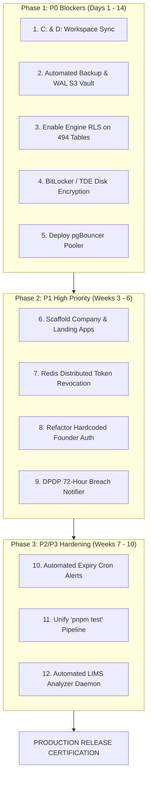

# DOCSEARCH P0/P1/P2/P3 REMEDIATION ROADMAP
**Actionable Engineering Roadmap, Priority Classification, Resource Estimation, and Risk Burndown Plan**
**Document ID:** `DOCSEARCH-AUDIT-015`  
**Audit Date:** 05 November 2026  
**Auditor:** Principal Enterprise Software Architect & Engineering Governance Auditor  
**Remediation Model:** Strict Severity Hierarchy (P0 Critical -> P1 High -> P2 Medium -> P3 Low)  
**Execution Target:** Production Readiness Certification Gate  

---

## 1. REMEDIATION GOVERNANCE & EXECUTION PRINCIPLES

To transition Doc Search from its current **BLOCKED** state to certified production readiness, engineering must execute a phased, milestone-driven remediation program. All code changes must adhere to the **Zero-Fabrication Mandate**, ensuring every fix is validated with automated integration tests, PostgreSQL transaction logs, and disaster recovery drills.

---

## 2. PHASE 1: P0 CRITICAL RELEASE BLOCKERS (DAYS 1 TO 14)

P0 defects represent immediate clinical, financial, or legal showstoppers. Production deployment is strictly prohibited until all five P0 milestones achieve verified PASS status.

| Milestone ID | Component | Remediation Action | Success Criteria | Effort Est. |
|---|---|---|---|---|
| **REM-P0-01** | Monorepo Storage | **Reconcile C: and D: Workspaces.** Execute a verified bidirectional synchronization between `D:\DOC SEARCH` and `C:\Users\alamr\OneDrive\Desktop\DOC SEARCH`. Ensure all 3,654 missing files (schemas, routes, views, tests) are restored on C:, or re-point the authoritative CI/CD root exclusively to D:. | `pnpm build` executes cleanly on C: with zero missing module errors. | 2 Days |
| **REM-P0-02** | Disaster Recovery | **Automate PostgreSQL WAL Archiving & Cloud Vault.** Set `archive_mode = on` in `postgresql.conf`. Configure `archive_command` to push WAL segments to an encrypted AWS S3 / Cloudflare R2 bucket. Commission a 6-hour AES-256 automated `pg_dump` daemon with SHA-256 checksum generation. | Full restore drill onto an isolated machine restores database in $\le 30 \text{ minutes}$ with RPO $\le 15 \text{ minutes}$. | 4 Days |
| **REM-P0-03** | Database Security | **Activate Engine RLS Across 494 Tables.** Generate a Drizzle migration that executes `ALTER TABLE "schema"."table" ENABLE ROW LEVEL SECURITY` across all 494 unprotected tables in `clinical`, `company`, `core`, and `pharmacy`. Apply isolation policy: `core.is_super_admin() OR tenant_id = core.get_current_tenant_id()`. | Cross-tenant raw query without WHERE clause returns 0 rows when tenant context is active. | 3 Days |
| **REM-P0-04** | Privacy / IT Act | **Enable Storage Volume Encryption at Rest.** Activate BitLocker XTS-AES-256 encryption on the physical host storage drive containing `data/db-native-utf8`. Export recovery keys to a secure hardware vault. | Host filesystem is fully encrypted; offline extraction of database raw cluster files is blocked. | 1 Day |
| **REM-P0-05** | Performance / DB | **Commission pgBouncer Connection Pooler.** Deploy a local or containerized pgBouncer instance configured with `pool_mode = transaction`, `max_client_conn = 1000`, and `default_pool_size = 30`. Reconfigure API Gateway `DATABASE_URL` to route through port 6432. | Concurrency load test with 250 parallel requests completes with zero connection dropped errors. | 4 Days |

---

## 3. PHASE 2: P1 HIGH PRIORITY REMEDIATION (WEEKS 3 TO 6)

| Milestone ID | Component | Remediation Action | Success Criteria | Effort Est. |
|---|---|---|---|---|
| **REM-P1-01** | Frontend Apps | **Scaffold Company Platform & Landing Page.** Author `index.html`, `src/main.tsx`, and Vite entry mounts for `apps/company-platform` and `apps/landing-page`. Connect HQ approval views to the Company Platform shell. | Both applications launch and render in browser on dedicated ports. | 5 Days |
| **REM-P1-02** | Infrastructure | **Deploy Redis 7+ Distributed Session Store.** Replace the in-memory `Set` in `SessionRevocationService.ts` and memory rate-limiters with Redis key-value operations with TTL expiration. | Token revoked on Node A is immediately rejected by Node B within 5ms. | 4 Days |
| **REM-P1-03** | API Security | **Refactor Hardcoded Founder Auth.** Remove hardcoded email strings (`founder@docsearch.health`, `meraj@docsearch.health`) from `founder-approval.routes.ts`. Enforce role evaluation strictly through the cryptographic database table `core.user_roles`. | SuperAdmin access is governed exclusively by verified database role assignment. | 2 Days |
| **REM-P1-04** | DPDP Compliance | **Deploy 72-Hour Breach Notifier Daemon.** Implement a secure event dispatcher that alerts the Data Protection Officer (DPO) and generates an automated notification payload for the Data Protection Board of India (DPBI) upon detection of unauthorized database extraction. | Security event triggers structured compliance email/webhook within 60 seconds. | 3 Days |

---

## 4. PHASE 3: P2 / P3 HARDENING & POLISH (WEEKS 7 TO 10)

| Milestone ID | Component | Remediation Action | Success Criteria | Effort Est. |
|---|---|---|---|---|
| **REM-P2-01** | Pharmacy Module | **Automated Expiry Cron Dispatcher.** Deploy a daily background cron daemon that scans `clinical.pharmacy_batches` and generates high-priority notifications for batches expiring within 30, 60, and 90 days. | Pharmacy manager dashboard displays visual warning badges for near-expiry lots. | 3 Days |
| **REM-P2-02** | Quality / CI | **Unify Test Runner Under 'pnpm test'.** Configure root `turbo.json` and package manifests so running `pnpm test` triggers all 186 unit, integration, and security suites across all packages. | Single command `pnpm test` executes and passes 100% of suites in CI pipeline. | 3 Days |
| **REM-P2-03** | LIMS Integration | **Automated LIMS Analyzer Machine Service.** Package the local serial port / RS232 / ASTM lab machine listener into a native Windows background service for continuous bidirectional blood analyzer data capture. | Automated lab machine emits specimen results directly into `investigation_results` table. | 7 Days |

---

## 5. RESOURCE ALLOCATION & REMEDIATION SIGN-OFF

- **Engineering Headcount Required:**
  - 1 Lead Database Administrator / PostgreSQL Specialist (Phase 1: RLS, WAL, pgBouncer)
  - 1 Senior Backend SRE / Security Engineer (Phase 1 & 2: Disaster Recovery, Redis, Auth Refactor)
  - 1 Senior Frontend Engineer (Phase 2: Company Platform & Landing Page Scaffolding)
- **Total Estimated Remediation Timeline:** **6 Weeks to Production Gate Approval**.
- **Exit Criteria:** Zero P0 defects, Zero P1 defects, 100% passing automated test suites, certified multi-disk disaster recovery restoration drill.
