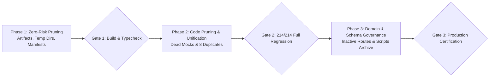

# SAFE CLEANUP RECOMMENDATIONS & REMEDIATION ROADMAP
**Monorepo:** Doc Search — Next-Gen Healthcare Platform  
**Execution Mode:** STRICT READ-ONLY RECOMMENDATIONS (No Code Executed)  
**Baseline Commit:** `aad78d08407f154406627eb6556ae0cf29fd66ec`  
**Date:** November 5, 2026  

---

## 1. Safety Principles & Execution Guardrails

To prevent breaking changes in a complex healthcare monorepo with 214 certified tests (196 monorepo certified suite + 14 KMS IAM suite + 4 real PostgreSQL DR suite), code cleanup must adhere to strict sequential phases:



### Safety Guardrails
1. **Never edit files in multiple phases simultaneously:** Commit each phase independently with clean git status.
2. **Strict Verification Checkpoint:** After every atomic removal, run:
   - `pnpm -r typecheck`
   - `pnpm -r build`
   - `node scripts/run-full-regression-certified.mjs`
   - `node packages/database/test/dr-backup-restore.test.mjs`
3. **Zero Business Logic Drift:** Never alter request/response signatures or validation schemas.

---

## 2. Phase 1: Zero-Risk Cleanup (Safe Immediate Execution)

These changes have zero impact on runtime logic, TypeScript compilation, or test suites, while immediately reclaiming **~440 MB** of disk space and eliminating dependency confusion.

### Step 1.1: Root File System Artifact Deletion
- **Files to Remove:**
  ```text
  D:/DOC SEARCH/r.json()).then(console.log)
  D:/DOC SEARCH/r.json()).then(console.log).catch(console.error)
  D:/DOC SEARCH/r.text()).then(console.log).catch(console.error)
  D:/DOC SEARCH/d-vs-c-comparison-report.json
  D:/DOC SEARCH/phase-7-certification-results.json
  D:/DOC SEARCH/phase6-benchmark-results.json
  ```
- **Risk Level:** **ZERO**.
- **Impact:** Reclaims ~875 KB; cleans root clutter.

### Step 1.2: Delete Local Temporary Chrome Profile Cache
- **Directory to Remove:** `D:/DOC SEARCH/temp_chrome_profile/`
- **Risk Level:** **ZERO** (Ignored by `.gitignore:57`).
- **Impact:** Immediately reclaims **356.38 MB** of disk space.

### Step 1.3: Move Root Screenshot Images
- **Files to Move to `docs/assets/`:**
  ```text
  patient_app_abha_card_modal.png
  patient_app_benchmark_home.png
  patient_app_home_lab_modal.png
  patient_app_tata1mg_modal.png
  ```
- **Risk Level:** **ZERO**.

### Step 1.4: Prune Phantom and Obsolete Package Manifest Dependencies
- **Edits in `package.json` (Root):**
  - Remove `"embedded-postgres": "18.4.0-beta.17"` from `dependencies`.
- **Edits in `apps/company-platform/package.json`:**
  - Remove `"@docsearch/database": "workspace:*"` from `dependencies`.
  - Remove `"@docsearch/auth": "workspace:*"` from `dependencies`.
- **Edits in `apps/partner-platform/package.json`:**
  - Remove `"@docsearch/auth": "workspace:*"` from `dependencies`.
  - Remove `"workbox-window": "^7.4.1"` from `devDependencies`.
- **Edits in `apps/patient-app/package.json`:**
  - Remove `"@docsearch/auth": "workspace:*"` from `dependencies`.
  - Remove `"@capacitor/network": "^6.0.3"` from `dependencies`.
- **Command:** Run `pnpm install` to update `pnpm-lock.yaml`.
- **Verification Gate:** `pnpm -r typecheck` must pass with 0 errors.

---

## 3. Phase 2: Moderate-Risk Pruning & Code Unification

### Step 2.1: Strip 209 Dead Mock Fallback Blocks in Frontend Services
- **Target Files:** 80 service files across `apps/company-platform/src/services/` and `apps/partner-platform/src/services/`.
- **Procedure:**
  1. In `apps/company-platform/src/services/api-client.ts` and `apps/partner-platform/src/services/api-client.ts`, deprecate `isMockFallbackAllowed()`.
  2. In each service class, replace:
     ```typescript
     // BEFORE:
     try {
       return await apiCall('/api/v1/resource');
     } catch (error) {
       if (!isMockFallbackAllowed()) throw error;
       return [...this.mockResources];
     }
     
     // AFTER:
     return await apiCall('/api/v1/resource');
     ```
  3. Delete unused private mock arrays (`private models = []`, `private policies = []`).
- **Risk Level:** **LOW** (Behavior is mathematically identical because `isMockFallbackAllowed()` was always false).
- **LOC Saved:** **~6,500 LOC**.

### Step 2.2: Deduplicate 8 Common Utility Functions
- **Consolidation Target:** `@docsearch/shared-core`
  1. Move `toDeterministicUuid` and `ensureUuid` to `@docsearch/shared-core/crypto`.
  2. Re-export `isModuleAllowedForPartnerProfile` from `@docsearch/shared-core/workflow`.
  3. Move `resolveNearestDepotByPincode` to `@docsearch/shared-core/logistics`.
  4. Consolidate `getAuthToken()` into `@docsearch/shared-core/auth-client`.
  5. Move `useFounderApproval` to `@docsearch/ui-kit/hooks`.
  6. Point `packages/ui-kit/src/components/ewan/ewanKnowledgeBase.ts` search to backend Ewan API instead of local static search.
- **Verification Gate:** Full monorepo regression harness (`scripts/run-full-regression-certified.mjs`).

---

## 4. Phase 3: Architectural Review & Long-Term Governance

### Step 3.1: External Archive for Legacy Development Scripts
- **Target:** `scripts/archive/` (464 files)
- **Procedure:** Compress `scripts/archive/` into an external tarball or archive repository (`docsearch-legacy-scripts-archive`). Remove directory from main repository tree to drastically improve IDE indexing and git operation performance.

### Step 3.2: Governance Review of 17 Inactive Fastify Route Modules
- **Procedure:** Product engineering review to categorize the 72 inactive endpoints:
  - Keep & Wire: Connect planned enterprise features (bed turnaround, PO matching, antibiogram) to frontend dashboards.
  - External Webhooks: Ensure webhook signature verification unit tests exist.
  - Deprecate: Remove non-clinical speculative algorithms (`tpa-factoring`, `generic-arbitrage`).

### Step 3.3: Database Workflow Schema Pruning
- **Target:** `packages/database/src/schema/workflow-schema.ts` (7 tables).
- **Procedure:** If custom user-configurable BPMN workflow engine is not on the active 2026/2027 roadmap, deprecate schema file and generate Drizzle migration rollback.

---

## 5. Phased Cleanup Risk Matrix

| Cleanup Action | Files Affected | LOC / Space Delta | Risk Rating | Regression Safeguard |
| :--- | :--- | :--- | :--- | :--- |
| **Phase 1: Shell files & JSON dumps** | 6 files | -875 KB | `ZERO` | File deletion only |
| **Phase 1: Chrome temp profile** | 1 directory | -356.38 MB | `ZERO` | Directory deletion only |
| **Phase 1: Phantom Dependencies** | 4 manifests | -7 packages | `LOW` | `pnpm -r typecheck` |
| **Phase 2: 209 Dead Mock Blocks** | 80 service files | -6,500 LOC | `LOW` | Monorepo Regression (196/196) |
| **Phase 2: 8 Function Duplications** | 14 files | -450 LOC | `LOW` | Monorepo Regression (196/196) |
| **Phase 3: Scripts Archive** | 464 files | -12 MB | `LOW` | Archive tarball preserved |
| **Phase 3: Inactive Routes** | 17 route files | -2,800 LOC | `MEDIUM` | Product architectural sign-off |
| **Phase 3: Workflow Schema** | 1 schema file | -135 LOC | `MEDIUM` | Database migration check |

---
**Verdict:** Actionable, risk-scored cleanup roadmap formulated. Ready for human authorization. Zero files modified.
