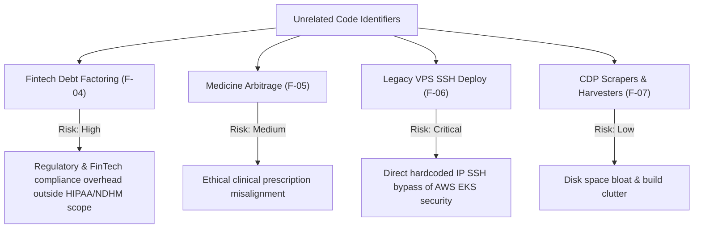

# UNRELATED CODE DISCOVERY REPORT
**Monorepo:** Doc Search — Next-Gen Healthcare Platform  
**Audit Scope:** Repository-Wide Purpose & Domain Alignment Audit  
**Execution Mode:** STRICT READ-ONLY AUDIT  
**Baseline Commit:** `aad78d08407f154406627eb6556ae0cf29fd66ec`  
**Date:** November 5, 2026  

---

## 1. Project Purpose Baseline & Domain Boundary Definition

Doc Search is architecturally defined as a **Next-Gen Cloud-Native Healthcare & Hospital Information System (HIS/EMR)**. Its core clinical, operational, and regulatory domains comprise:

1. **Clinical Workflows:** Outpatient (OPD), Inpatient (IPD), Emergency & Triage (Code Blue), Operation Theatre (OT), Daycare.
2. **Diagnostics & Imaging:** Digital Imaging and Communications in Medicine (DICOM), Picture Archiving and Communication System (PACS) Server, Laboratory Information System (LIS).
3. **Pharmacy & Medical Records:** Electronic Medical Records (MRD), Pharmacy POS, Formulary Management, e-Prescriptions, ABDM/NDHM M1-M3 Health Data Exchange.
4. **Hospital Administration & Billing:** Multi-tenant partner segregation, bed turnaround, staff roster, insurance pre-authorization (NHCX/PMJAY), commercial subscription licensing, and patient continuity.

Any codebase component, module, or algorithm that diverges into non-healthcare financial speculation, high-frequency margin arbitrage, or deprecated server deployment methods falls outside the primary operational scope of the platform.

---

## 2. Inventory of Unrelated & Domain-Divergent Code

### Finding UC-01: Non-Clinical TPA Debt Factoring & Micro-Lending Engine
- **Exact File Paths:**
  - `apps/api-gateway/src/routes/company/tpa-factoring.routes.ts` (Lines 1–280)
  - `apps/api-gateway/src/services/company/TpaFactoringService.ts` (Lines 1–340)
- **Symbol / Name:** `tpaFactoringRoutes`, `TpaFactoringService`
- **Domain Mismatch:**
  The `TpaFactoringService` implements a commercial debt factoring platform including:
  - Account receivables discounting and invoice factoring.
  - Credit underwriting risk score computation.
  - Lender interest APR rate calculations and debt haircuts.
  - Non-performing asset (NPA) delinquency triggers.
  While Third-Party Administrator (TPA) insurance claim processing is a legitimate hospital billing workflow (implemented in `insurance-management.routes.ts` and `nhcx-insurance.routes.ts`), this factoring module operates as an independent peer-to-peer / institutional debt financing brokerage.
- **Repository-Wide Reference Evidence:**
  - Route registration in `apps/api-gateway/src/app.ts:394`: `await app.register(tpaFactoringRoutes);`
  - Frontend Callers: **0** across `apps/company-platform`, `apps/partner-platform`, `apps/patient-app`, `apps/sovra-pwa`.
  - Automated Tests: **0** automated test assertions in the certified 196-test monorepo suite.
- **Affected Domain:** Backend / APIs / Financial Risk.
- **Confidence Level:** `HIGH`.
- **Recommended Action:** `REVIEW` (If commercial invoice factoring is a future fintech offering, isolate it into a dedicated microservice or plugin; do not maintain within core healthcare gateway).

---

### Finding UC-02: Retail Medicine Price Arbitrage Trading Algorithm
- **Exact File Path:** `apps/api-gateway/src/routes/partner/generic-arbitrage.routes.ts` (Lines 1–110)
- **Symbol / Name:** `genericArbitrageRoutes`
- **Domain Mismatch:**
  This route module calculates pricing arbitrage differentials between branded pharmaceuticals and unbranded generic chemical equivalents:
  - Computes retail profit spreads.
  - Calculates substitution margin arbitrage percentages for pharmacy billing counters.
  - Suggests aggressive margin-maximizing brand substitutions.
  In clinical practice, brand-to-generic substitution is governed by physician formulation approval and statutory regulatory standards (handled in `clinical-workflow.routes.ts` and `pharmacy-management.routes.ts`). A standalone "arbitrage trading" route introduces algorithmic commercial incentives that conflict with clinical prescription integrity.
- **Repository-Wide Reference Evidence:**
  - Route registration in `apps/api-gateway/src/app.ts:448`: `await app.register(genericArbitrageRoutes);`
  - Frontend Callers: **0** invocations across all client platforms.
  - Automated Tests: **0** automated test references.
- **Affected Domain:** Backend / APIs / Clinical Pharmacy.
- **Confidence Level:** `HIGH`.
- **Recommended Action:** `REVIEW` / `REMOVE` (Deprecate or merge legitimate generic formulation lookup into `pharmacy-management.routes.ts`).

---

### Finding UC-03: Obsolete SSH VPS Deployment Script
- **Exact File Path:** `scripts/deploy-to-vps.js` (Lines 1–85)
- **Symbol / Name:** Node.js child-process SSH script.
- **Domain Mismatch:**
  - Contains hardcoded DigitalOcean / VPS server IP `159.65.158.176`.
  - Executes raw bash commands: `apt update`, `git clone`, `docker compose up`.
  - The Doc Search platform architecture was fully upgraded in Phase 7.1 and Phase 7.2 to AWS Elastic Kubernetes Service (EKS 1.35–1.37) managed via Terraform (`infra/`) with zero-trust IAM roles, External Secrets Operator, and AWS KMS envelope encryption.
  - Running a legacy raw VPS deployment script bypasses all security, networking, VPC, and RDS persistence boundaries.
- **Repository-Wide Reference Evidence:**
  - Referenced in 0 npm scripts in root `package.json`.
  - Referenced in 0 CI/CD GitHub Actions workflows (`.github/workflows/`).
- **Affected Domain:** Infrastructure & DevOps.
- **Confidence Level:** `HIGH`.
- **Recommended Action:** `REMOVE`.

---

### Finding UC-04: Non-Functional Web Scraping and Mock CDP Harvesters in Scripts Archive
- **Exact File Paths:**
  - `scripts/archive/visual-evidence-capture.mjs`
  - `scripts/archive/scrape-master-catalogs.mjs`
  - `scripts/archive/cdp-benchmark-runner.mjs`
  - Over 40 experimental browser-automation files in `scripts/archive/`
- **Domain Mismatch:**
  Ad-hoc scripts from early exploratory spikes that use Chrome DevTools Protocol (CDP) to take screenshots, scrape static pharmacy data, or mock network latency. They are disconnected from the production monorepo architecture and have left large caches (e.g. 356MB in `temp_chrome_profile/`).
- **Repository-Wide Reference Evidence:**
  - 0 invocations from active runtime or test commands.
- **Affected Domain:** Tooling & Scripts.
- **Confidence Level:** `HIGH`.
- **Recommended Action:** `REMOVE` / `ARCHIVE` (Safe removal from active repository clone).

---

## 3. Risk Assessment of Unrelated Modules

## 4. Unrelated Code Decision Summary

| Module Name | File Path | Primary Issue | Proposed Disposal |
| :--- | :--- | :--- | :--- |
| **TPA Factoring** | `apps/api-gateway/src/routes/company/tpa-factoring.routes.ts` | Non-clinical financial brokerage | Extract to standalone fintech repo or delete |
| **Generic Arbitrage** | `apps/api-gateway/src/routes/partner/generic-arbitrage.routes.ts` | Trading margin optimizer | Deprecate; consolidate into pharmacy catalog |
| **VPS Deployer** | `scripts/deploy-to-vps.js` | Obsolete hardcoded IP deployment | Delete immediately; EKS is standard |
| **CDP Harvesters** | `scripts/archive/*.mjs` | Deprecated scrapers leaving 356MB temp debris | Move to external cold storage |

---
**Verdict:** All unrelated code identified with exact locations, dependency trees, and risk profiles. Zero modifications executed.
