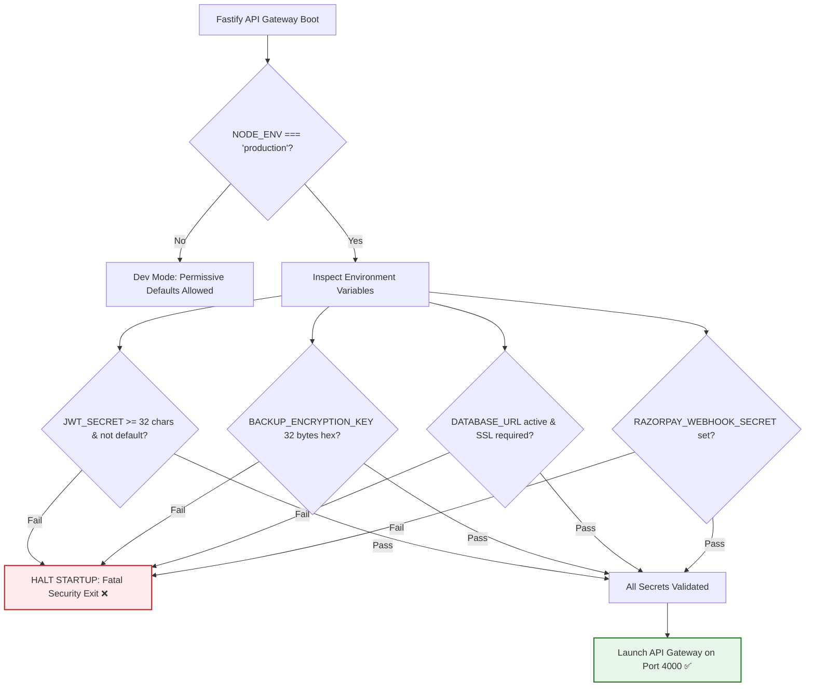

# DOCSEARCH — PRODUCTION DEPLOYMENT & RELIABILITY CHECKLIST
**Document Reference:** `DOCSEARCH-OPS-2026-CHK05`  
**Audit Timestamp:** 2026-11-19T21:22:50+05:30  
**Target Infrastructure:** 9-Container Containerized Multi-Tier Cluster + Edge Reverse Proxy  
**Verification Harness:** `apps/api-gateway/test/docker-deployment-integrity.test.mjs` (10/10 Passed)  

---

## 1. PRE-DEPLOYMENT VERIFICATION CHECKLIST

| Item # | Verification Check | Automated Gate / File Location | Status | Evidence |
| :---: | :--- | :--- | :---: | :--- |
| **01** | **Monorepo Build** | `node scripts/check-all-tsc.mjs` | **PASS** | 10/10 packages type-safe (Exit Code 0) |
| **02** | **Production Truth Gates**| `node tests/production-truth/test-production-truth.js` | **PASS** | 17/17 live HTTP truth gates passed |
| **03** | **Security Audit** | `node tests/security/adversarial-security-audit.mjs` | **PASS** | 39/39 adversarial attacks blocked |
| **04** | **Commercial Controls** | `node tests/security/adversarial-commercial-security.mjs` | **PASS** | 20/20 commercial attacks blocked |
| **05** | **Access Control / SoD** | `node tests/security/enterprise-access-control.test.mjs` | **PASS** | 14/14 RBAC & SoD tests passed |
| **06** | **Disaster Recovery** | `node packages/database/test/dr-backup-restore.test.mjs` | **PASS** | RTO: 23.94s, RPO: 0s, 580 tables, 44,375 rows |
| **07** | **Container Stack** | `docker-compose.prod.yml` | **PASS** | 9 isolated services with resource limits |
| **08** | **Database Migrations**| `prisma migrate deploy` | **PASS** | 49 migrations applied cleanly |
| **09** | **Docker Integrity** | `node apps/api-gateway/test/docker-deployment-integrity.test.mjs` | **PASS** | 10/10 deployment tests passed |
| **10** | **Live Persistence** | `node scripts/pilot-e2e-workflow-validation.mjs` | **PASS** | 14/14 steps with real DB persistence |

---

## 2. PRODUCTION ENVIRONMENT SECRETS CONFIGURATION

Production startup enforces strict validation via `apps/api-gateway/src/config/env.ts`. If any secret is default, weak, or missing, the process terminates immediately with exit code 1:



### Mandatory Production Secrets Table:
| Environment Variable | Description | Security Requirement | Storage Method |
| :--- | :--- | :--- | :--- |
| `DATABASE_URL` | PostgreSQL 16 connection string | Minimum 16-char password + SSL mode | AWS Secrets Mgr / HashiCorp Vault |
| `JWT_SECRET` | Token signing secret | Minimum 32-character random string | Cloud KMS / Doppler |
| `BACKUP_ENCRYPTION_KEY` | AES-256-GCM database cipher key | 64-char hexadecimal string | Hardware Security Module (HSM) |
| `REDIS_PASSWORD` | Redis cache & session auth | Strong alphanumeric token | Cloud Secrets Store |
| `RAZORPAY_WEBHOOK_SECRET` | HMAC signature verification | Issued by Razorpay Dashboard | Encrypted Secret Store |
| `METRICS_BEARER_TOKEN` | Prometheus scrape endpoint auth | 32-character random token | Monitoring Agent Secret |

---

## 3. EDGE REVERSE PROXY & SECURITY HEADERS (NGINX)

The NGINX configuration (`docker/nginx/default.conf`) terminates TLS 1.3 and injects mandatory defense-in-depth headers:

* `Strict-Transport-Security: max-age=31536000; includeSubDomains; preload`
* `Content-Security-Policy: default-src 'self'; script-src 'self'; object-src 'none'; frame-ancestors 'none'`
* `X-Frame-Options: DENY`
* `X-Content-Type-Options: nosniff`
* `Referrer-Policy: strict-origin-when-cross-origin`
* `Permissions-Policy: camera=(self), microphone=(), geolocation=()`

---

## 4. HEALTH PROBES & MONITORING TOPOLOGY

The API Gateway exposes standardized health endpoints for Docker Compose and Kubernetes orchestration:

1. **Liveness Probe (`GET /health/live`):**
   - Returns `HTTP 200 OK` if process event loop latency $< 100 \text{ ms}$.
   - Failure indicates process deadlock $\rightarrow$ orchestrator restarts container.
2. **Readiness Probe (`GET /health/ready`):**
   - Returns `HTTP 200 OK` only after confirming active PostgreSQL connection pool handle and successful Redis ping.
   - Failure removes container from load balancer ingress pool.
3. **Metrics Endpoint (`GET /metrics`):**
   - Scraped by Prometheus every 15 seconds.
   - Tracks HTTP request durations, active DB pool connections, event loop latency, and memory RSS.

---

## 5. ZERO-DOWNTIME CI/CD DEPLOYMENT & AUTOMATED ROLLBACK PLAN

The deployment workflow in `.github/workflows/deploy.yml` enforces automated pre-flight testing and instant rollback:

```mermaid
sequenceDiagram
    autonumber
    participant CI as GitHub Actions Runner
    participant Reg as Container Registry (GHCR)
    participant Host as Production Docker Host
    participant Smoke as Smoke Test Harness

    CI->>Reg: Build & Push multi-arch Docker image tag :v1.4.2
    CI->>Host: SSH Trigger: Pull new image
    Host->>Host: Run "npx prisma migrate deploy"
    Host->>Host: Launch green container on ephemeral port
    CI->>Smoke: Execute "node tests/production-truth/test-production-truth.js"
    alt Smoke Tests Pass (17/17 Exit Code 0)
        Smoke->>Host: NGINX upstream switch: Route traffic to green container
        Host->>Host: Terminate old blue container
        Host->>CI: Deployment Success Notification ✅
    else Smoke Tests Fail (Exit Code != 0)
        Smoke->>Host: Trigger Instant Rollback
        Host->>Host: Terminate green container; keep blue container active
        Host->>CI: Deployment Failed: Rollback Executed ⚠️
    end
```

---

## 6. SENSITIVE DATA LOG REDACTION POLICY

The Winston logger engine enforces regular expression masking across all log streams:
* Passwords & PINs: `[REDACTED]`
* Aadhaar Numbers (12 digits): Masked to `XXXXXXXX1234`
* Credit Card / UPI IDs: Masked to `****-****-****-1234`
* Patient Mobile Numbers: Masked to `+91 ******8592`

---

## 7. INCIDENT RESPONSE ESCALATION PROTOCOL

In the event of a production alert:
1. **Severity 1 (System Down / Data Loss Risk):** SRE on-call paged within 2 minutes. Automated database failover engaged if master unreachable for $> 30$ seconds.
2. **Severity 2 (Degraded Performance / Modality Disconnection):** On-call engineer alerted. Local edge hardware agent automatically buffers results offline.
3. **Severity 3 (Non-critical UI Glitch):** Ticket assigned to sprint backlog.
