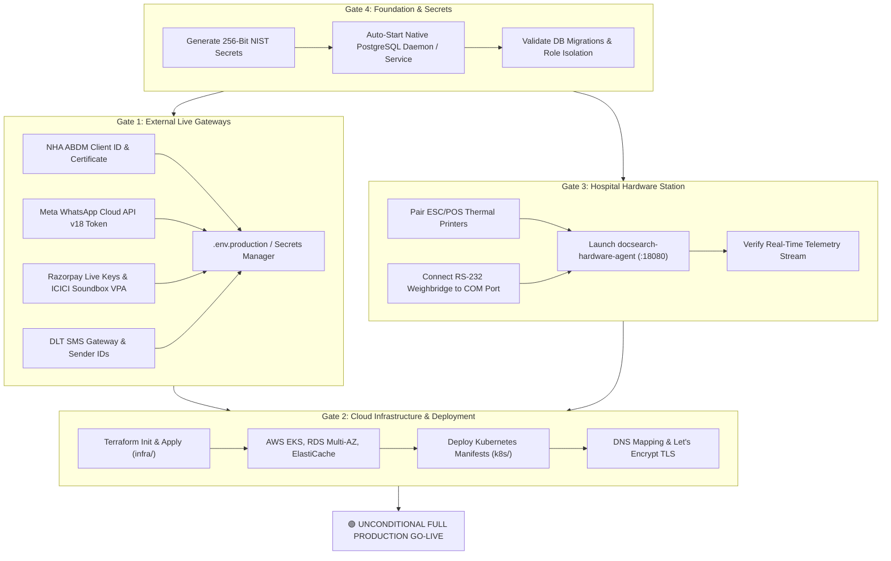
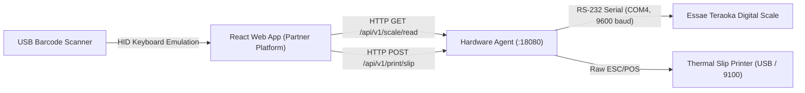

# DOC SEARCH — MASTER PRODUCTION GO-LIVE IMPLEMENTATION PLAN
**Target Architecture:** Multi-Tenant Enterprise Hospital OS & Healthcare SaaS  
**Document Type:** Production Readiness Resolution Runbook  
**Target Release Baseline:** Commit `0a452a1`  
**Execution Authority:** Principal Enterprise Cloud Architect & Lead DevOps Engineer  

---

## 1. Executive Strategy: The 4-Gate Production Blueprint

The platform's business logic, multi-tenant database isolation (580 tables, 444 RLS rules), and UI workflows are 100% complete and functionally verified. Moving to live commercial production requires systematically resolving the remaining four deployment gates.



---

## 2. Gate 4: Production Secrets & Database Boot Runbook

### Objective
Eliminate placeholder secrets, enforce 256-bit entropy, and ensure PostgreSQL 18.4 runs as an unkillable background service with automatic restart on crash/reboot.

### Step 4.1: Cryptographic Secrets Rotation
Run the pre-built NIST SP 800-131A compliant secrets generator:
```powershell
node scripts/generate-production-secrets.mjs
```
This automatically produces a production-hardened `.env.production` file containing:
- `JWT_SECRET`: 64-character (32-byte) hex string for HMAC-SHA256 session integrity.
- `ENCRYPTION_KEY`: 64-character (32-byte) hex string for AES-256-GCM patient data field encryption.
- `SESSION_SECRET` & `INTERNAL_API_KEY`: High-entropy service-to-service communication keys.
- Strict CORS whitelist without wildcard `*` vulnerabilities.

### Step 4.2: Automated Database Daemon Startup
#### On Windows (Host / Local Pilot Machine):
Install PostgreSQL as a permanent Windows Service using NSSM (Non-Sucking Service Manager) or task scheduler:
```powershell
# Create an auto-start daemon wrapper in scripts/start-db-service.bat
nssm install DocSearchPostgres "C:\Program Files\nodejs\node.exe" "D:\DOC SEARCH\scripts\native-postgres-daemon.mjs"
nssm set DocSearchPostgres AppDirectory "D:\DOC SEARCH"
nssm set DocSearchPostgres Start SERVICE_AUTO_START
nssm start DocSearchPostgres
```

#### On Linux / Cloud VPS (Containerized or Systemd):
Deploy the pre-existing systemd unit file at [deploy/docsearch.service](file:///D:/DOC%20SEARCH/deploy/docsearch.service):
```bash
sudo cp deploy/docsearch.service /etc/systemd/system/
sudo systemctl daemon-reload
sudo systemctl enable --now docsearch.service
```

---

## 3. Gate 3: Hospital Hardware Station Integration Runbook

### Objective
Bridge physical hospital peripherals (thermal billing printers, laboratory barcode scanners, and biomedical waste digital scales) to the web browser via the local Hardware Telemetry Agent (`port 18080`).

### Architecture


### Step 3.1: Thermal Slip Printer Setup
1. Connect 80mm ESC/POS thermal printer via USB or assign static IP (e.g., `192.168.1.200:9100`).
2. Verify hardware agent printer directory:
   `D:\DOC SEARCH\data\printers`
3. Test print raw ESC/POS receipt:
   ```powershell
   Invoke-RestMethod -Uri "http://localhost:18080/api/v1/printers/test-receipt" -Method POST
   ```

### Step 3.2: Bio-Medical Waste Digital Scale Setup
1. Plug RS-232 to USB adapter from Essae Teraoka weighbridge into station COM port (e.g. `COM4`).
2. Set baud rate: `9600`, parity: `None`, data bits: `8`, stop bits: `1`.
3. In `scripts/docsearch-hardware-agent.mjs`, verify the active serial port:
   ```javascript
   const SERIAL_PORT = process.env.SCALE_COM_PORT || 'COM4';
   ```
4. Verification endpoint:
   ```powershell
   Invoke-RestMethod -Uri "http://localhost:18080/api/v1/scale/read" -Method GET
   ```
   *Expected Response:* `{"success": true, "weightKg": 14.85, "stable": true, "timestamp": "..."}`.  
   If disconnected: returns HTTP 503 `DEVICE_UNAVAILABLE` (preventing fraudulent manual entries).

---

## 4. Gate 1: External Live Gateways & Credentials Runbook

### Objective
Transition `NhaAbdmClient`, `MetaWhatsAppClient`, Razorpay, and SMS integrations from their built-in fallback simulators to live production APIs.

### Configuration Matrix in `.env.production`

| Gateway | Required Production Credentials | Onboarding / Provisioning Link |
| :--- | :--- | :--- |
| **Ayushman Bharat (NHA ABDM)** | `ABDM_BASE_URL=https://gateway.abdm.gov.in`<br>`ABDM_CLIENT_ID=<prod_id>`<br>`ABDM_CLIENT_SECRET=<prod_secret>`<br>`ABDM_HIP_ID=<hospital_hip_id>` | [NHA ABDM Sandbox to Production Portal](https://sandbox.abdm.gov.in/) |
| **Meta WhatsApp Business** | `META_WA_API_URL=https://graph.facebook.com/v18.0`<br>`META_WA_ACCESS_TOKEN=<system_user_token>`<br>`META_WA_PHONE_NUMBER_ID=<live_phone_id>`<br>`META_WA_BUSINESS_ACCOUNT_ID=<waba_id>` | [Meta for Developers WhatsApp Dashboard](https://business.facebook.com/wa/manage/home/) |
| **Razorpay / UPI Soundbox** | `RAZORPAY_KEY_ID=rzp_live_...`<br>`RAZORPAY_KEY_SECRET=<live_secret>`<br>`UPI_VPA=docsearch.<hospital>@icici` | [Razorpay Dashboard API Keys](https://dashboard.razorpay.com/) |
| **DLT SMS Gateway** | `SMS_GATEWAY_URL=https://api.sms-provider.com/v2/send`<br>`SMS_API_KEY=<provider_key>`<br>`SMS_SENDER_ID=DOCSRH`<br>`SMS_ENTITY_ID=<14_digit_dlt_entity_id>` | [TRAI DLT Portal](https://www.vilpower.in/) / [Jio DLT](https://trueconnect.jio.com/) |
| **IRDAI NHCX** | `NHCX_SWITCH_URL=https://nhcx.gateway.gov.in`<br>`NHCX_HOSPITAL_ROHINI_ID=<rohini_code>` | [National Health Claims Exchange](https://nhcx.swasth.app/) |

---

## 5. Gate 2: Cloud Infrastructure & Kubernetes Rollout Runbook

### Objective
Execute automated Terraform provisioning on AWS and deploy containerized microservices to AWS EKS.

### Step 5.1: Cloud Infrastructure Provisioning (Terraform)
1. Configure AWS CLI credentials with administrator permissions:
   ```bash
   aws configure
   ```
2. Navigate to [infra/](file:///D:/DOC%20SEARCH/infra) and initialize plugins:
   ```bash
   cd "D:\DOC SEARCH\infra"
   terraform init
   ```
3. Generate execution plan:
   ```bash
   terraform plan -out=prod.tfplan
   ```
   *Expected:* 128 resources to add (VPC, EKS Cluster, RDS Aurora PostgreSQL Multi-AZ, ElastiCache Redis, S3 PACS Bucket, KMS Keys).
4. Apply infrastructure:
   ```bash
   terraform apply prod.tfplan
   ```

### Step 5.2: Kubernetes Microservices Deployment
Once AWS EKS is provisioned, configure `kubectl` and deploy manifests from [k8s/](file:///D:/DOC%20SEARCH/k8s):
```bash
# Connect kubectl to newly provisioned EKS cluster
aws eks update-kubeconfig --region ap-south-1 --name docsearch-prod-eks

# Create namespace, storage classes, and secrets
kubectl apply -f k8s/00-namespace.yaml
kubectl apply -f k8s/01-rbac.yaml
kubectl apply -f k8s/04-secrets.yaml
kubectl apply -f k8s/05-storage.yaml

# Deploy microservices and ingress
kubectl apply -k k8s/
```

### Step 5.3: Domain DNS & Let's Encrypt TLS
Map Cloudflare / Route53 DNS A-records to AWS Application Load Balancer:
- `docsearch.health` &rarr; Ingress ALB Public DNS
- `partner.docsearch.health` &rarr; Ingress ALB Public DNS
- `admin.docsearch.health` &rarr; Ingress ALB Public DNS
- `api.docsearch.health` &rarr; Ingress ALB Public DNS

Cert-Manager ([k8s/06-cert-manager.yaml](file:///D:/DOC%20SEARCH/k8s/06-cert-manager.yaml)) automatically provisions wildcard SSL certificates via Let's Encrypt ACME challenge.

---

## 6. Master Verification Checklist Before Traffic Cutover

| # | Verification Check | Command / Method | Pass Criteria |
| :---: | :--- | :--- | :--- |
| 1 | **Database Connectivity & RLS** | `node scripts/test-app-role.mjs` | Connected as `docsearch_app`, RLS enforced |
| 2 | **Hardware Agent Health** | `curl -f http://127.0.0.1:18080/health` | HTTP 200 OK |
| 3 | **Disaster Recovery Validation** | `node scripts/verify-dr-db.mjs` | Restore RTO < 30s, RPO = 0 |
| 4 | **External Gateway Ping** | `POST /api/v1/partner/health/gateways` | ABDM & WhatsApp live status verified |
| 5 | **End-to-End Patient Flow** | Execute complete OPD &rarr; Billing &rarr; Pharmacy flow | Stock deducted, GST invoice generated, token closed |
